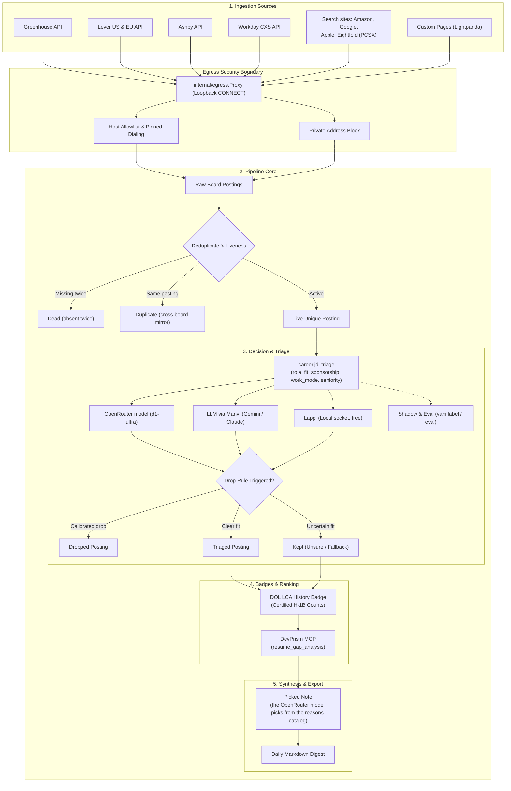
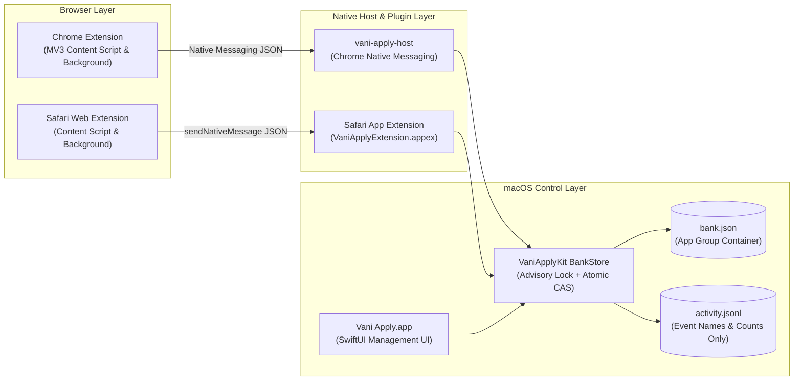

<p align="center">
  
</p>

# Vani

A personal, listings-first career engine. Each day it reads the job boards of companies you
watch, drops dead and duplicate postings without spending anything, triages the rest with a
decision model, ranks them against your career knowledge base with DevPrism's deterministic
resume tools, and writes a Markdown digest.

Plan: `/Users/bharath/Code/vani-plan.md`. Follow-ups: [`docs/FOLLOWUPS.md`](file:///Users/bharath/Code/apps/Vani/docs/FOLLOWUPS.md).

## How a posting moves



```
board listing ─▶ live ─▶ triaged | unsure | dropped ─▶ scored ─▶ explained ─▶ digested
                   └─ dead (absent twice) · duplicate (same posting on another board)
```

- **Sources:** Greenhouse, Lever (US and EU), Ashby and Workday (cxs search, paged by 20)
  public job-board APIs, and the big-employer search sites: amazon.jobs (`az`, its search.json),
  Google Careers (`gg`, page 1 of results only, as its robots.txt allows), jobs.apple.com (`ap`)
  and Eightfold PCSX sites such as Microsoft's and Qualcomm's (`ef`). All go through [`internal/egress`](file:///Users/bharath/Code/apps/Vani/internal/egress) (https only, host allowlist, private-address
  block, pinned dialing). Custom careers pages (`pg` boards) are fetched by Lightpanda, run as a
  separate process whose traffic is forced through a per-run authenticated loopback CONNECT
  proxy that applies the same egress rules ([`docs/PHASE0-lightpanda.md`](file:///Users/bharath/Code/apps/Vani/docs/PHASE0-lightpanda.md)). JSON-LD `JobPosting`
  is read from the HTML dump. Weak keys (`pg`, `x`) dedupe onto the ATS posting they mirror.
- **Triage:** `career.jd_triage` (role_fit, sponsorship, work_mode, seniority) through a router
  over the OpenRouter decision model (`decide.openrouter_model`, e.g. `liquid/d1-ultra`, asked
  through the Decisions API) then the LLM. The model answers under a name derived from its id
  (`liquid/d1-ultra` → `d1-ultra`) in routing, ledger annotations, drop reasons and the eval.
  Answers only annotate; a posting is dropped only by a configured `drop_rules` entry, on a
  calibrated answer (`min_openrouter_prob` for the OpenRouter model, `min_lappi_score` for
  Lappi). Anything uncertain is kept and marked unsure.
- **Renamed keys (2026-10-19):** `jev_model`, `jev_key_env`, `daily_usd.jev`, `min_jev_prob` and
  `decide.shadow` `jev` are now `openrouter_model`, `openrouter_key_env`, `daily_usd.openrouter`,
  `min_openrouter_prob` and `openrouter`. Old configs and track files still load, every command
  says which keys to rename, a file setting an old and a new key to different values is refused,
  and saving writes the new names. Ledger rows written before the rename name the model `jev`;
  `vani eval` and `vani label` read those as the configured model's name and say how many they
  mapped. The daily cap file stays `<state dir>/budget/jev.json`, so the rename kept the day's spend.
- **Ranking:** DevPrism `resume_gap_analysis` must-have coverage (DevPrism started lazily over
  `--mcp`). Skipped while `devprism.binary` is empty.
- **Note ("why this role"):** picked, not written. `vani reasons draft` has the LLM draft, once, a
  catalog of short reasons for the target summary in three categories (why it fits, the biggest
  gap, what to check first), written to `<state dir>/reasons.json` for review and editing (`vani reasons import FILE` installs
  one drafted elsewhere, and `vani reasons check` validates a hand edit). For each
  scored posting the OpenRouter model picks one reason per category, or none, in one call ([`internal/decide/jdreasons`](internal/decide/jdreasons/jdreasons.go)),
  and its probability is shown as the relevance score. No model writes text per posting. Without
  a catalog, or with one drafted for another target summary, notes are off and scored postings
  reach the digest without one; with a catalog but no OpenRouter model this run, notes pause and the postings
  wait for a run that can pick.
- **Decision clients** live in the shared module `~/Code/devtools/decide` (types, router, budget
  caps, the Jev and Lappi clients). The question itself is [`internal/decide/jdtriage/fixture.json`](file:///Users/bharath/Code/apps/Vani/internal/decide/jdtriage/fixture.json):
  task, exact question text, context layout and options, plus one single-slot Lappi family per
  slot with its own exact question (Lappi trains one slot per example). The OpenRouter model and the LLM get all
  slots in one request; Lappi gets one request per slot, and an absent or hung agent costs one
  timeout per posting. The target-roles summary is rendered into the context, so question text
  never varies.
- **Shadow, eval and promotion:** `decide.shadow` (`openrouter`, `llm`, `lappi` or `local`) asks a second backend
  alongside the chain and records its reading, backend and any disagreement; it never decides.
  `vani label` labels postings (disagreements first) and `vani eval` reports per-backend precision
  and coverage, plus a promotion verdict per slot: the shadow is promotable when, on at least 30
  labeled postings it was asked about, its precision meets the primary's at no worse coverage.
  Promotion is a config change (`decide.lappi.primary: true` puts Lappi first), never automatic.
- **Lappi** (`decide.lappi`, socket default `~/Library/Caches/qd/qd.sock`): local and free. With no
  agent running every ask reads `unavailable/socket_not_found` and the chain carries on; the first
  `task_not_trained` refusal stops Vani asking for the rest of the process.
- **Local decision model** (`decide.local`, shadow only; config refuses it anywhere else): a
  llama.cpp server's `/v1/systemone` (for example LiquidAI d1-3B, llama.cpp ≥ 0.7.0), asked
  through the Jev client under the name `local` with no key, over `egress.Loopback`, which dials
  only loopback addresses. Either `endpoint` (a server you keep running) or `server` (`binary`,
  `model_path`, optional `context_size`, `start_timeout_ms`): Vani then starts `llama-server` on
  a free 127.0.0.1 port for each run, Metal only (`--device MTL0 -ngl all`; no CPU fallback), with
  only `PATH`/`HOME`/`TMPDIR`, waits for `/health`, and
  stops it when the run ends. A server that does not come up costs the run its shadow, never the
  run. `questions: per_slot` sends each slot its Lappi family's question; the default `combined`
  measured better on d1. Measuring d1 is `vani run-once` (with the chain's keys), then
  `vani label -n 30` and `vani eval`.
- **Sponsorship badge:** `vani lca import` loads DOL LCA disclosure CSVs ([`docs/LCA.md`](file:///Users/bharath/Code/apps/Vani/docs/LCA.md)); each
  posting gets a certified-H-1B-history badge. A badge, never a filter.
- **Employer badge:** `vani employer import` loads the IRS exempt-organizations list and the IPEDS
  directory ([`docs/EMPLOYER.md`](docs/EMPLOYER.md)); each posting gets a "likely cap-exempt" /
  "likely non-profit" badge. It never filters; a track's employer preference only adds to rank.
- **Tracks:** `vani track list|show|use` applies a track decider's target summary and drop rules,
  keeping sponsorship and other track-independent rules ([`docs/TRACKS.md`](docs/TRACKS.md)).
- **Knowledge base:** `vani kb sync` copies rkb's `bank.json` (claims resolved by
  `rkb claims export`) one way into DevPrism with `career_upsert_block`. Hash-tracked, never
  deletes, never confirms an overwrite DevPrism asks about. `--dry-run` reads no live DevPrism
  state and sends nothing.

- **Applying (browser extension):** [`extension/`](file:///Users/bharath/Code/apps/Vani/extension) saves your answers when you submit an
  application and fills the next form's known questions, marked green or yellow. It never submits
  ([`extension/README.md`](file:///Users/bharath/Code/apps/Vani/extension/README.md)). Chrome and Safari share one answer bank through the Vani Apply Mac app
  ([`macos/`](file:///Users/bharath/Code/apps/Vani/macos): SwiftUI, a Chrome native messaging host and a Safari app extension), which is also
  where answers are viewed, added, edited and deleted ([`macos/README.md`](file:///Users/bharath/Code/apps/Vani/macos/README.md)). Without the app,
  answers stay in the browser.
- **Drafting:** `vani draft` reads one JSON request on stdin (question, posting, word limit) and
  writes one JSON reply. It drafts a free-text answer with one bounded LLM turn from the posting and
  the most relevant knowledge-base bullets, never personal data, and charges the same daily LLM
  ledger as the pipeline. Failures carry a code: `bad_request`, `budget_exhausted`, `timeout`,
  `provider`, `empty_reply`, `config` or `kb`. The Mac app and the Chrome host run it.
- **Anthropic models:** current Claude models reject `temperature` and always reason.
  `llmbackend.Shape` therefore drops temperature for Anthropic and asks for low effort, with
  1,024 tokens of reasoning headroom. Every single-turn caller (triage, the reasons-catalog draft, draft) goes
  through it.



## Use

```bash
go -C /Users/bharath/Code/apps/Vani build -o build/vani ./cmd/vani
build/vani init
build/vani watchlist add --ats gh --token <board> --company <Name> --allow-host boards-api.greenhouse.io
build/vani config check
build/vani run-once
build/vani status
build/vani lca import /absolute/path/LCA_FY2025.csv
build/vani employer import /absolute/path/HD2024.csv
build/vani track use ml-research
build/vani label -n 20
build/vani eval
build/vani kb sync --dry-run --bank /abs/bank.json --rkb /abs/rkb --code-root /abs/Code
build/vani launchd plist --binary /absolute/path/to/vani
```

Workday boards: `watchlist add --ats wd --token tenant/site --host tenant.wd5.myworkdayjobs.com
--search "query"`. Search sites take repeated `--search` (up to 10 terms; the board lists their union)
and, where verified, `--filter name=value`: `az --token amazon` (`normalized_country_code[]`,
`category[]`), `gg --token google` (`target_level`, `location`), `ap --token apple` (`location`),
`ef --token microsoft.com --host apply.careers.microsoft.com` (`location`). A board over its
posting cap fails rather than being truncated, so pick searches narrow enough. Careers pages: `--ats pg --url https://... --link-pattern '<regexp for posting
URLs>'`, with `lightpanda_binary` set or `lightpanda` on PATH.

Config and state default to `~/Library/Application Support/Vani/` (override with `VANI_CONFIG`
and `VANI_STATE_DIR`). Keys come from the environment: `OPENROUTER_API_KEY` for the OpenRouter model,
`GEMINI_API_KEY` / `GOOGLE_API_KEY` or `ANTHROPIC_API_KEY` for the LLM. An Anthropic key not
scoped to a workspace also needs `ANTHROPIC_WORKSPACE_ID` (`wrkspc_…`), or Anthropic refuses every
request with a 400; `ANTHROPIC_BASE_URL` overrides the API host. Both are Manvi's variables.

Before setting `devprism.binary` (which enables ranking and a real `kb sync`), run the Phase 0
check that the installed DevPrism answers `--mcp` without migrating `career.db`.

## Build and test

The `go.work` file is ignored but required: Manvi's own `go.mod` replaces DevCouncil and gusset
with sibling checkouts, and Go only applies those replaces inside a workspace. On a fresh clone,
create it as:

```
go 1.26.6

use (
	.
	/Users/bharath/Code/devtools/Manvi/manvi
	/Users/bharath/Code/devtools/decide
)

replace github.com/bharathvbcr/Manvi/manvi v0.0.0 => /Users/bharath/Code/devtools/Manvi/manvi
```

```bash
go -C /Users/bharath/Code/apps/Vani vet ./...
go -C /Users/bharath/Code/apps/Vani test -race ./...
```
