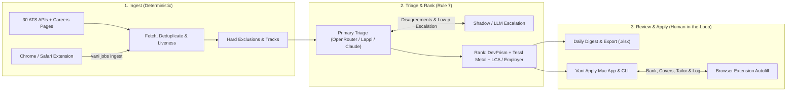

<p align="center">
  
</p>

# Vani

A personal job-search pipeline, resume studio, and application autofill suite. Vani polls 30 ATS and careers sources, filters and deduplicates postings deterministically, runs calibrated role triage and ranking against your skill knowledge base, and serves results to the **Vani Apply** macOS app and browser extension (Chrome and Safari).

> [!IMPORTANT]
> **License & Notice:** This repository is licensed under the [PolyForm Noncommercial License 1.0.0](LICENSE) — personal job-search use is permitted; commercial use is not. See [NOTICE](NOTICE) and [docs/LEGAL.md](docs/LEGAL.md) for source attribution and takedown rules. Credits: [docs/ACKNOWLEDGEMENTS.md](docs/ACKNOWLEDGEMENTS.md).

## How it works



- **Ingestion (`watchlist` + extension):** Polls Greenhouse (`gh`), Lever (`lv`), Ashby (`ab`), Workday (`wd`), Amazon (`az`), Google (`gg`), Apple (`ap`), Eightfold (`ef`), Jibe (`jb`), Gem (`gm`), SmartRecruiters (`sr`), IBM (`ib`), Avature (`av`), D. E. Shaw (`ds`), Atlassian (`at`), Oracle HCM (`oc`), Rippling (`rp`), Workable (`wk`), Recruitee (`rc`), Pinpoint (`pp`), BambooHR (`bh`), Personio (`ps`), TikTok (`tt`), TalentBrew (`tb`), XML feeds (`fd`), Breezy (`bz`), Teamtailor (`tm`), HireHive (`hv`), HiBob (`hb`), the Himalayas (`hm`) and Remote OK (`ro`) job boards through their public APIs, and generic careers pages (`pg`), plus pages crawled in your browser. Only hosts in `allowed_hosts` are contacted.
- **Deterministic filtering & lifecycle:** Deduplicates cross-posted/reposted jobs, verifies liveness against each board (with mass-disappearance safety guards), applies hard config `exclude` rules and career `track` deciders, and closes removed boards' open postings on the next run via tombstones (`watchlist/removed/`).
- **Calibrated triage (Rule 7):** Decision models read four slots (`role_fit`, `seniority`, `sponsorship`, `work_mode`) and may only annotate, narrow, or rank — never drop silently outside explicit calibrated policy or widen access. Ranked displays (`jobs list`, `--fit`, `stats`, `export`) prefer your manual `jobs retriage` and low-confidence escalation readings over raw primary triage (`SlotFor`).
- **Ranking & enrichment:** Scores bullet alignment via [DevPrism](docs/RUNTIME.md), optional local Qwen3 embeddings on Apple Silicon Metal (`-tags tessl`) for semantic similarity (`semantic warm`), plus offline [DOL LCA sponsorship](docs/LCA.md) and [IRS/IPEDS nonprofit/cap-exempt](docs/EMPLOYER.md) badges.
- **Human-in-the-loop applying:** Generates role-tailored resumes (`Resume Studio`), one-page cover letters (`jobs cover`), Excel exports (`jobs export`), and grounded form autofill/drafting in Chrome and Safari without ever submitting applications automatically.

## What it does not do

- Never applies to jobs, clicks Submit, or submits personal forms on your behalf.
- Never scrapes behind logins or bypasses `robots.txt` on HTML page boards (`pg`).
- Never fills unknown or blank fields with guesses; missing profile details stay blank.
- Never sends your identifying words (`identifying_words_file`) or raw private answer bank to decision models; models see only your redacted `target_summary` and job-relevant eligible bullet text.

## Platform support & optional tools

The Go CLI (`cmd/vani`) has macOS, Linux and Windows code paths; the desktop pieces are macOS-only.

| Piece | Platforms | Notes |
|---|---|---|
| `vani` CLI (pipeline, digests, exports) | macOS, Linux, Windows | Off macOS there is no Keychain: put the key in the variable named by `decide.openrouter_key_env` (default `OPENROUTER_API_KEY`). Config and state follow XDG on Linux (`~/.config/vani`, `~/.local/state/vani`) and `%AppData%\Vani` on Windows. `rekey` refuses on Windows ([FOLLOWUPS A2-7](docs/FOLLOWUPS.md)). |
| Scheduling (`vani launchd plist`) | macOS | Elsewhere, run `vani daemon` or `vani run-once` under your own scheduler. |
| Vani Apply app, `vani-fm` | macOS 14+ (Foundation Models: macOS 26 with Apple Intelligence) | SwiftPM, no Xcode project ([macos/README.md](macos/README.md)). |
| Metal embeddings (`-tags tessl`) | macOS on Apple Silicon | cgo + Rust (`cargo`) to build the engine ([SETUP.md](docs/SETUP.md)). |
| Browser extension | Chrome/Chromium; Safari via the Mac app | Built with [Bun](https://bun.sh) ([extension/README.md](extension/README.md)). |

Optional external tools, and what happens without them:

| Tool | Used for | Without it |
|---|---|---|
| [DevPrism](https://github.com/bharathvbcr/DevPrism) (`devprism.binary`) | KB gap ranking, `kb sync`, `rescore` | Jobs are ranked without KB coverage |
| `rkb` (`kb.rkb`; built from [`rkb/`](rkb/README.md) by the bootstrap) | KB claims, `kbmatch`, `draft`, `resume` (contract in [KNOWLEDGE_BASE_GUIDE.md](docs/KNOWLEDGE_BASE_GUIDE.md)) | KB features are off |
| [Lightpanda](https://github.com/lightpanda-io/browser) (`lightpanda_binary`) | `pg` careers-page boards | Use the ATS adapters, `fd` feeds or the extension crawler |
| Chrome + `pdftotext` (poppler) | `vani resume` page fitting | `resume` reports a `render` error |

## Quick start

You need **git** and **Go 1.27.4** ([go.mod](go.mod); with an older Go, `GOTOOLCHAIN=auto` downloads it). Everything else is fetched or reported by one script:

```sh
git clone https://github.com/bharathvbcr/vani.git && cd vani
scripts/bootstrap.sh
```

[`scripts/bootstrap.sh`](scripts/bootstrap.sh) clones the four public sibling repos Vani builds against (Manvi, DevCouncil, gusset, tessl) into `.deps/` at the commits pinned in [`scripts/deps.lock`](scripts/deps.lock), writes `go.work`, builds `build/vani` and `build/rkb`, writes the default config (`vani init`) and checks it, then lists each optional layer (OpenRouter key, DevPrism, Chrome/poppler, Tessl engine, embedding model, lightpanda) as found or missing with the next step. It never changes an existing `go.work`, checkout or config, and spends nothing. The decision client (`decide/`) and the knowledge-base tool (`rkb/`) live in this repo as nested modules.

### Set up with a coding agent

Paste this into Claude Code, Codex or another coding agent running in the directory where you want Vani:

```text
Set up Vani (https://github.com/bharathvbcr/vani) on this machine for me.

1. Clone it here unless it is already cloned, then read README.md, docs/ONBOARDING.md and
   docs/SETUP.md before running anything.
2. Check the prerequisites: git, and Go at the version go.mod names (1.27.4 or newer). If one is
   missing or too old, tell me and ask before installing anything.
3. From the repo root, run `scripts/bootstrap.sh`. It clones the public sibling repos into .deps/
   at the commits in scripts/deps.lock, writes go.work, builds build/vani and build/rkb, writes
   the default config and checks it. It reads no secret and spends nothing (it only asks whether
   the Keychain item exists). Do not edit go.mod, go.work or scripts/deps.lock. If the script
   fails, show me the exact error and stop.
4. Show me the "optional layers" table it prints. For each missing layer, say what it adds and
   what it needs, and ask me before installing anything (Rust, the embedding model, DevPrism,
   poppler, Chrome, lightpanda). If I want the knowledge-base features (grounded drafts, tailored
   resumes, gap ranking), start from the invented sample in rkb/examples as
   docs/KNOWLEDGE_BASE_GUIDE.md describes, and help me replace its content with my own.
5. Ask me which companies I want to watch, add them with `build/vani watchlist add ... --allow-host`
   (docs/SETUP.md step 8 lists the board types), then run
   `VANI_NO_KEYCHAIN=1 build/vani run-once --list-only`, which lists postings and spends nothing.
6. If I want a target_summary (what roles I am after), help me word it without my name, contact
   details, employers, schools or work-authorization status. Before you save it, I create the
   identifying-words file myself: one term per line (my name, email, handles and the like), at
   <state dir>/tracks/identifying-words.txt. Tell me that path and format, but do not ask me to
   type those terms into the chat and do not open the file. While target_summary is set and that
   file is missing or empty, every run (--list-only included) refuses. `config check` does not
   test this, so confirm with `VANI_NO_KEYCHAIN=1 build/vani status` and another
   `VANI_NO_KEYCHAIN=1 build/vani run-once --list-only`.
7. Put VANI_NO_KEYCHAIN=1 in front of every `build/vani` command you run. Besides the edits above
   (init, watchlist add, the config fields I agree to), run only reads, dry runs and --list-only
   runs: status, config check, watchlist list, jobs list, prefilter, kb sync --dry-run,
   run-once --list-only. Anything that triages, drafts or asks a model spends money. skills/cli-anything-vani/SKILL.md lists those commands under "Run the pipeline" and
   "Spend from the daily LLM budget"; read it before running any vani command not listed here.
   Run none of them until I have set my OpenRouter key myself and said go. Never ask me to paste an
   API key into the chat: tell me how to set it (the OPENROUTER_API_KEY environment variable, or
   the macOS Keychain command in docs/SETUP.md step 4).
8. Keep my name, contact details and work-authorization status out of target_summary,
   motivation_notes, logs, prompts and test fixtures.

Finish with what was built, the config and state paths in use (from `build/vani status`), which
optional layers are still missing, and my next step.
```

Then watch a board and run once:

```sh
build/vani watchlist add --ats gh --token stripe --company Stripe --allow-host
VANI_NO_KEYCHAIN=1 build/vani run-once --list-only   # lists postings, spends nothing
# Add your redacted target_summary, and your own terms (name, email, handles; one per line) to
# <state dir>/tracks/identifying-words.txt: every run refuses a summary without that file.
# Set your OpenRouter key (OPENROUTER_API_KEY or the Keychain, docs/SETUP.md step 4), then:
build/vani status                     # names the state dir and whether target_summary passes
build/vani run-once --advance 25      # a small first triage; spends from decide.daily_usd
```

> [!TIP]
> New to Vani? Start with **[docs/ONBOARDING.md](docs/ONBOARDING.md)** (minimal portable setup & optional layers). For the full setup (manual `go.work`, Keychain, `-tags tessl`, all 30 board flags, `exclude`, `launchd`), follow **[docs/SETUP.md](docs/SETUP.md)**.

## Core CLI commands

Run `vani --help` for full usage or `vani --json help` for the structured automation contract ([skills/cli-anything-vani/SKILL.md](skills/cli-anything-vani/SKILL.md)).

| Group | Common Commands | Purpose |
|---|---|---|
| **Setup & Config** | `init`, `config check`, `config exclude`, `config motivation` | Initialize/validate config, exclusions, motivation notes |
| **Watchlist** | `watchlist list \| add \| remove \| discover`, `logos refresh` | Manage 30 board types, discover boards via freehire.me, manage tombstones |
| **Pipeline** | `run-once`, `run-request`, `daemon`, `digest`, `status`, `runs list\|show\|failures` | Execute scheduled/scoped runs, write digests, inspect failures & spend |
| **Jobs & Resumes** | `jobs list\|show\|stats\|folders\|gaps\|export\|mark\|note\|retriage\|resume\|cover` | Browse ranked roles, track interview stages, tailor resumes/letters, export `.xlsx` |
| **Triage & Tuning** | `prefilter`, `retriage`, `rescore`, `kb sync`, `kbmatch`, `semantic warm\|status` | Dry-run exclusions, reopen policy drops, sync DevPrism bullets, warm Metal vectors |
| **Learning & Audit** | `label`, `eval`, `audit`, `relevance`, `rankfit`, `doctor`, `teacher`, `auditor` | Weekly stratified audits, Platt/weight fitting, Opus pipeline diagnostics |

## Documentation

| Topic | Guide |
|---|---|
| **New-User Onboarding** | [docs/ONBOARDING.md](docs/ONBOARDING.md) — Portable `go.work`, minimal setup, optional layers, no-code board setup (`fd`/`pg`/extension) |
| **Installation & Configuration** | [docs/SETUP.md](docs/SETUP.md) — Local checkout setup, keys, Metal (`-tags tessl`), all 30 ATS flags, `exclude`, `launchd` |
| **Agent Developer Guides** | [docs/ADAPTER_GUIDE.md](docs/ADAPTER_GUIDE.md) (building ATS adapters) & [docs/KNOWLEDGE_BASE_GUIDE.md](docs/KNOWLEDGE_BASE_GUIDE.md) (`bank.json`, selections, `rkb`, `kbsync.Eligible`) |
| **Runtime & Internals** | [docs/RUNTIME.md](docs/RUNTIME.md) — Config/state pair, Rule 7, KB eligibility, Resume Studio, `doctor`, locks, liveness, cloud shadow, idle warm |
| **macOS App & Agent** | [macos/README.md](macos/README.md) — Vani Apply SwiftUI app, Resume Studio, schedule agent, Apple Foundation Models (`vani-fm`) |
| **Browser Extension** | [extension/README.md](extension/README.md) — Chrome & Safari autofill, Workday crawler, native messaging, privacy/security impact |
| **Automation & Agents** | [skills/cli-anything-vani/SKILL.md](skills/cli-anything-vani/SKILL.md) — JSON envelopes, error codes, backlog workflows (`VANI_NO_KEYCHAIN=1`) |
| **Career Tracks & Similarity** | [docs/TRACKS.md](docs/TRACKS.md), [docs/SIMILARITY.md](docs/SIMILARITY.md), [docs/EXTENSION_INGEST.md](docs/EXTENSION_INGEST.md) |
| **Enrichment Badges** | [docs/LCA.md](docs/LCA.md) (DOL H-1B history), [docs/EMPLOYER.md](docs/EMPLOYER.md) (IRS/IPEDS cap-exempt/nonprofit) |
| **Ranking, Benchmarks & Legal** | [docs/RANKING_PLAN.md](docs/RANKING_PLAN.md), [docs/BENCHMARKS.md](docs/BENCHMARKS.md), [docs/FOLLOWUPS.md](docs/FOLLOWUPS.md), [docs/LEGAL.md](docs/LEGAL.md), [docs/RELEASE.md](docs/RELEASE.md) |

## Build and test

```sh
VANI_NO_KEYCHAIN=1 go -C $CODE_ROOT/apps/Vani vet ./...
$CODE_ROOT/apps/Vani/scripts/test.sh          # every gate at once: Go, Swift, Bun, type-check
$CODE_ROOT/apps/Vani/scripts/test.sh --bg     # the same, detached (no window, nothing on your screen)
```

`scripts/test.sh` is the one entry point (and what `scripts/release.sh` calls): it runs the suites concurrently,
shards the 1,800-test `cmd/vani` package, runs the Swift and Bun suites in parallel, and prints pass, fail or
**skipped / not run** per suite. It never opens a window or takes focus unless you pass `--ui`: the Jobs tab UI
tests launch a host process that macOS makes the active app ([macos/README.md](macos/README.md#build)). The
numbers, what was tried and what is still open: [docs/TESTING.md](docs/TESTING.md). The underlying commands
(`go test`, `swift test`, `bun test`) still work on their own.

## Acknowledgements & Releasing

Third-party libraries and upstream patterns live in [docs/ACKNOWLEDGEMENTS.md](docs/ACKNOWLEDGEMENTS.md). Release packaging (`scripts/release.sh`), signing checks, and rollback live in [docs/RELEASE.md](docs/RELEASE.md).
