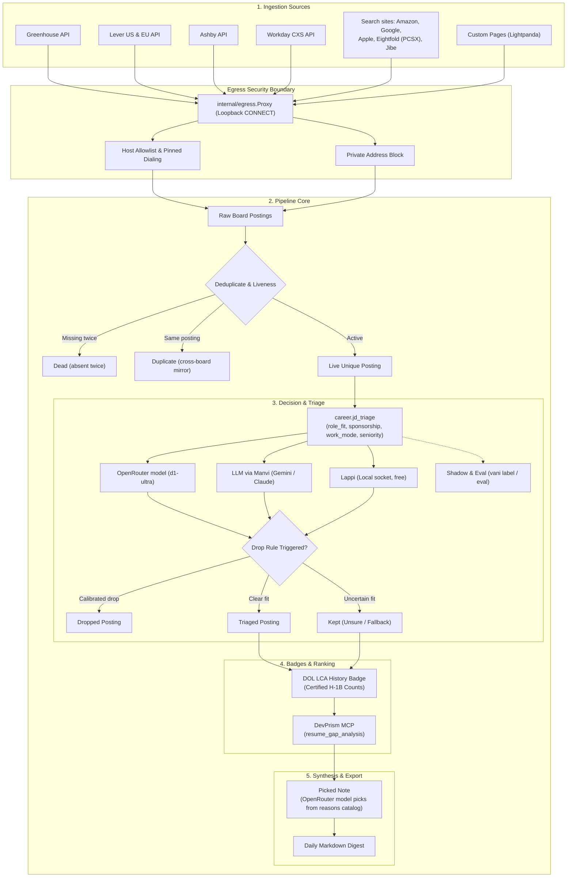
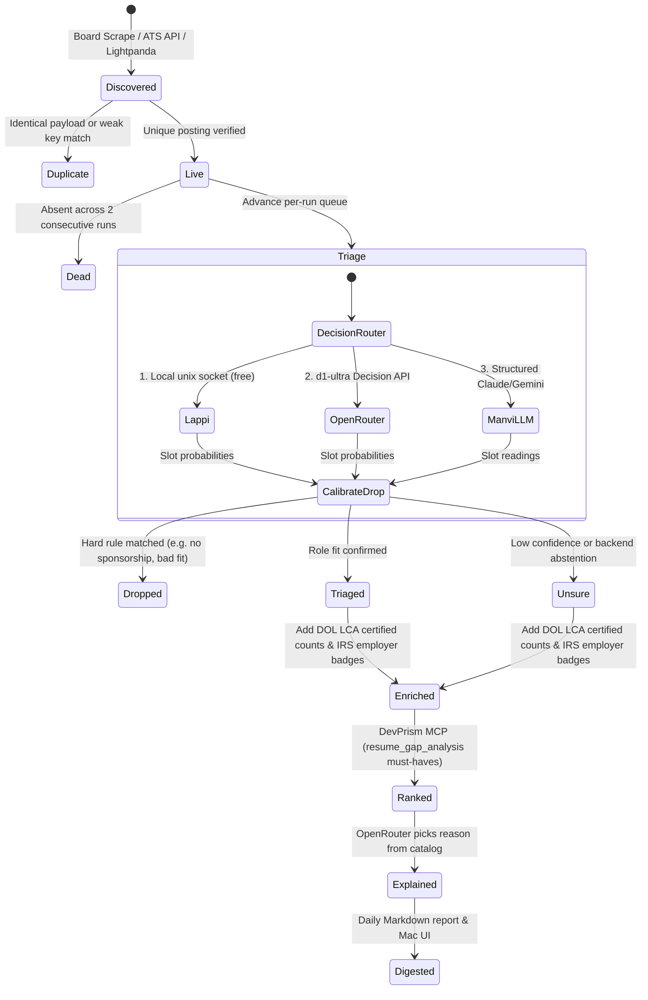
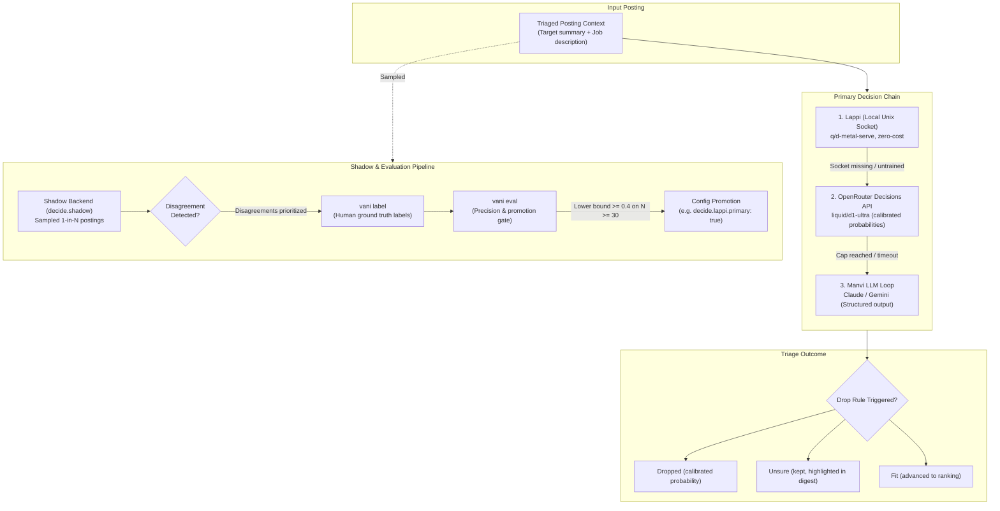
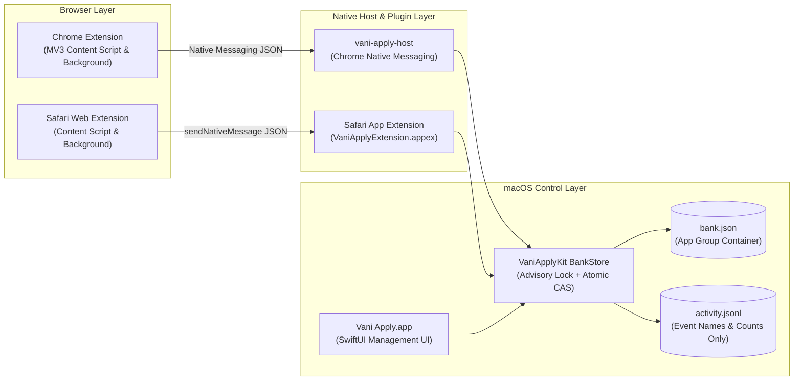

<p align="center">
  
</p>

# Vani

A personal, listings-first career engine. Each day it reads the job boards of companies you
watch, drops dead and duplicate postings without spending anything, triages the rest with a
decision model, ranks them against your career knowledge base with DevPrism's deterministic
resume tools, and writes a Markdown digest.

Plan: [`docs/PLAN.md`](docs/PLAN.md). Follow-ups: [`docs/FOLLOWUPS.md`](docs/FOLLOWUPS.md).

## Ingestion & Pipeline Architecture



## Posting Lifecycle State Machine



- **Sources:** Greenhouse, Lever (US and EU), Ashby and Workday (cxs search, paged by 20)
  public job-board APIs, and the big-employer search sites: amazon.jobs (`az`, its search.json),
  Google Careers (`gg`, page 1 of results only, as its robots.txt allows), jobs.apple.com (`ap`),
  Eightfold PCSX sites such as Microsoft's and Qualcomm's (`ef`), and iCIMS Jibe careers sites
  such as AMD's (`jb`, token the client code `amd`, host `careers.amd.com`; search optional, pages
  of 100 spaced 5 s apart as its robots.txt asks). All go through [`internal/egress`](internal/egress) (https only, host allowlist, private-address
  block, pinned dialing). Custom careers pages (`pg` boards) are read by Lightpanda: one
  `lightpanda mcp` process per board, driven over stdio, whose traffic is forced through a per-run
  authenticated loopback CONNECT proxy that applies the same egress rules ([`docs/PHASE0-lightpanda.md`](docs/PHASE0-lightpanda.md)). JSON-LD `JobPosting`
  is read from each page's HTML. Weak keys (`pg`, `x`) dedupe onto the ATS posting they mirror.
- **Triage:** `career.jd_triage` (role_fit, sponsorship, work_mode, seniority) through a router
  over the OpenRouter decision model (`decide.openrouter_model`, e.g. `liquid/d1-ultra`, asked
  through the Decisions API) then the LLM. The model answers under a name derived from its id
  (`liquid/d1-ultra` → `d1-ultra`) in routing, ledger annotations, drop reasons and the eval.
  Answers only annotate; a posting is dropped only by a configured `drop_rules` entry, on a
  calibrated answer (`min_openrouter_prob` for the OpenRouter model, `min_lappi_score` for
  Lappi). Anything uncertain is kept and marked unsure.
- **Exclusions (`exclude`):** the owner's hard filter, an engine rule on a posting's own fields
  (never a model's reading), so it drops without a threshold and spends nothing. Example:
  `"exclude": {"titles": ["intern", "interns", "internship", "co-op", "coop"], "title_unless":
  ["internal"], "companies": ["Acme Corp"], "locations": ["India", "London", "remote"],
  "descriptions": ["security clearance"]}`.
  - `titles`: whole words, any case (`intern` does not match `Internal` or `Internship`, so list
    each form). `title_unless` keeps a title that also contains one of its phrases.
  - `companies`: exact names, ignoring case and spacing.
  - `locations`: a posting is dropped only when every option it lists is excluded, so a role in
    Bangalore or San Francisco is kept. Options are its places, plus remote work when the board
    says where (`Remote (US)`) or names no place. An entry matches an area or region as whole words
    (`London` also matches `New London, CT`), a US state by code or name (`TX`, `Texas`;
    `Washington` is the state, not DC), `United States`/`USA`/`US` any US place, and `remote`
    remote-only roles. A remote scope of several places (`US, Canada`) needs each excluded. A
    posting with no readable location is kept.
  - `descriptions`: at most 32 phrases, matched against the whole description; the ledger records
    only that one matched, never which.
  - At most 128 entries per list and 100 bytes per entry; empty or duplicate entries are refused.
  - Where it applies: a Live posting is dropped at triage before any backend (and Workday rows by
    title before their detail request); every run first drops kept postings (triaged through
    digested) it now matches, never one you marked, and returns to live the postings it dropped
    that it no longer matches. `vani jobs` and the Jobs tab hide matching unmarked roles at once.
    The reason is the `exclude.matched` annotation. `vani prefilter --list` shows what the next
    run will do; `vani config exclude [--set]` (and Settings › Exclude postings) read and replace
    it as JSON. Tracks leave it alone.
- **Renamed keys (2026-10-19):** `jev_model`, `jev_key_env`, `daily_usd.jev`, `min_jev_prob` and
  `decide.shadow` `jev` are now `openrouter_model`, `openrouter_key_env`, `daily_usd.openrouter`,
  `min_openrouter_prob` and `openrouter`. Old configs and track files still load, every command
  says which keys to rename, a file setting an old and a new key to different values is refused,
  and saving writes the new names. Ledger rows written before the rename name the model `jev` (no persisted ledger key was renamed);
  `vani eval` and `vani label` read those as the configured model's name and say how many they
  mapped. The daily cap file stays `<state dir>/budget/jev.json` (spend key `jev`) on purpose: the
  cap takes no lock across processes, so a renamed file would let a still-running daemon start the
  day at zero. `kbmatch.backend` `"jev"` followed on 2026-10-20 and is now `"openrouter"`.
- **Ranking:** DevPrism `resume_gap_analysis` must-have coverage (DevPrism started lazily over
  `--mcp`). Skipped while `devprism.binary` is empty; `vani rescore` scores those postings once
  it is set (see Use).
- **Note ("why this role"):** picked, not written. `vani reasons draft` has the LLM draft, once, a
  catalog of short reasons for the target summary in three categories (why it fits, the biggest
  gap, what to check first), written to `<state dir>/reasons.json` for review and editing (`vani reasons import FILE` installs
  one drafted elsewhere, and `vani reasons check` validates a hand edit). For each
  scored posting the OpenRouter model picks one reason per category, or none, in one call ([`internal/decide/jdreasons`](internal/decide/jdreasons/jdreasons.go)),
  and its probability is shown as the relevance score. No model writes text per posting. Without
  a catalog, or with one drafted for another target summary, notes are off and scored postings
  reach the digest without one; with a catalog but no OpenRouter model this run, notes pause and the postings
  wait for a run that can pick.
- **Digest:** `<state dir>/digests/YYYY-MM-DD.md`, ranked roles then unsure ones. Each role shows
  where it is, its stated pay (`- Pay: USD 120k–160k/yr`, one short range per currency, the form
  `vani jobs list` prints, read from the description by fixed rules and left out when the posting
  states none), its link, must-have coverage, triage answers and the note. Every posting field is
  escaped so it cannot add links, headings or lines.
- **Decision clients** live in the shared module `~/Code/devtools/decide` (types, router, budget
  caps, the Lappi client and `decide/jev`, the OpenRouter Decisions API client Liquid D is asked
  through). The question itself is [`internal/decide/jdtriage/fixture.json`](internal/decide/jdtriage/fixture.json):
  task, exact question text, context layout and options, plus one single-slot Lappi family per
  slot with its own exact question (Lappi trains one slot per example). The OpenRouter model and the LLM get all
  slots in one request; Lappi gets one request per slot, and an absent or hung agent costs one
  timeout per posting. The target-roles summary is rendered into the context, so question text
  never varies.

## Decision Tier & Shadow Evaluation



- **Shadow, eval and promotion:** `decide.shadow` (`openrouter`, `llm`, `lappi` or `local`) asks a second backend
  alongside the chain and records its reading, backend and any disagreement; it never decides.
  `vani label` labels postings (disagreements first) and `vani eval` reports per-backend precision
  and coverage, plus a promotion verdict per slot and primary. A shadow that errored or timed out
  is recorded as `unavailable` (so it still counts as asked, and shows in a "shadow unavailable"
  column), and each shadow backend, which for a local model includes the model and question
  mode, is its own row. The shadow is promotable when, on at least 30 labeled postings it was
  asked about, it answers at least as often as the primary, and then, on the postings both
  answered (at least 30), there are at least 10 where exactly one was right and a one-sided 95%
  exact lower bound on the shadow's share of those is at least 0.4. A shadow that agrees with the
  primary almost everywhere reads "insufficient disagreements", never "promotable".
  Promotion is a config change (`decide.lappi.primary: true` puts Lappi first), never automatic.
- **Lappi** (`decide.lappi`, socket default `~/Library/Caches/qd/qd.sock`): local and free. With no
  agent running every ask reads `unavailable/socket_not_found` and the chain carries on; the first
  `task_not_trained` refusal stops Vani asking for the rest of the process.
  - `decide.lappi.primary_slots: ["<slot>", ...]` promotes Lappi one slot at a time (slot names are
    the triage slots in `fixture.json`; an unknown or repeated name is refused, naming it). Each
    named slot goes to Lappi first and the OpenRouter model (d1-ultra) no longer answers it; the
    other slots keep their arrangement, and with `decide.shadow: lappi` Lappi keeps shadowing them
    (it has nothing left to shadow once every slot is promoted, which is refused: use `primary`).
    It is exclusive with `primary: true`, which still means all four slots and keeps d1-ultra as
    its fallback. If Lappi is down for a promoted slot, d1-ultra does not take it back: the next
    chain backend (the LLM, when configured) answers it, otherwise it reads `unavailable` and the
    posting is kept as unsure. A config with `primary_slots` gets its own reading cache id (naming
    the promoted set), so readings made under other routing are re-asked; configs without it keep
    theirs. A Vani binary that predates the key refuses to load the config (unknown field).
- **Cloud shadow (recommended setup):** the OpenRouter model decides and a Claude Haiku reads every
  drop candidate as the second opinion, with no local model or server to run. In the config:

  ```json
  "llm": {"provider": "anthropic", "model": "<your Opus id>", "triage_model": "<a Haiku id>",
          "input_nano_usd_per_token": 4000, "output_nano_usd_per_token": 20000},
  "decide": {"openrouter_model": "liquid/d1-ultra", "daily_usd": {"openrouter": 1, "llm": 1},
             "shadow": "llm", "shadow_mode": "drop_candidates"},
  "drop_rules": [{"slot": "role_fit", "values": ["mismatch_domain"], "min_openrouter_prob": 0.9}]
  ```

  The shadow runs on `llm.triage_model` (config refuses `shadow: "llm"` with `drop_candidates`
  unless it is set and differs from `llm.model`, so the expensive tier is never asked), is metered
  under the `daily_usd.llm` cap together with every other Claude call (past it a reading is
  `unavailable`, never agreement), is recorded under the backend name `llm`, and shows in
  `vani relevance` as `llm (<triage model>)`. Prices are your conservative per-token figures; set
  the other values to your own. The local model below is optional.
- **Local decision model** (optional; `decide.local`, shadow only; config refuses it anywhere else): a
  llama.cpp server's `/v1/systemone` (for example LiquidAI d1-3B, llama.cpp ≥ 0.7.0), asked
  through the same `decide/jev` client under the name `local-<model>-<combined|per_slot>` (the GGUF file name
  without `.gguf` when Vani starts the server; at most 32 bytes in all, which `vani config
  check` enforces; rows recorded earlier are filed as plain `local`) with no key, over `egress.Loopback`, which dials
  only loopback addresses. Either `endpoint` (a server you keep running) or `server` (`binary`,
  `model_path`, optional `context_size`, `start_timeout_ms`, and `batch_size`/`parallel` for -b/-ub
  and -np, which a vllm-d3 model needs at 8192 and 1): Vani then starts `llama-server` on
  a free 127.0.0.1 port for each run, Metal only (`--device MTL0 -ngl all`; no CPU fallback), with
  only `PATH`/`HOME`/`TMPDIR`, waits for `/health`, and
  stops it when the run ends. A server that does not come up costs the run its shadow, never the
  run. `questions: per_slot` sends each slot its Lappi family's question; the default `combined`
  measured better on d1. Measuring d1 is `vani run-once` (with the chain's keys), then
  `vani label -n 30` and `vani eval`.
- **Pipeline health (`vani status --json`, the Mac app's Pipeline tab):** every run, from the
  daemon or `run-once`, writes `<state dir>/runs/last.json` when it starts and when it ends:
  outcome (`ok`, `failed`, `cancelled`), the stage it stopped at (pipeline or digest), a one-line
  error, and the ledger's counts by status before and after. `status --json` adds the ledger, the
  schedule, today's spend and remaining cap per paid backend (UTC day), and the decision-model
  setup. It reads without the ledger lock, so it answers while the daemon runs. Each section has
  its own `ok` and `reason`: a section that could not be read is reported as unknown with the
  reason, never as zero or fine. A record that started but never ended is `running` only while its
  process lives and is under a day old, otherwise `interrupted`. The app flags a failed or
  interrupted run, an unreadable section, a spent budget and a run older than 36 hours in its
  sidebar. A run the daemon skips for starting too late is logged but not recorded. The record's
  `trigger` says who started the run (`schedule`, the daemon; `manual`, `run-once`) and `options`
  what a manual run changed.
- **Manual runs (`vani run-once`, the Mac app's Pipeline tab › Run Now):** the flags change one run
  and never the config: `--advance N` caps the advance phase at N in place of `advance_per_run`,
  `--board ats:token` (repeatable) lists only those watchlist boards (the others' postings are
  untouched; a board no longer on the watchlist stops the run before it lists anything),
  `--list-only` lists and reconciles without triage, scoring or explaining (no decision model is
  called, and none needs to be configured; a run that advances still needs one), and `--no-digest`
  leaves the run's roles for the next digest. A digest from a manual run marks its roles digested,
  so the next daily digest does not list them again. `run-once` is refused at once while the daemon
  (or another run, rescore or retriage) holds the ledger. The app starts it with drafting's keys,
  writes its output to `<state dir>/runs/manual.log`, follows it through `vani status --json`, and
  can stop a run it started (SIGTERM; recorded `cancelled`), never one the daemon started.
- **Run requests (`vani run-request`, Run Now while the daemon runs):** the daemon holds the ledger
  for its whole life, so a manual run is asked of it instead. `vani run-request [--json]` takes
  run-once's flags, checks them, and writes them with the time to `<state dir>/runs/request.json`.
  It refuses when no daemon is running (the daemon writes `runs/daemon.json`, its pid and start
  time, once it holds the ledger, and removes it when it exits) or when a request is already
  waiting. The daemon looks for a request every 3 seconds; under the same lock as its scheduled
  run and inbox poll, so never beside them, it claims it (renames it to `request.claimed.json`,
  removed when the run ends) and makes the run as a `manual` run with those options, its own keys
  and its own run record. A request it has not picked up within an hour is dropped unrun, as is one
  that is corrupt, oversized, not a regular file (a symlink is never followed) or from a newer vani;
  each drop is a line in the daemon's log (`vani.err.log` under launchd). A board removed from the
  watchlist since the request is a recorded, failed run. A claim left by a daemon that died is
  removed at the next start and never re-run, and a manual run that leaves the ledger unusable ends
  the daemon as a scheduled one does. `status --json` adds `daemon` (`running`, `pid`, `since`) and
  `run_request` (`pending`, `stale`, `requested_at`, `options`; `claimed`, `claimed_requested_at`).
  A pid reused after a crash can make a dead daemon look alive; a request made then goes stale.
- **Browsing aids (`vani jobs`, the Mac app's Jobs tab):** every role carries a freshness date
  and a relevance score with its basis. Display-only: they sort and plot, and never drop a role.
  - Freshness is the board's posted date. Greenhouse's comes from `first_published`. A board with
    no date falls back to when Vani first saw the role, and that fallback is marked approximate.
  - Relevance (0-100) and priority come from one ranker (`jobinsight.Score`, also the digest's
    order): triage's role_fit, DevPrism's coverage, title signals, target-term overlap and
    marks on the company, each unknown part taking a prior below "known good". `score_factors`
    in the JSON lists the parts.
  - A kept role whose answered triage reading matches a `drop_rules` entry (under its drop
    threshold) or a `rank_penalties` entry is demoted in proportion to that reading's
    confidence, never dropped. `rank_penalties` has the drop-rule shape without thresholds, e.g.
    `[{"slot": "seniority", "values": ["senior"]}]` to keep senior roles but list them lower.
    `vani jobs` and the digest apply the same rules and title signals.
  - Priority is relevance scaled by freshness (`--half-life`, default 10 days). A posting listed
    in its board's first crawl with no posted date has an unknown age: it is scored as one first
    seen 1.5 half-lives old (freshness about 0.5 when first seen today) and ages from the day Vani
    first saw it, instead of taking the floor of a very old posting. List employers that close
    postings by an application cap, not by age, in `age_neutral_companies` (e.g. `["Google"]`;
    matched on the posting's company, ignoring case): an undated posting of theirs is held at a
    flat freshness of 0.78 (a posting about a week old) instead of ageing from when Vani first
    saw it. A date the board gives still counts, and the Mac app says the age was held flat.
  - `vani rankfit` learns the ranking's constants from judged labels (docs/RANKING_PLAN.md,
    Phases 4–5): per-backend Platt calibration of triage confidence from `vani label`'s slot
    labels (100 judged postings per backend), and Score's shares from `vani audit`'s judgments
    (150 usable: yes above maybe above no), with saved/hidden marks and shown-but-unmarked
    postings for volume. An unmarked posting is a negative only when an impression shows it was
    shown. Below a threshold it says "could not run", exits 1
    and writes nothing; `--dry-run` prints the counts. A weight fit that does not beat the hand
    weights on held-out judged pairs is not written either. Point `rank_weights_file` (an
    absolute path) at the file it writes to rank by it; `vani jobs` reports `"weights": "hand"`
    or `"fitted <date>"`, and a configured file that is missing or invalid means the hand
    weights with a warning, never silently.
  - The knowledge-base match (`internal/semantic`) leaves out lines that ask the same of every
    candidate (a degree, years of experience, communication skills, work authorization), scores
    a posting that offers few distinct lines lower than one that offers a full set, and no
    longer clips at 1.0, so postings closer to your work than the target-summary anchor still
    order. Scores cached by an older build are ignored, so the ranker treats every posting as
    unknown until `vani semantic warm --max 5000` recomputes them (about 2 minutes for 1,700
    postings; a plain `warm` does `semantic.warm_per_run`, default 1,000).
  - `vani kbmatch run [--top N] [--dry-run] [--backend llm|openrouter] [--model ID] [--no-retrieve]`
    asks a model, for the top N postings by priority (default 40) that triage did not read as a
    mismatch, whether the work each describes is the work in your knowledge base: `core`,
    `partial`, `adjacent` or `unrelated`. It is a second read of the job's duties, not of the
    company's industry, so it is what separates an AI company's marketing role from an
    inference role. The answers are kept in `kbmatch.json` beside the ledger and enter the
    ranking as one more part (`kb_match`, 15% of a judged posting's blend); a posting nobody
    asked about scores exactly as before, and the answer only orders and explains.
    Three models take part. The **embedding model** (EmbeddingGemma, on this machine) picks, for
    each posting, the eight lines of your knowledge base closest to it, so the question carries
    the evidence that bears on that posting beside a compact digest (stack terms and titles) and
    is shorter; without it (`--no-retrieve`, or the model cannot load) the question carries the
    full digest instead. The **answering model** is the llm (`kbmatch.backend` `"llm"`, the
    default) on `kbmatch.model`, else `llm.triage_model`, else `llm.model`, or the **decision
    model** (`"openrouter"`, formerly `"jev"`: Liquid D, `decide.openrouter_model`, over
    OpenRouter, from the OpenRouter cap).
    `kbmatch.model` is its own setting so a cheap model can read postings here without changing
    how triage and escalation run. Example: `"kbmatch": {"model": "claude-haiku-5-5"}`.
    **What is sent**, per posting: the posting, your `target_summary` and a view of the
    knowledge base (a compact digest plus the picked lines, or a full digest of at most 6 KB;
    role titles, stack terms and bullets, with employers, dates, places, URLs and e-mail
    addresses already removed), to the answering model's provider. `--dry-run` prints the
    counts, what is sent and where, and the cost at that model's rates, and sends nothing. It
    spends from `decide.daily_usd.llm` (or `.openrouter`), stops after three unusable answers
    in a row, and keeps what it got. An edit to the bank or the target summary makes the stored
    answers out of date, and `vani kbmatch status` counts them. On the live ledger 643 of 1,682
    postings are not mismatches. Dry-run estimates for the top 40, at most 144,000 input tokens
    (focused questions are shorter), typical / at most counting every reply at its full budget:
    claude-haiku-5-5 $0.02 / $0.04, claude-sonnet-5-5 $0.35 / $0.80, claude-opus-5-5 $0.70 /
    $1.60. All 500 allowed in a run: haiku $0.23 / $0.51, sonnet $4.54 / $10.19.
  - Keywords come from a deterministic, bounded extractor ([`internal/jobinsight`](internal/jobinsight)).
    It uses an embedded vocabulary with stop phrases ("Spark Capital" is not Spark). A term at
    least 90% of one company's postings repeat is that company's blurb, and is left out.
  - Each keyword is marked when the target summary names it, or when DevPrism found it missing.
  - `jobs list` adds `--sort priority|relevance|fresh|company|salary` and filters for fit, work
    mode, sponsorship, seniority, age and closed roles, plus `--company` / `--exclude-company`
    (exact names), `--exclude` (title words) and `--min-relevance`. `jobs stats` returns the
    distributions the app's Insights charts draw.
  - Pay ([`internal/jobinsight/pay.go`](internal/jobinsight/pay.go)): each job's description is
    read for stated pay by fixed rules (currency, range, period, a pay word, plausible yearly
    bounds; "$100/month budget" or "$50M raised" is not pay), at most one range per currency, as
    `pay` with yearly figures. `--min-salary 150k` compares the top of the range in `--currency`
    (default USD, no exchange rates): a job stating no pay stays unless `--salary-listed`, and a
    job stating pay only in another currency is left out. `--sort salary` and the stats' `salary`
    buckets use the same currency. A bare "$" reads as USD. The Lever adapter adds the board's
    closing text (`additionalPlain`, where Lever boards state pay), `salaryDescriptionPlain` and
    `salaryRange`; Ashby is fetched with `includeCompensation=true` and its salary component leads
    the description unless the company hides pay on its postings.
  - Location ([`internal/location`](internal/location)): each job's board location is read into
    `places` (area plus US state code, or area plus the region as written) and `remote_listed` /
    `remote_scope` ("Remote (US)"). That is what the board says, not triage's `work_mode` reading.
    `--state TX,new mexico|none`, `--area "El Paso"|none` and `--remote` filter on it
    (`--or-remote` with a state or area keeps remote roles too: "remote, or in Texas"), `jobs stats`
    counts states, areas and remote listings, and the digest's "Where:" line uses it, falling back
    to the board's text. There is no home area or city table: an area is the place as written.
  - `jobs gaps` ("what to learn next") counts, across the selected roles, the skills DevPrism
    found missing or weak, plus (with a target summary) skills a role names that the summary does
    not, weighted by role priority. DevPrism's gaps rank first (by the priority of the roles it
    flagged them in): a short summary not naming a skill is weak evidence you lack it. Display-only:
    it never drops or reorders a role, and without a target summary it says only DevPrism gaps were
    counted.
- **Local-model bench:** `vani bench local` replays postings the primary already read through
  one or more local GGUF models. It uses the run's exact request and reproduced the recorded
  shadow 382/382. It reports per-slot agreement with the primary, the confusion between them,
  agreement by probability, and latency. Metal only, no key, never writes the ledger. Agreement
  is not accuracy; that is still `vani label` and `vani eval` ([`docs/FOLLOWUPS.md`](docs/FOLLOWUPS.md)).
- **Sponsorship badge:** `vani lca import` loads DOL LCA disclosure CSVs ([`docs/LCA.md`](docs/LCA.md)); each
  posting gets a certified-H-1B-history badge. A badge, never a filter.
- **Employer badge:** `vani employer import` loads the IRS exempt-organizations list and the IPEDS
  directory ([`docs/EMPLOYER.md`](docs/EMPLOYER.md)); each posting gets a "likely cap-exempt" /
  "likely non-profit" badge. It never filters; a track's employer preference only adds to rank.
- **Tracks:** `vani track list|show|use` applies a track decider's target summary and drop rules,
  keeping sponsorship and other track-independent rules ([`docs/TRACKS.md`](docs/TRACKS.md)).
- **Knowledge base:** `vani kb sync` copies rkb's `bank.json` (claims resolved by
  `rkb claims export`) one way into DevPrism with `career_upsert_block`. Hash-tracked, never
  deletes. An overwrite that would drop bullets or facts, or rewrite a locked bullet, is reported
  as `needs_confirmation` and skipped. `--confirm` confirms those overwrites for the blocks
  DevPrism asks about in that run: it prints each dropped or rewritten bullet and fact first, and
  skips a block that changed in DevPrism since the run read it (`stale`). Passing the flag is the
  consent; there is no prompt. `--dry-run` reads no live DevPrism state, sends nothing and cannot
  be combined with `--confirm`.

- **Applying (browser extension):** [`extension/`](extension/) saves your answers when you submit an
  application and fills the next form's known questions, marked green or yellow. It never submits
  ([`extension/README.md`](extension/README.md)). Chrome and Safari share one answer bank through the Vani Apply Mac app
  ([`macos/`](macos/): SwiftUI, a Chrome native messaging host and a Safari app extension), which is also
  where answers are viewed, added, edited and deleted ([`macos/README.md`](macos/README.md)). Without the app,
  answers stay in the browser.
- **Drafting:** `vani draft` reads one JSON request on stdin (question, posting, word limit) and
  writes one JSON reply. It drafts a free-text answer with one bounded LLM turn from the posting and
  the most relevant knowledge-base bullets, never personal data, and charges the same daily LLM
  ledger as the pipeline. The posting is split at its headings ("About <company>", "About the role",
  "Responsibilities", "Logistics", ...): the excerpt sent leads with the company and role sections
  wherever they sit and leaves out pay, benefits, logistics and legal text. A motivation question
  ("Why <company>?", "What excites you about this role?") ranks evidence against the role's own work
  first and the target summary second, and the model is told to tie it to this company's mission and
  this role, never in an answer another company could receive unchanged. What the seeker values is
  rarely in resume bullets, so the optional `motivation_notes` in the config (the owner's own words
  on what they care about, at most 2,048 bytes after whitespace collapse) goes to motivation
  questions only, as trusted text labelled as the seeker's, and the model may use those reasons
  where they meet the posting but add none. It enters a prompt, so like `target_summary` it must be
  non-identifying: no name, contact details, location, work authorization, or names of people,
  employers or schools. It does not affect which evidence is picked. Every evidence list skips
  rewordings of a bullet already sent and takes at most three bullets per role. Failures carry a code: `bad_request`, `budget_exhausted`, `timeout`,
  `provider`, `empty_reply`, `config` or `kb`. The Mac app and the Chrome host run it.
- **Anthropic models:** current Claude models reject `temperature` and always reason.
  `llmbackend.Shape` therefore drops temperature for Anthropic and asks for low effort, with
  1,024 tokens of reasoning headroom. Every single-turn caller (triage, the reasons-catalog draft, draft) goes
  through it.



## Use

```bash
go -C /Users/bharath/Code/apps/Vani build -o build/vani ./cmd/vani
build/vani init
build/vani watchlist add --ats gh --token <board> --company <Name> --allow-host boards-api.greenhouse.io
build/vani config check
build/vani run-once
build/vani run-once --board gh:<board> --advance 25 --no-digest
build/vani run-request --board gh:<board> --advance 25   # the same, made by the running daemon
build/vani status
build/vani lca import /absolute/path/LCA_FY2025.csv
build/vani employer import /absolute/path/HD2024.csv
build/vani track use ml-research
build/vani label -n 20
build/vani eval
build/vani audit --list                    # this week's draw: stratum, p_select, key (writes nothing)
build/vani audit                           # judge the draw on the terminal: would you apply? 1-3, s, q
build/vani audit answer --key KEY --verdict yes --source STRATUM --p-select P
build/vani relevance                       # would_apply rates, precision at K, shadow agreement on drop candidates
build/vani labels --json                   # the label vocabularies the screens show
build/vani impressions log --surface jobs --slate new-20261020 < rows.json   # {"rows":[{"key","position"}]}
build/vani jobs list --sort priority --fit strong_fit,partial_fit --max-age 14
build/vani jobs list --min-salary 150k --seniority mid,senior --exclude manager --sort salary
build/vani jobs stats --view all
build/vani rescore --dry-run
build/vani bench local --model /abs/candidate.gguf --model /abs/d1-3B-Q8_0.gguf
build/vani kb sync --dry-run --bank /abs/bank.json --rkb /abs/rkb --code-root /abs/Code
build/vani launchd plist --binary /absolute/path/to/vani
```

`launchd plist` prints an agent definition and installs nothing. It runs `vani daemon` at load and
restarts it only after a failed exit, at most once every 5 minutes (`KeepAlive` with
`SuccessfulExit` false, `ThrottleInterval` 300). A ledger that can no longer be written safely (a
failed append that could not be cut back, a failed fsync) ends the daemon with a non-zero exit and
a line in `vani.err.log`; the restarted daemon reopens the ledger. A clean stop stays down. An
agent installed from an older plist (`KeepAlive` false) keeps the old behaviour until it is
replaced: write the new output to `~/Library/LaunchAgents/<label>.plist`, then
`launchctl bootout gui/$UID ~/Library/LaunchAgents/<label>.plist` and
`launchctl bootstrap gui/$UID ~/Library/LaunchAgents/<label>.plist`. launchd gives an agent no
shell environment, so the plist pins the config file and state folder this command resolved: its
`EnvironmentVariables` holds exactly `VANI_CONFIG` and `VANI_STATE_DIR` (the variables' values when
set, else the defaults below), and the logs go to that state folder's `logs/`. Run it with the
variables you want the daemon to use, e.g. `VANI_CONFIG=/abs/config.json VANI_STATE_DIR=/abs/state
build/vani launchd plist --binary /abs/vani`; a relative value is refused (exit 2). Moving the config
or state means regenerating the plist and bootstrapping it again. Nothing else from the environment
is written into the plist, API keys included.

Workday boards: `watchlist add --ats wd --token tenant/site --host tenant.wd5.myworkdayjobs.com
--search "query"`. Search sites take repeated `--search` (up to 10 terms; the board lists their union)
and, where verified, `--filter name=value`: `az --token amazon` (`normalized_country_code[]`,
`category[]`), `gg --token google` (`target_level`, `location`), `ap --token apple` (`location`),
`ef --token microsoft.com --host apply.careers.microsoft.com` (`location`). A board over its
posting cap fails rather than being truncated, so pick searches narrow enough. Workday lists past
its 2000-row window by splitting the board on its own facets (5,000 postings by default; a board's
`max_postings` sets 1 to 10,000); stored
postings are reused, so a run spends at most 300 detail requests per board and a new large board
fills over a few runs. Careers pages: `--ats pg --url https://... --link-pattern '<regexp for posting
URLs>'`, with `lightpanda_binary` set or `lightpanda` on PATH. Each careers-page load waits until
a host's interval has passed since the previous load from that host ended. The interval is the longer
of `page_interval_ms` (0..10000, default 0) and the `Crawl-delay` the host's `robots.txt` sets for
`Vani` (or `*`), read once per host per run; that read counts as a visit, so the first load waits
after it too. A `Crawl-delay` above 10 s, or a `robots.txt` that cannot be read (5xx, timeout,
refused host, over 512 KiB, malformed `Crawl-delay`), fails that board with a warning; a 4xx means
no `robots.txt` and no delay. lightpanda runs as `Vani/0.1 (+personal job-listing reader)`, so its
`--obey-robots` (Allow/Disallow, subresources included) applies the same `Vani` group; one process
serves a whole board, so it reads the host's `robots.txt` once per board. The wait happens before
each navigation, since lightpanda gives up on a first response after 5 s and the egress proxy's own
per-host pacing must stay under that.

Company icons: a board's optional `domain` is the host of the company's own website
(`watchlist add … --domain www.acme.com`, or `watchlist domain --ats gh --token acme --domain
www.acme.com` for a board you have; `--allow-host` adds it to `allowed_hosts`, which must list it).
Each run asks that host for `/apple-touch-icon.png`, then `/favicon.ico`, then `/favicon.png`, and
keeps the first reply that is a PNG, ICO or JPEG of at most 1 MiB in `<state dir>/logos/`. It never
reads the site's pages or follows their links, and a redirect to another host is refused, so give the
host that serves the icon (often the `www.` one). A site that names its icon only in its HTML (Databricks,
Modal, Qualcomm, Together AI) needs the URL set by hand: `watchlist icon --ats gh --token acme --url
https://www.acme.com/assets/icon.png --allow-host` (or `watchlist add … --icon URL`). That URL is asked
for first, must be https on a host in `allowed_hosts`, needs the board's `domain` (the icon is cached
under it), and boards sharing a domain may not name two icons; changing it refetches at once. `--url ""`
clears it. Icons are refetched after 30 days; a domain that failed waits 7. The
refresh takes at most 2 minutes and 50 domains a run, and only warns. `logos refresh [--force]` does
it now. `jobs list`/`show` give each job's cached icon as `logo` (an absolute path); the Jobs tab shows
it in place of the company's monogram, and the monogram when there is none.

Config and state default to `~/Library/Application Support/Vani/` on macOS, on Linux to
`$XDG_CONFIG_HOME/vani/config.json` and `$XDG_STATE_HOME/vani` (`~/.config`, `~/.local/state`
when unset), and on Windows to `%AppData%\Vani`; override either with `VANI_CONFIG` and
`VANI_STATE_DIR`.

Vani runs on macOS. The Go engine also compiles under `GOOS=windows` and `GOOS=linux` (both are
vetted), but **Windows is untested and not supported**, and Linux is untested beyond that. The
Mac app, its native messaging host and its helpers are macOS only and have no Windows path. Keys come from the environment: `OPENROUTER_API_KEY` for the OpenRouter model,
`GEMINI_API_KEY` / `GOOGLE_API_KEY` or `ANTHROPIC_API_KEY` for the LLM. An Anthropic key not
scoped to a workspace also needs `ANTHROPIC_WORKSPACE_ID` (`wrkspc_…`), or Anthropic refuses every
request with a 400; `ANTHROPIC_BASE_URL` overrides the API host. Both are Manvi's variables.

The `funnel` config block (all keys optional) trims paid calls without hiding a posting:
`min_description_runes` (default 40) skips the triage call for a thinner description and keeps the
posting as unsure; `notes_min_relevance` (default 32, about the 78th percentile of the live
ledger: the age-free relevance the Jobs views show, not DevPrism coverage) is the floor for a "why this
role" note, with a relevance that rests on nothing known deferred, not explained;
`notes_daily_usd` (default 0.15, from the measured ~$0.00011 per call) is the notes' own OpenRouter cap, separate from
`decide.daily_usd.openrouter` so notes cannot starve triage; `score_after_triage` puts DevPrism back
after triage (by default it runs first, and coverage never gates anything). A posting that matches an
already-read one on description hash, title, location and model id copies its reading
(`triage.inherited_from`) and the drop rule runs again on the copy. The run record's `advance` block
reports `deferred` (not reached because of the cap), `fail_open` (kept because a check could not run,
by cause) and `notes`.

Each run triages, scores and explains at most `advance_per_run` postings (default 300, at most
5000), which bounds its spend and duration. They go highest title rank first, then the freshest:
the posted date when the board gives one, else when Vani first saw a posting that appeared after
its board's first crawl; undated postings from a board's first crawl go last. `advance_concurrency`
postings advance at a time (default 4, at most 16; 1 is strictly one by one). With a shadow
configured, `decide.shadow_every` asks it about one posting in that many (default 12, picked by a
hash of the posting key; 1 asks it about every posting), and a local shadow takes at most its
server's `parallel` calls plus one waiting; the run's warnings say how many postings it read and
how many sampled ones it skipped while busy. `decide.shadow_mode: "drop_candidates"` (default
`"sample"`, the behaviour above) instead asks the shadow about every slot the drop rules would
drop on (the primary answered a rule's value at or above its `min_openrouter_prob`), before the
drop is applied: the reading is recorded as the usual shadow annotations (`.shadow`,
`.shadow_backend`, `.disagree`) and the drop still follows the primary's rule alone. A candidate
waits for a free shadow slot rather than being skipped; a shadow that errors or times out is
recorded `unavailable`, never as agreement. It needs `decide.shadow` and no `shadow_every`, and
it lets `decide.escalate` run beside it (they read disjoint slots, so `escalate.below_p` must not
exceed a rule's `min_openrouter_prob`). `vani relevance` ends with the agreement of each shadow
with the primary on drop candidates, per slot: asked, unavailable, answered, agree/answered with a
95% Wilson interval, and how many disagreements carry an owner `would_apply` label (and how many
of those say yes or maybe); with nothing asked it says "no data". The rest stay `live` for the next run. Only triaged
postings are listed in Jobs, so `jobs list`/`jobs stats` (`pending` in `--json`), the digest
footer and the Jobs tab footer say how many are still awaiting triage. `status --json` shows
the last run's `advance` report (eligible, attempted, unread, deferred, why it stopped) and
`backend_errors`: every decision-backend call that failed, counted by cause, with one example.

Before setting `devprism.binary` (which enables ranking and a real `kb sync`), run the Phase 0
check that the installed DevPrism answers `--mcp` without migrating `career.db`.

Postings that went through a run while `devprism.binary` was empty are `scored` or `explained`
with no score, so the ranker gives them its unknown-coverage prior; setting the binary later does
not revisit them. `vani rescore --dry-run` counts them, reading the ledger without its lock so it
works while the daemon runs. `vani rescore [--limit N]` scores them, at most N
(default `advance_per_run`), freshest first and `advance_concurrency` at a time. It needs the
ledger lock, so stop the daemon first. It calls DevPrism only, spends nothing, and adds the
`rank`, coverage, block-count and missing-requirement annotations in place. Status and
explanation are kept, so nothing is re-explained or re-digested. The kept explanations were picked
without the coverage, and re-picking them would cost an OpenRouter call each. A posting with no
description is left unscored, since an empty JD would score near zero and rank below the prior.
Digested postings are counted and left alone. If DevPrism fails, or the call times out or is
cancelled, nothing is written for that posting. 20 failures in a row, or a pass where every
posting it tried failed, fail the command. A second pass finds only what the first left, and
does nothing once none are left.

## Measuring the ranking

Three things measure the ranking against the owner's judgement; none changes a ranking or a drop
(the plan and each finding's status are in [docs/RANKING_PLAN.md](docs/RANKING_PLAN.md)).

- **Impressions** (`<state dir>/feedback/impressions.jsonl`, `internal/feedback`): which postings a
  screen showed, where, and in which slate. A posting is seen-and-passed only when an impression
  says it was shown; unmarked is not negative. A row holds the key, surface (`digest`, `jobs`,
  `audit`), section, 1-based position and a `slate_id`; digest rows add the priority, relevance and
  known Score parts, and an Explore row its stratum and `p_select`. Never a title, company, text or
  note. A key is logged once per slate, and the log rotates at 16 MiB (two files at most). The
  digest records what it wrote (a failure is printed and kept in the run record as
  `impressions_error`), the terminal audit the cards it showed, and the Mac app reports the top 20
  Jobs rows after each refresh and each Audit card through `vani impressions log --surface
  jobs|audit --slate ID [--section S] [--json]`, with `{"rows":[{"key","position"}]}` on stdin.
- **Digest sections.** `digest.top_open` (default 20, at most 50) lists the best roles listed before
  and still open, by the age-free relevance. `digest.explore_below_fold` (default 2) and
  `digest.explore_dropped` (default 1), at most 10 each, list unmarked roles picked at random from
  those ranked lower and from those dropped, so Vani learns what it misses; each row carries the
  stratum and `p_select` that `vani audit answer` takes. `0` turns a section off; none changes a
  posting's status.
- **The weekly audit.** `vani audit` draws 15 postings (5 scored by priority decile, 10 dropped by
  drop class; unmarked roles only; stable within an ISO week; `--scored` and `--dropped` set the
  quotas) and asks one question: would you apply (1 yes, 2 maybe, 3 no, `s` can't tell, `q`
  quit). Each answer is a `would_apply` label carrying the stratum and the inclusion probability.
  `--json` prints the draw as keys, strata and `p_select` with no posting text, `--blind` hides the
  model's readings, and `--list` and `--json` write nothing. `vani audit answer` records one
  verdict; the Mac app's Audit tab is the same draw, one card at a time. `vani relevance` reports
  the labels: would_apply rates with 95% Wilson intervals, precision at K, drop misses, backend
  reliability, and the shadow's agreement on drop candidates. `vani labels --json` is the label
  vocabulary the screens read once at launch.

A calibration needs about 100 judged labels and the weight fit 150; both refuse to run below that.

## Knowledge-base matching (semantic)

Postings are also matched to the resume knowledge base by meaning, so "k8s" scores against
"Kubernetes". It only orders and explains postings (weight 0.25 of the match part of
`jobinsight.Score`); it never drops one, and a posting with no score takes the ranker's prior, not 0.
It is on when both keys are set, and off otherwise:

```json
{
  "kb": {"bank": "/abs/path/to/rkb/bank.json"},
  "semantic": {
    "snapshot": "/Users/<you>/.cache/huggingface/hub/models--google--embeddinggemma-2/snapshots/<revision>",
    "warm_per_run": 1000
  },
  "target_summary": "Senior platform engineer building Kubernetes and Go infrastructure"
}
```

- `kb.bank` is rkb's `bank.json`. The profile is built from role titles, stack terms and bullet text
  only; organisations, dates, locations and contact fields are never read. `target_summary` is the
  calibration ceiling and is required.
- `semantic.snapshot` is the absolute path of a Hugging Face snapshot directory of
  `google/embeddinggemma-2` (the `snapshots/<revision>` folder, not the repository root).
  `warm_per_run` (default 1000, at most 5000) bounds the postings one daily run embeds.
- The model runs in-process on Metal through Tessl, so it needs a build with `-tags tessl` on
  darwin/arm64 (cgo on, Xcode command line tools) and the Tessl engine archive. No `CGO_*` flag is
  set by hand: the tessl binding's own `#cgo LDFLAGS` link
  `/Users/bharath/Code/research/tessl/go/engine/target/release/libgusset.a` and the Metal frameworks.
  Build the archive once (and again when the tessl or gusset checkout changes), then build vani:

  ```bash
  make -C /Users/bharath/Code/research/tessl/go engine
  go -C /Users/bharath/Code/apps/Vani build -tags tessl -trimpath -o build/vani ./cmd/vani
  build/vani semantic status    # "this binary has the Tessl engine: yes"
  ```

  Go's build cache keys a cgo package on the text of its flags, not on the archive's bytes, so after
  **rebuilding** the archive, name its hash the way tessl's Makefile does (otherwise Go may relink the
  old engine): `CGO_CFLAGS="-DTESSL_ENGINE_SHA=$(shasum -a 256
  /Users/bharath/Code/research/tessl/go/engine/target/release/libgusset.a | cut -c1-16)"` in front of
  the `go build`. go.mod's `replace` for `github.com/bharathvbcr/tessl/go` is the relative
  `../../research/tessl/go`, right for the main checkout; in a git worktree the ignored `go.work`
  needs `replace github.com/bharathvbcr/tessl/go v0.0.0 => /Users/bharath/Code/research/tessl/go`.
  Linking prints `ld: warning` lines about a duplicate `-lgusset`; they are
  harmless.

  To install it for the Mac app (which calls `Contents/Helpers/vani`), rebuild the bundle:
  `macos/scripts/bundle.sh` adds the tag by itself on Apple silicon when the archive exists, or
  `VANI_CLI_BINARY=/Users/bharath/Code/apps/Vani/build/vani macos/scripts/bundle.sh` reuses the
  binary above. Check the installed helper with
  `"…/Vani Apply.app/Contents/Helpers/vani" semantic status`. The same binary answers
  `vani answers similar` (the merge sheet's similar-wording pass) and the near-duplicate cosine;
  see [docs/SIMILARITY.md](docs/SIMILARITY.md).
- **Without the tag** (or with no snapshot, or a snapshot that will not load) the daily run still
  succeeds and writes the digest; its run record (`vani status --json`, `last_run.semantic`) and
  stderr say `semantic matching not run: <reason>`, and `vani jobs` carries no `semantic` field.
  It is never reported as success.
- The daily run scores the freshest browsable postings first (the Jobs views' rule), up to
  `warm_per_run`, within 10 minutes, between the pipeline and the digest. `vani semantic warm
  [--max N]` does the same on demand (use it for the first big backlog); `vani semantic status`
  prints whether this binary has Tessl, whether the config is on, the profile's chunk count, the
  cached scores and the model id, and warns when the cache on disk was warmed for an earlier profile
  (those scores are not shown; `vani semantic warm` replaces them). Scores are cached in `<state dir>/semantic/` per
  (profile, model, posting text); a changed bank, target summary, model or posting rescores.
  An unreadable cache is rebuilt by the next warm.
- `vani jobs` and the digest only read that cache (no model is loaded). Each job gets
  `semantic: {score, evidence: [{snippet, label, cosine}]}` when a score is cached. If the bank or
  the cache cannot be read, `insight.warning` says so and the score stays unknown.
- No bank text or posting text is written to a log line, the run record or an error: counts and
  reasons only.

## Build and test

The `go.work` file is ignored but required: Manvi's own `go.mod` replaces DevCouncil and gusset
with sibling checkouts, and Go only applies those replaces inside a workspace. On a fresh clone,
create it as:

```
go 1.26.6

use (
	.
	/Users/bharath/Code/devtools/Manvi/manvi
	/Users/bharath/Code/devtools/decide
)

replace github.com/bharathvbcr/Manvi/manvi v0.0.0 => /Users/bharath/Code/devtools/Manvi/manvi
replace github.com/bharathvbcr/decide v0.0.0 => /Users/bharath/Code/devtools/decide
replace github.com/bharathvbcr/tessl/go v0.0.0 => /Users/bharath/Code/research/tessl/go
```

The decide and tessl replaces are absolute so the same file works in a worktree, where the
relative replaces in `go.mod` point outside the tree. The default build leaves tessl out; only
`-tags tessl` (darwin/arm64, with the engine archive) links it.

```bash
go -C /Users/bharath/Code/apps/Vani vet ./...
go -C /Users/bharath/Code/apps/Vani test -race ./...
```

## Releasing

A release is private: a GitHub release in the private repo, signed with the Apple Development
identity, not notarized, and rolled back by reinstalling the previous release's zip. Cut one with
`scripts/release.sh vX.Y.Z [--dry-run]`; the policy, commands, install and rollback steps are in
[docs/RELEASE.md](docs/RELEASE.md).
