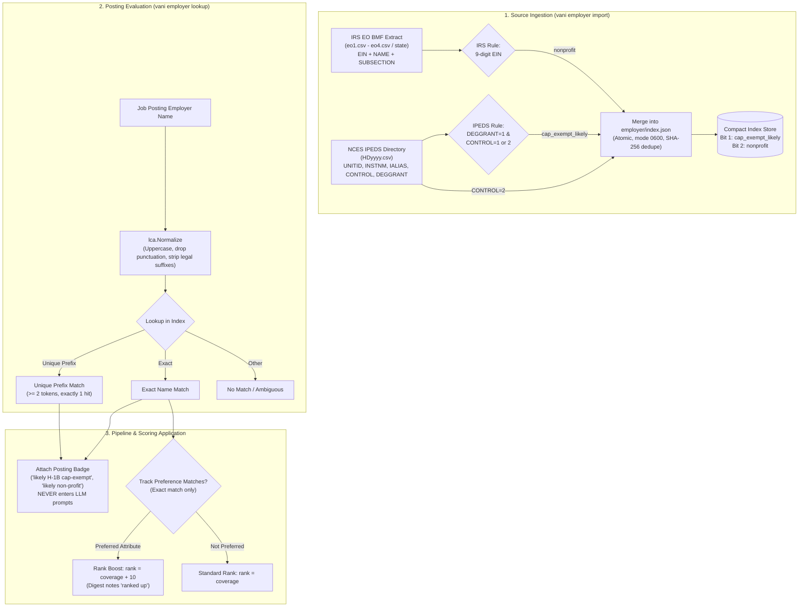

# Employer-attribute badge (cap-exempt likely, non-profit)

Vani can show a badge beside a posting such as
`likely H-1B cap-exempt (degree-granting public or non-profit institution, IPEDS) (exact name match)`.
It comes from two public lists, imported locally by
[`internal/employer`](../internal/employer):

| attribute | source | rule |
|---|---|---|
| `cap_exempt_likely` | NCES IPEDS directory file `HDyyyy` | `DEGGRANT` = 1 (degree-granting) and `CONTROL` = 1 (public) or 2 (private not-for-profit) |
| `nonprofit` | IRS Exempt Organizations Business Master File extract | any row with a nine-digit EIN; also IPEDS `CONTROL` = 2 |

Why that IPEDS rule: the H-1B cap exemption in INA 214(g)(5)(A) covers an "institution of higher
education" as defined in HEA section 101(a), 20 U.S.C. 1001(a), whose paragraph (4) requires "a
public or other nonprofit institution". For-profit schools are therefore never badged.



## What the badge is not

- **Not a filter.** It never drops a posting and never changes a posting's status. The pipeline
  attaches it at triage after the status is decided; tests pin that.
- **Not a legal determination.** Every attribute reads "likely". Cap exemption also covers
  non-profits *affiliated* with a university and non-profit or government research organizations,
  which no list here identifies; and it depends on the employer of record for the job, which a
  company name on a job board may not be.
- **Not in any prompt.** The badge and the attributes imply the seeker's work authorization, so they
  never enter `target_summary`, the triage context or the note question (`internal/decide/jdreasons`
  has a test). The ledger records the badge text (`employer.badge`); which attributes the owner
  prefers stays in the config, and the scoring stage looks the employer up again rather than
  storing attributes. One trace remains: a boosted posting's `rank` exceeds its
  `gap.coverage_pct` by 10, so the ledger shows that a preference applied, not which one.

## Rank boost

A track's `employer_preferences.prefer` is copied into the config's `employer_preferences` by
`vani track use`. At scoring, a posting whose employer matched **exactly** and has a preferred
attribute gets `rank = coverage + 10` (`pipeline.EmployerRankBoost`); `gap.coverage_pct` is kept
as is and is what the digest shows as must-have coverage. The digest notes "ranked up" on such
roles. A unique-prefix match is shown but never boosts, and neither is an exact match on a one-word name
found only on the IRS list (`exact_one_word`): on the 2026-10 file "Ramp", "Apex", "Atlas" and
"OpenAI" all match exempt organisations of that name. One-word true positives (MITRE) keep the
badge and lose the boost. While scoring is off (no DevPrism binary
configured) there is no rank, so the boost has no effect.

## Matching

Names are normalised with the LCA normaliser (`lca.Normalize`: upper case, punctuation dropped, a
leading THE and trailing legal suffixes such as INC, LLC, CORP removed), then matched exactly, or by
a whole-token prefix of at least two tokens that selects exactly one name. IPEDS aliases (`IALIAS`)
are split on `|` and `;` and indexed when at least two tokens long; one-token aliases such as
"MIT" are too ambiguous to stand alone. The dictionary documents no delimiter; in HD2024.csv
institutions used `|` (211 cells), `;` (25) and `,` (138). A comma is never a delimiter because it
sits inside names ("Rutgers, The State University of New Jersey"; UCSF's "University of
California, San Francisco" would otherwise alias "SAN FRANCISCO" to UCSF).

Known limits:

- A for-profit company whose normalised name equals a small non-profit's (the BMF holds about two
  million organisations) gets a false "likely non-profit". The badge shows the matched name.
- A university's research foundation or hospital is listed under its own name, not the
  university's.
- Names are matched as written; there is no fuzzy edit-distance matching, on purpose.

## Importing (manual; Vani never downloads)

Downloading either file needs the owner's go-ahead. Vani reads only local CSV files:

```bash
vani employer import eo1.csv
vani employer import HD2024.csv
vani employer lookup "Example University"
```

The file kind is recognised from the header. Each import is merged into
`<state dir>/employer/index.json` (mode 0600, written atomically, checksummed), and the lookup
view `index.view` beside it is rewritten (see Cost and Index format below). Re-importing a
byte-identical file replaces it rather than counting it twice. A file that reads rows but counts
none is refused: it means the layout or codes are not the documented ones.

### IRS EO BMF

- Page: <https://www.irs.gov/charities-non-profits/exempt-organizations-business-master-file-extract-eo-bmf>
  (data posted 2026-10-13; 1,975,975 records, checked 2026-10-18).
- Files, CSV, sizes not published on the page (the server sends none either):
  - by region: `https://www.irs.gov/pub/irs-soi/eo1.csv` … `eo4.csv` (all four together are the
    whole country plus international). On 2026-10-18: eo1 49 MB, eo2 127 MB, eo3 166 MB, eo4
    0.9 MB; 1,975,975 rows in all, matching the page's record count;
  - or by state: `https://www.irs.gov/pub/irs-soi/eo_<state>.csv` (lower-case postal code), plus
    `eo_pr.csv` and `eo_xx.csv` (international).
- Layout: <https://www.irs.gov/pub/foia/ig/tege/eo-info.pdf> (January 2026). Columns used: `EIN`,
  `NAME` (and `SUBSECTION`, to recognise the file). Revoked organisations are not in the file.

### NCES IPEDS HD (institutional characteristics, directory)

- Data center: <https://nces.ed.gov/ipeds/datacenter/DataFiles.aspx>; files follow
  `https://nces.ed.gov/ipeds/datacenter/data/HD<year>.zip`, with the dictionary in
  `HD<year>_Dict.zip`. HD2024 was the latest on 2026-10-18: `HD2024.zip` 1,088,372 bytes
  (one 4.5 MB `HD2024.csv`, UTF-8 with a BOM), `HD2024_Dict.zip` 140,379 bytes. Unzip and import
  the CSV inside.
- Columns used: `UNITID`, `INSTNM`, `IALIAS`, `CONTROL`, `DEGGRANT`. Codes, from
  `HD2024_dict.xlsx` (Frequencies sheet): CONTROL 1 Public (1,980), 2 Private not-for-profit
  (1,813), 3 Private for-profit (2,257), -3 Not available (22); DEGGRANT 1 Degree-granting (4,090),
  2 Nondegree-granting (1,960), -3 Not available (22). Recheck them when importing a later year.
  An unknown code is skipped, never guessed; if every row is skipped, the import fails rather than
  producing an empty index. HD2024 imports 3,381 institutions (4,090 degree-granting less 709
  for-profit).
- Cells that are not valid UTF-8 are read as Latin-1 (older IPEDS files shipped in it).

### Cost

The full index (four BMF files and HD2024) is 55 MB on disk, about 1.6 million names. Runs and
`employer lookup` do not load it: they read `index.view` beside it, a 54 MB merged, sorted,
read-only view that import writes. A lookup takes about 0.09 s and 69 MB max RSS, down from about
3 s and 490 MB when the full index was loaded (measured 2026-10-18 on the real index with a warm
page cache, min of 5 interleaved runs). Import still loads the full per-source index: re-importing
eo3, the largest file, into it takes about 6.3 s and 770 MB at peak (was 6.6 s and 1.0 GB). The
interleaved benchmark is `TestLoadCostInterleaved` in `internal/employer/view_bench_test.go`.

## Index format

`{"version":1,"checksum":"<sha256 of sources>","sources":[{"name","kind","sha256","rows_read",
"rows_counted","skipped",names:{"<normalised name>":<bits>}}]}`, bits 1 = cap_exempt_likely,
2 = nonprofit. A truncated, tampered, unknown-version or inconsistent file is refused on load, and
a corrupt index is an error at run time, never "no data".

`index.view` (`internal/employer/view.go`, schema `vani-employer-view` v1) holds every name in
sorted order with one byte of attribute and source-kind bits, checksummed and bound to the sha256
and size of the `index.json` it was derived from. A missing, stale or corrupt view is rebuilt from
the index, with a warning, and written back; if it cannot be written, every run says it is
loading the full index. The view is derived, so deleting it is safe: the next run rebuilds it. A
truncated, tampered or unknown-version `index.json` is still refused even when a good view sits
beside it, because the view is bound to the index's bytes. Loading the view checks its checksum,
offsets, sort order and attribute bits but does not re-normalise names: import already did, and
re-normalising the 1.6M real names would add about 0.49 s to a 0.06 s load.
