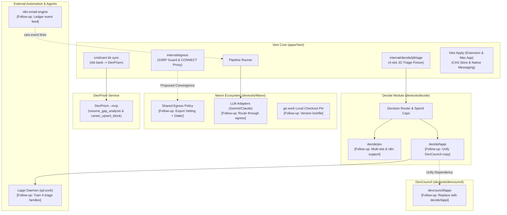

# Follow-ups

## Needs the owner's go-ahead

- **Converge egress with Manvi.** [`internal/egress`](file:///Users/bharath/Code/apps/Vani/internal/egress) re-implements manvi/fetch's rules because
  manvi/fetch is GET-only, reduces bodies to prose and caps them for model context, so it cannot
  carry ATS JSON or Workday POSTs. Fix: Manvi exports its vetting + pinned dialer as a reusable
  policy; Vani wraps it and deletes its copy. A Manvi change plus a Jarvis pin bump.
- **LLM traffic bypasses Vani's egress.** Manvi's Gemini/Anthropic adapters open their own
  connections to their fixed vendor endpoints. The model cannot choose the destination, so this
  is not an SSRF path, but it is a second outbound path. Resolved by the same Manvi egress export.
- **n8n-email-engine `vani.event` lines** feeding the ledger (alerts from email). A change in
  another repo.
- **DevCouncil's `devcouncil/lappi` onto `decide/lappi`.** The client and request code now live in
  `~/Code/devtools/decide/lappi` (moved, made generic: `NewRequest`, no defect-class constants);
  DevCouncil still has its own copy, so there are two until this lands;
  `decide/lappi/drift_test.go` fails if their code (comments aside) diverges, and skips with a
  message when DevCouncil is not checked out beside `decide`. The change: DevCouncil
  requires `github.com/bharathvbcr/decide` and keeps only its defect-class request, `asker.go`,
  `record.go` and `diffsplit.go`. Blast radius: replace directives in a dependency are ignored, so
  every module that builds DevCouncil through a `replace` (Manvi, Jarvis, Vani's workspace) needs
  its own `require` + `replace` for `decide`, or `decide` must be published. That touches Manvi's
  `go.mod` and `module-pins.txt` and Jarvis's `go.mod` and `upstream.lock.json`.
- **n8n-email-engine onto `decide/jev`.** The email engine's inline Jev client has no context, no
  cancellation and no spend cap. Moving it needs two additions to `decide/jev`: a configurable
  endpoint (with the email engine's key-host and loopback-http rules) and a caller-shaped `state`
  (it sends `{from, subject, snippet, bulk_mail}`, not `{"text": ...}`).
- **Lappi training (approved, deferred).** Lappi-decision's decision pool carries one choice slot
  per example, so the triage question is split for Lappi into four single-slot families
  (`career.jd_role_fit`, `career.jd_sponsorship`, `career.jd_work_mode`, `career.jd_seniority`;
  fixture v2). Vani's Lappi backend routes each slot to its family; Jev and the LLM still get all
  four slots in one request. The generators are being written in Lappi-decision; the training run
  waits for the owner.

## Structural

- **Decide module location.** `decide` is local-only (no remote, nothing committed); Vani reaches
  it by `replace => ../../devtools/decide`.
- **Manvi pin.** `go.work` uses the local Manvi checkout (main at ccbe4ed on 2026-10-18), while
  Jarvis pins 5dbf47c. Add a lock file and a check.

## Unverified (Phase 0)

- **Picked notes have not run live (2026-10-18).** Notes are now reasons that d1-ultra picks from
  `<state dir>/reasons.json` (`internal/decide/jdreasons`), replacing a Claude turn per posting.
  The live catalog (14 fit, 14 gap, 13 check) was drafted in a Claude Code session on 2026-10-18
  and installed with `vani reasons import`, because `vani reasons draft` needs Claude and the
  Keychain key is refused until `ANTHROPIC_WORKSPACE_ID` is set. Its `drafted_by` says so. Not
  measured: how well d1-ultra picks among up to 16 options per category, and what
  a three-question call costs. The design gives one pick per category; a yes/no question per reason
  (several scored picks per category, about 15 times the questions per call) was not built.
- **`typesafe/jev-1.13` not tested, and not in use (owner's call, 2026-10-19).** The owner runs
  `liquid/d1-ultra` (below), so no four-question request was ever sent to jev-1.13. It stays
  `decide/jev`'s `DefaultModel` and the model in `TestRequestShapeGolden`
  (`decide/jev/jev_test.go:86`). A config that leaves `decide.jev_model` empty, or sets jev-1.13,
  runs untested against the four-slot question.
- **Lappi does not serve the triage families; nothing to calibrate yet.** Checked 2026-10-18,
  read-only. Lappi-decision has no `career.jd_triage` family. It registers the four single-slot
  families (`crates/qd-prep/src/synth_career.rs:57-66`), and its generator is written. All four are
  `task_not_trained` in `docs/caller-contract.md` (rows at lines 85-88) and stated zero-train in
  `data/decisions/v6-allocation.json` (`stated_zero_train_families`: "no pool is built or trained. No
  R2 cap has been ruled"). There is no train cap, so no calibration entry exists. The export
  calibration gate refuses a family without one (`crates/qd-export/tests/calibration_gate.rs`).
  Both copies of the client require and parse `score` (the margin) and `conformal_set`
  (`decide/lappi/client.go:125, 442-487`; DevCouncil `devcouncil/lappi/client.go:124-125, 441-476`), so
  the calibration fields are supported on the client side. The fixture copies match
  (sha256 `0cf04ad7...`, both sides). Rechecked: no `qd` on PATH, `~/.cargo/bin` or
  `/opt/homebrew/bin`; no `~/Library/Caches/qd/` (the default socket dir); no launchd agent; no `qd`
  process. Nothing reads Lappi until an R2 cap is ruled and the four families are pooled, trained,
  calibrated and served.
- **d1-3B against your own labels.** `.state/config.json` runs d1 (`decide.local.server`) as the
  shadow, but agent shells have no API keys, so no real run has recorded a shadow reading yet. The
  measurement is `vani run-once` with the chain's keys exported (300 postings per run), then
  `vani label` and `vani eval`. The verdict needs at least 30 labeled postings that d1 was
  asked about. The 12-slot synthetic check below is not evidence for promotion.
  - The owner decided on 2026-10-18 to port d1 natively to tessl only if it beats Jev. Jev runs
    only with `OPENROUTER_API_KEY` exported, and its `daily_usd` cap is 0.5. The promotion table has
    one row per primary backend (d1 vs `jev`, d1 vs `llm`), each needing its own 30 labels. A day
    where the LLM answered after Jev's cap therefore never counts as Jev's baseline.
  - The primary is now `liquid/d1-ultra` (`decide.openrouter_model`, the owner's choice). Since
    2026-10-19 it answers as `d1-ultra` in annotations and eval rows. The 382 earlier rows name it
    `jev`; `vani eval` reads those as `d1-ultra` (primary only, never a shadow), so the numbers do
    not move (`internal/eval/names_test.go`). "Beats Jev" reads as local d1-3B against cloud
    d1-ultra. Lappi-decision's pre-registration amendment 2 records this rename (draft, for the
    owner's review).
  - **The first live runs read nothing (2026-10-18, about 22:10).** `OPENROUTER_API_KEY` was unset,
    so d1-ultra was off. Anthropic refused every call with HTTP 400, "This API key is not scoped to
    a workspace", because `ANTHROPIC_WORKSPACE_ID` was unset; Vani sends `anthropic-workspace-id`
    only when it is (`wire.go`, as Manvi's CLI does). All 300 postings per run stayed Live, and no
    shadow reading was recorded. Since then, the advance phase stops after 20 unread postings in a
    row, or when none of the postings it tried were read, and the run fails. A shell loop then
    stops, and no empty digest is written. Unread postings are summarised in one line, and a
    provider error that differs only in its request id is printed once.
  - `vani label` queues, in order: disagreements, then postings d1 was asked about, then postings
    triaged before the shadow existed. The 604 postings triaged on 2026-10-18 have no d1 reading and
    are not re-asked: `vani retriage` only returns postings that got no reading at all.
  - The qd.sock scoping session recommends about 80 labels: 50 to fit calibration and 30 held out.
    Labelling disagreements first means precision is measured on harder cases than a random sample,
    but the shadow and the primary are scored on the same postings.
- **whisper.cpp after the llama.cpp 0.7.0 upgrade:** `whisper-cli --help` runs; no transcription
  was made, because no whisper model is on this Mac.

## Verified (Phase 0)

- **Lever EU host (2026-10-19).** Vani's real `lever` source and `egress` client
  (`build/phase0-devprism/leverprobe`), free unauthenticated GETs:
  - `quantinuum`, `olx` and `kwalee` (all listed on `jobs.eu.lever.co`) on `api.eu.lever.co`
    returned 121, 55 and 17 postings, all with `jobs.eu.lever.co` posting URLs. On `api.lever.co`
    every one was `board not found`.
  - `spotify` is the reverse: 82 postings on the US host, `board not found` on the EU host.
  - So a board's `region` must match where the company is hosted; the wrong host fails loudly as
    not-found, never empty. Egress's DNS vetting and pinned TLS accept the EU host.
- **DevPrism `--mcp` (2026-10-18, [PHASE0-devprism.md](PHASE0-devprism.md)).** `devprism.binary`
  can be set to `/Applications/DevPrism.app/Contents/MacOS/claude-prism-desktop` with
  `devprism.tools_hash` `1349173b7e4784bf59a8f478d6a4d63fe4f3479e332dba946ad5f09767ecab39`.
  - Every `--mcp` start opens the real `career.db` and runs schema init plus two idempotent
    migrations. On today's db they change nothing: a copy was byte-identical after a session.
  - Only `HOME` selects the data dir.
  - The three tools Vani calls match its shapes on the installed build, and a real `kb sync` against
    a copy added 81 blocks, then reran as 81 unchanged.
  - Ranking input is bounded: every source caps a description at 64 KiB (`srcutil.MaxDescription`;
    ashby, greenhouse, lever, workday, page and its JSON-LD path), far under DevPrism's 1 MiB
    `jd_text` refusal.
  - The installed build (2026-08-22 13:14) is older than the DevPrism checkout. Inferred from
    `git log`: it was built from `24ecbc8` (2026-08-21), the last commit before it. Four later commits
    touch `career_db` or the MCP tools: `777f94b`, `52869d3`, `51b213f`, `90b910c`. Recompute the
    hash after any DevPrism update.
  - **Owner decision before the first real sync: the duplicated work history.** Back up
    `career.db` first. 5 of rkb's 8 `work` blocks duplicate 4 existing DevPrism `experience` blocks
    (same title and org, different ids). Those 4 blocks hold 8 bullets and 4 facts that rkb does
    not carry. Another 5 title matches are at a different org and are not duplicates. The id pairs
    are in `build/phase0-devprism/duplicate-work-blocks.tsv` (gitignored; ids only, plus
    bullet/fact counts). Either delete the 4 old blocks in DevPrism after moving anything worth
    keeping into rkb, or keep both and accept that `resume_gap_analysis` counts evidence from
    either copy.
- **Decisions API, four slots in one request (2026-10-19 02:18 UTC, `liquid/d1-ultra`).** The owner
  approved one paid call, sent by `build/phase0-devprism/jevone`: Vani's real `jdtriage.Question` for a
  synthetic posting, `decide/jev` with `MaxAttempts: 1`, through `egress`.
  - Result: 1 HTTP request, status 200, 755 ms. All four slots answered (`role_fit`, `seniority`,
    `sponsorship`, `work_mode`), each `{"type": "choice", "choice", "probabilities", "confidence"}`.
    `state: {"text": ...}` was accepted. The response names the resolved model
    (`liquid/d1-ultra-20261015`) and `"provider": "Liquid"`.
  - **`usage.cost` is USD**: `{"input_tokens": 664, "output_tokens": 0, "cost": 0.000027888}`, which
    is exactly 664 tokens at the published $0.042 per million input tokens. `decide/jev` charged that
    value as `cost_usd`.
  - Readings: senior, sponsors_visa and remote, each correct for the posting. `role_fit` was
    `mismatch_seniority` (0.93), correct against the default early-career target.
  - `decide/jev` records `confidence` (for example 0.913) as the slot probability, not the chosen
    option's entry in `probabilities` (0.931). That is by design: it prefers `confidence` and falls
    back to `probabilities[choice]` (`decide/jev/jev.go:454-456`), as the email engine does.
  - Set as Vani's Jev model on 2026-10-19: `.state/config.json` `decide.jev_model` is now
    `liquid/d1-ultra` (was `typesafe/jev-1.13`). `vani config check` passes. Key env
    `OPENROUTER_API_KEY`; cap `decide.daily_usd.jev` 0.5, about 17,900 postings a day at this call's
    cost.
- **Local d1-3B (Q8_0) on llama.cpp 0.7.0 (2026-10-18).** llama.cpp 0.6.0 refuses the model
  (`unsupported decision model type: lfm2-d1`). The model is at
  `~/Code/research/models/LiquidAI-d1-3B-GGUF/`, sha256 `2f0942d5…eaba77d`.
  - `localserver` starts it in about 2 s and stops it cleanly. A real `vani run-once`, run without
    keys, started and stopped it before failing at "no decision backend". No process was left behind.
  - The check used three synthetic postings and 12 slots, through `decide/jev` (`Name: local`) over
    `egress.Loopback`, with the configured target summary rendered as in a real run.
    - The `combined` question scored 10/12, at about 0.3 s per posting on Metal.
    - Both misses had low probability: a `role_fit` at p 0.22, and a `seniority` at p 0.37 on a mid
      sales role.
    - Without the target summary, `per_slot` scored 9/12 and `combined` 10/12.
  - **CPU (`-ngl 0`) and Metal gave the same choice on all 12 slots.** Probabilities differed by at
    most 0.03, and CPU took about 4 s per posting.
  - A low-probability answer is still read as `answered` (the Jev wire shape has no abstain). Only a
    drop rule's `min_openrouter_prob` turns probability into action, and only for the configured
    OpenRouter model's name (`DropPolicy.calibrated`, `internal/pipeline/runner.go`); `local` is
    only ever the shadow and never drops.
  - **Prompt variant measured:** each option goes out with its fixture description
    (`jdtriage.Descriptions()`), in fixture order, and the target summary is in the state. The
    qd.sock scoping session found that the bare option strings change 3 of 12 choices and that a
    reordering can move a probability by up to 0.36. A shadow verdict therefore holds only for this
    variant; an adapter that serves d1 has to send the same descriptions in the same order.
  - **Metal only.** `localserver` passes `--device MTL0 -ngl all`, following the owner's rule
    (2026-10-18) that on-device decider runtimes use Metal by default and never fall back to CPU.
    Measured: an absent device makes llama-server exit 1 at startup ("invalid device: MTL9"), so
    without Metal the run carries on without the shadow. The test fake reports unhealthy unless it
    was started Metal-only. A real start took 3.0 s and gave the same 10/12.
  - **What the verdict covers.** The served runtime for d1 is to be a native tessl/qd-metal port
    (Lappi-decision `docs/third-party-decider-runtime-2026-10-18.md` §10/§13), not llama.cpp.
    llama.cpp is the eval path and the port's parity oracle on the same GGUF weights. So a
    promotable verdict from `vani eval` holds for the port only once the port passes parity with
    llama.cpp on the same prompt variant.
  - **Slots and context:** `localserver` leaves `-np` on auto. On 0.7.0 that gives
    `n_slots = 4, n_ctx_slot = 8192, kv_unified = true`, so the four combined questions run in one
    pass over a shared 8192-token pool. A maximum-size posting (past the 24 KiB cap, with the
    summary) answered in 2.1 s without a context error. Do not add `-np 4` alone. Measured with
    `-c 8192 -np 4`, the log shows `n_ctx_slot = 2048, kv_unified = 'false'`, and the same posting
    (5073 tokens) was refused with HTTP 400 ("exceeds the available context size (2048 tokens)").

## Known limits

- **llama-server on a Unix socket leaves the socket file behind** (llama.cpp 0.7.0, `--host
  <path>.sock`). It does so even after a clean SIGTERM (exit 0), and the next start on that path
  fails with `couldn't bind HTTP server socket`. Vani's `localserver` uses a TCP loopback port, so it
  is unaffected. Any socket adapter (the Lappi-decision qd.sock plan) has to remove a stale socket
  itself after checking that nothing is listening. Serving over the socket works: health, then
  `/v1/systemone`. The socket was created `srwxr-xr-x` under the default umask. On macOS, connecting
  needs write permission, so only the owner should be able to connect. That is inferred, not tested
  as another user; keep the socket in a 0700 directory anyway.

- **Lightpanda proxy token is in argv.** The per-run token rides in `--http-proxy` and
  `--proxy-bearer-token`, so another process of the same user can read it with `ps` while a fetch
  runs. Bounded: the proxy listens on loopback only, the token is fresh per run and dies with the
  proxy, and it only forwards to allowlisted hosts on 443. `lightpanda help` lists proxy
  credentials as flags only (`--http-proxy`, `--proxy-bearer-token`; checked 2026-10-18).
- **Lightpanda has no `structured_data` dump mode;** JSON-LD is parsed from `--dump html`.
  Telemetry is on by default and is disabled through `LIGHTPANDA_DISABLE_TELEMETRY=1`.
- **kbsync shared bullets: fixed in code, not yet run against the real career.db.** 14 rkb
  bullets are listed by more than one entry. Before the fix, every copy kept the bare rkb bullet
  id. DevPrism keys embeddings by `(owner_id, model)` with the bullet id as `owner_id`, so the
  copies shared one embedding row. A search hit then resolved to an arbitrary parent block
  (`career_db/vectors.rs:629-635`, `LIMIT 1`). Deleting one parent also dropped the embedding the
  other still used (`career_db/mod.rs:526-556`).

  Now every bullet id, shared or not, is `<entry id>/<bullet id>` (`scopedBulletID` in
  `internal/kbsync/blocks.go`).
  - Why every bullet: an id does not change when a second entry starts listing a bullet.
  - Why `/`: it is outside rkb's id alphabet `[A-Za-z0-9._:-]`, so a scoped id never collides
    with a bare id.
  - DevPrism accepts it: `Bullet.id` is an unvalidated `String` (`career_db/mod.rs:49-60`).
    `career_upsert_block` caps only the whole block, at 1 MiB, and every DevPrism lookup compares
    the whole id.
  - Refused: an entry with an empty id, or any id containing `/`, is blocked, never sent.
  - Hashes: `hashVersion` is now 2, so every hash changed. State written before the fix reads as
    "update", never "unchanged".

  **Limit left: a block already synced with bare ids.**
  - `buildUpdate` renames each bare-id bullet to its scoped id. That keeps DevPrism's fields on the
    bullet and does not duplicate its text.
  - DevPrism's overwrite gate counts the vanished bare id as a dropped bullet. It answers
    `inputRequired`, which `kb sync` reports as `needs_confirmation`.
  - The sync never confirms. It records no hash, and it asks again on every run.
  - Way out: the owner deletes that block in DevPrism. The next sync then adds it fresh with
    scoped ids, because `Plan` adds any block DevPrism lacks.
  - No real sync has run, so only the Phase 0 copy of career.db has bare ids.
  - Tests: `internal/kbsync/scoped_test.go`.
- **Employer lists need a yearly re-import** (IRS eo1-eo4 and IPEDS HD2024 imported 2026-10-18 into
  `.state/state`, 1.6M names). Recheck the IPEDS codes in each year's dictionary (docs/EMPLOYER.md).
  Runs read the derived `index.view` (0.09 s / 69 MB a lookup, was 3 s / 490 MB). Import still loads
  the full index: re-importing eo3 into it takes about 6.3 s and 770 MB at peak (was 6.6 s / 1.0 GB).
- **LCA imports are one file per fiscal year.** Quarterly files are cumulative, so importing Q2
  and Q4 of one year double-counts. Re-importing identical bytes replaces the earlier import
  (keyed by the file's sha256).
- `decide.DailyCap` is safe within one process only; the daemon and a manual `run-once` at the
  same moment could under-count a Jev charge.
- DevPrism reports no aggregate score; the rank is must-have coverage until a better definition
  exists.
- `launchd plist` does not embed `VANI_CONFIG` / `VANI_STATE_DIR`.
- **Vani Apply Mac app, unverified on a live system** (`macos/README.md`):
  - Safari loading the hand-assembled appex: `pluginkit -m -p com.apple.Safari.web-extension` after
    the app is first opened.
  - Whether a development-signed extension needs "Allow unsigned extensions".
  - Signed host/appex opening the App Group container without a prompt.
  - A live put/get from each browser.
  - Safari's native message size limit (undocumented; the bank is capped at 900 KB for Chrome's
    1 MB).
- **Safari and promise-returning `chrome.*`:** `background.ts` awaits `chrome.tabs.query`,
  `chrome.tabs.sendMessage`, `chrome.scripting.executeScript` and `chrome.storage.local.*`. Apple
  documents the `chrome.*` alias but not that these return promises. If the live Safari test shows
  them returning undefined, add a `dist-safari` prelude in `build.ts` that aliases `chrome` to
  `browser`. The native transport already prefers `browser.runtime.sendNativeMessage`.
- **Safari booleans:** the store requires a real boolean for `captureSelfId` and `review`. If Safari's
  bridge delivers JS `true` as a plain NSNumber, every Safari write turns self-ID capture off. The live
  check: a Safari put with `captureSelfId: true` must read back true.
- **Mac app deletions do not win over a browser offline copy:** answers written to
  `chrome.storage.local` during a host outage are merged back by `updatedAt`, so an answer deleted
  in the app meanwhile can return. There are no tombstones yet.
- **Claude wiring (2026-10-18), not yet exercised live:**
  - **No real Opus call yet.** Agent shells cannot read the Keychain item `anthropic-api-key`, so
    no paid call has been made. The first one is a Draft click in Vani Apply, after setting Settings ▸
    Claude drafting to `.state/config.json` and `.state/state`. Its acceptance check: a draft returns
    and `.state/state/budget/llm-<day>.json` records the charge.
  - **The pipeline still needs the key in its environment.** `run-once` and `daemon` have no
    launcher that injects it (the `manvi` shell function covers only `manvi`). Running them needs
    `ANTHROPIC_API_KEY` exported for that command, or a `vani` shell function like the `manvi` one.
    A launchd agent would need its own injection.
  - **First-run cost.** With no Jev and no title prefilter, every live posting goes to Opus for
    triage, at roughly $0.01 to $0.03 each. On 9 boards the $10/day cap runs out on day one. Postings
    the cap refuses now stay `live` and are retried the next day (`ErrTriageUnavailable`). Before this
    change they became `unsure` and were never triaged. A title prefilter, from the track deciders'
    `title_signals`, would stretch the budget.
  - **First `run-once` (2026-10-18 21:15) used a stale `build/vani`,** built before the
    pricedProvider fix. Every LLM call was refused locally, so $0 was spent. 300 postings went
    live → unsure → scored on that non-answer. `vani retriage` (new; `--dry-run` lists) returned
    them to live. It is the repair for any future outage that predates `ErrTriageUnavailable`.
    The pipeline also caps each run at 300 postings, so one run is at most 300 triages plus their
    notes.
  - **Second `run-once` (21:20): Anthropic refused every request with a 400** (300 refused
    attempts, $0). `vani draft` showed why: the owner's key is not scoped to a workspace, so each
    request must carry `anthropic-workspace-id`. Vani built the adapter with `anthropic.New`,
    ignoring Manvi's `ANTHROPIC_WORKSPACE_ID` (and `ANTHROPIC_BASE_URL`). `provider()` now uses
    `NewForWorkspace` as Manvi's CLI does, and Vani Apply has a Settings ▸ Claude drafting
    workspace field that it passes to `vani draft`. Either export `ANTHROPIC_WORKSPACE_ID` with
    the key, or replace the Keychain key with one created inside a workspace.
  - **Safari can't draft.** Its sandboxed appex cannot start `vani`, so the draft op answers
    `unsupported`. Fixing that means XPC to the app, or a request queue in the group folder that the
    app serves.
  - **Vani Apply launches anthropic drafts through `anthropic-account` (2026-10-19).** The app and
    the Chrome host no longer read the Keychain or keep a workspace id. When the config's
    `llm.provider` is anthropic they start `anthropic-account exec [--account NAME] -- vani …`, and
    the account comes from a Settings picker fed by `anthropic-account list --json`. That replaces
    the workspace field above, and it means a Keychain prompt is now the launcher's (`security`, up
    to 2 min). Two things are open: it has not been run live against the API, and it is not
    installed in `~/.local/bin` yet. Vani still ignores `ANTHROPIC_API_KEY_FALLBACK`, because
    `cmd/vani/wire.go` builds the adapter without arming the fallback.
  - **The host's Keychain read has no timeout.** An unanswered macOS prompt leaves a Chrome draft
    waiting until the extension's own timeout fires. On the anthropic path the read is now the
    launcher's, inside the draft's own 150 s ceiling.
