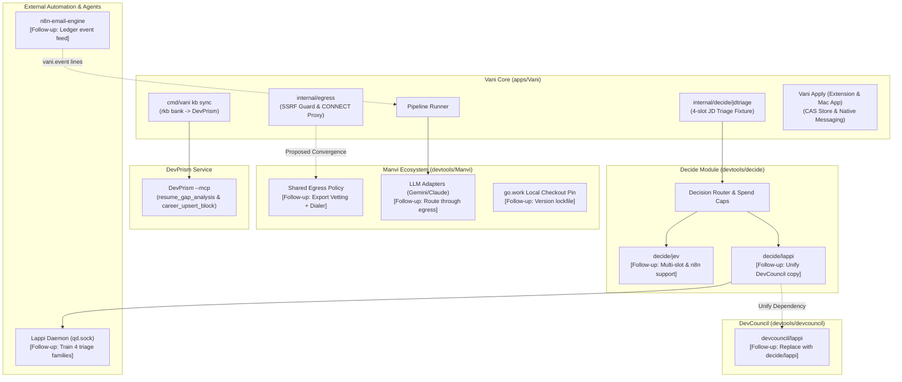

# Follow-ups

## Needs the owner's go-ahead

- **Converge egress with Manvi.** [`internal/egress`](../internal/egress) re-implements manvi/fetch's rules because
  manvi/fetch is GET-only, reduces bodies to prose and caps them for model context, so it cannot
  carry ATS JSON or Workday POSTs. Fix: Manvi exports its vetting + pinned dialer as a reusable
  policy; Vani wraps it and deletes its copy. A Manvi change plus a Jarvis pin bump.
- **LLM traffic bypasses Vani's egress.** Manvi's Gemini/Anthropic adapters open their own
  connections to their fixed vendor endpoints. The model cannot choose the destination, so this
  is not an SSRF path, but it is a second outbound path. Resolved by the same Manvi egress export.
- **n8n-email-engine `vani.event` lines** feeding the ledger (alerts from email). A change in
  another repo.
- **DevCouncil's `devcouncil/lappi` onto `decide/lappi`.** The client and request code now live in
  `~/Code/devtools/decide/lappi` (moved, made generic: `NewRequest`, no defect-class constants);
  DevCouncil still has its own copy, so there are two until this lands;
  `decide/lappi/drift_test.go` fails if their code (comments aside) diverges, and skips with a
  message when DevCouncil is not checked out beside `decide`. The change: DevCouncil
  requires `github.com/bharathvbcr/decide` and keeps only its defect-class request, `asker.go`,
  `record.go` and `diffsplit.go`. Blast radius: replace directives in a dependency are ignored, so
  every module that builds DevCouncil through a `replace` (Manvi, Jarvis, Vani's workspace) needs
  its own `require` + `replace` for `decide`, or `decide` must be published. That touches Manvi's
  `go.mod` and `module-pins.txt` and Jarvis's `go.mod` and `upstream.lock.json`.
- **n8n-email-engine onto `decide/jev`.** The email engine's inline Jev client has no context, no
  cancellation and no spend cap. Moving it needs two additions to `decide/jev`: a configurable
  endpoint (with the email engine's key-host and loopback-http rules) and a caller-shaped `state`
  (it sends `{from, subject, snippet, bulk_mail}`, not `{"text": ...}`).
- **Lappi training (approved, deferred).** Lappi-decision's decision pool carries one choice slot
  per example, so the triage question is split for Lappi into four single-slot families
  (`career.jd_role_fit`, `career.jd_sponsorship`, `career.jd_work_mode`, `career.jd_seniority`;
  fixture v2). Vani's Lappi backend routes each slot to its family; Jev and the LLM still get all
  four slots in one request. The generators are being written in Lappi-decision; the training run
  waits for the owner.
- **Title drops count toward `advance_per_run`.** A title drop asks no backend, so leaving it out
  of the cap would let a run triage more postings for the same spend. The owner kept it counted
  when approving `title_signals.read` (2026-10-19). Changing that needs their go-ahead.
- **Card 13's extension `ownText` change is not on main yet (split 2026-10-19, owner).** The
  card's Go half (benchmarks, the htmltext/scanHTML copy cuts, marks compaction) merged without
  it. The extension part (the `ownText` TreeWalker, `OWN_TEXT_SKIP`, `MAX_LABEL` and the
  `ownTextParity` DOM checks, in `extension/src/extract.ts` and `extension/test/dom-runner.ts`,
  +60/−8) is commit 72340ec on `worktree-w4-bench-marks` (`git diff fdf890f 72340ec --
  extension/`, also written to the ignored `build/card13-extension.patch`). It waits for the
  Greenhouse session's single commit of all of `extension/`, which is to fold it in once the
  extension type-checks.

## Audit 2026-10-19: criteria not built as written

Each was decided on evidence; the cards' other criteria were built and tested.

- **Card 13: marks writes still read the store first.** The criterion asked `marks.write` to
  append without re-reading earlier lines. The read is what refuses to append to a corrupt store,
  and it folds the entry a write returns, so it stays. Its cost is bounded instead: a write
  compacts the store once it passes 1 MiB with more than half its lines superseded, or when its
  line would pass the 8 MiB cap (`internal/marks`). Interleaved A/B, min of 5, per mark: 1 MiB of
  history 16.6 -> 12.3 ms, 4 MiB 46.2 -> 12.4 ms, 7 MiB 77.9 -> 12.9 ms. If the live marks alone
  grow past a few MiB, the next step is a faster line decoder, not dropping the check.
- **Card 12: only the reasoning headroom is clamped.** `llmbackend.Shape` keeps the headroom from
  lifting `MaxTokens` past the model's output ceiling. A request already over the ceiling is not
  lowered: Manvi refuses it before sending, which is louder than a silently smaller budget.
- **Card 12: no untrusted-content frame to move the reasons facts across.** The
  `career.jd_reasons` question goes only to Jev (`cmd/vani/reasonscmd.go`), whose state carries no
  BEGIN/END UNTRUSTED markers. The context is now capped at `jdtriage.MaxContextBytes` with the
  facts kept; only the coverage percentage is the pipeline's own fact, and the missing
  requirement names are posting text and are labelled so.
- **Card 12: no shadow over-count found.** Unsampled questions write no shadow keys, and the live
  ledger had 2,176 records with shadow keys, none left over from an earlier triage. The one path
  that could leave one (a dead posting with no `died_from` coming back live) is closed: a triage
  now replaces every earlier `triage.*` key.
- **Card 11: the Mac app's models were not moved into `VaniApplyKit`.** They are already testable
  through `@testable import VaniApply` (`VaniApplyUITests`), and moving `AppModel` would link
  SafariServices and ServiceManagement into the Safari appex and the native host. `JobsModel`
  gained unit tests that need no accessibility trust; `AppModel` has none, since its init reaches
  the App Group container, SMAppService and a timer. Splitting those behind injected seams is the
  route to testing it.
- **Card 6: eval labels do not follow a re-keyed posting.** `vani migrate rekey-fallback` moves
  ledger events and marks. Labels (`labels.jsonl`, keyed by posting) can live in the repository's
  `eval/jd_triage` rather than the state directory, so the migration cannot find them all. No
  fallback-keyed posting exists today, so none is labelled; if one ever is, re-point its label by
  the old -> new map in `ledger/rekey-fallback-title.json`.
- **`TestJobsInsightScalesTo5000Postings` has a tight bound under load.** It ran 5.7-6.5 s under
  `-race` on a quiet machine and passed its 10 s bound, but crossed it twice while a Swift build
  ran alongside. Not a code fault; raise the bound or skip it under `-race` if it recurs.

## Title prefilter (built 2026-10-19, not yet enabled in the live config)

- **Enabling it: install the binary first.** `Parse` refuses unknown fields, so a
  `title_signals.read` in `config.json` makes every older `vani` fail to load the config. That
  includes `run-once`, the daemon and the Mac app's calls. The order: merge, rebuild and install
  `vani`, then run `vani prefilter` (it should print "off"). Next, add the `read` entries
  (docs/TRACKS.md shows them) and run `vani prefilter` again to see the count and false drops. A
  track's decider can carry them instead; `vani track use` copies them.
- **Measured precision (dry run on a 10:58 copy of the live ledger, with the approved lists).**
  1,313 of 2,663 live postings would be dropped. d1-ultra had read role_fit on 270 of the
  postings it drops: mismatch_domain 232, mismatch_seniority 21, adjacent 17, strong_fit and
  partial_fit 0. `Principal` (43 live) and `Distinguished` have no model reading in the ledger.
  They are kept on what the words mean, unmeasured. Re-run `vani prefilter` after a change to the
  lists; any strong_fit or partial_fit it lists is a false drop.
- **Reversal.** `vani retriage --title-drops` returns the title drops that the current rules no
  longer drop.
- **The track deciders have no `read` entries yet.** `drafts/deciders` is personal and outside git,
  and this session's write gate could not edit it. If the owner runs `vani track use ai-engineer`
  or `ml-inference-systems` without them, the config's `read` entries are cleared, since
  `title_signals` is copied as is. To fix, paste the `read` block from TRACKS.md into each file's
  `title_signals` and run `vani track show <id>`, which checks it.
- **Outage detection.** A title drop is no backend reading. It does not reset the unread
  breaker, and it does not stop a phase in which no backend read anything from failing
  (`advanceAll`'s `titleDrop`).

## Run speed (applied 2026-10-19, measured on fakes only)

- **Why:** a run advanced postings one at a time and waited for the d3-mini shadow on each:
  about 4.5 s per posting on 2026-10-19 against about 1 s on 2026-10-18 without it.
- **Owner's choices:** option A, `decide.shadow_every` = 12; `decide.Router.ShadowSample` added
  in the decide module; up to 3 calls past the OpenRouter daily cap with 4 workers is acceptable
  (`DailyCap.Allow` and `Charge` are separate steps; `TestAdvanceConcurrentSpendCapHolds`).
- **What changed:**
  - `advance_concurrency` (default 4): `advanceAll` starts postings in rank order and counts
    results on one goroutine. A stop starts nothing new and waits for the postings in flight.
    The unread streak can admit up to workers-1 extra attempts.
  - `decide.shadow_every` (default 12): hash sample by posting key (`cmd/vani/shadowsample.go`).
    A local shadow allows server `parallel` + 1 calls, and a sampled posting is skipped while
    that is full. Unsampled and skipped postings carry no shadow keys, which `vani eval` reads as
    not asked. `TestGatedShadowChangesNoDecision` checks that statuses and triage annotations
    match a run with no shadow.
  - Ordering: title rank, then freshness, then ledger order (`cmd/vani/advanceorder.go`).
- **BenchmarkAdvance** (fakes at 1/100 of measured latencies: d1-ultra triage 0.65 s, d3-mini
  3.2 s at parallel 1, notes 0.35 s, scoring 0.02 s assumed; 96 postings; M5 Pro; real s/posting):

  | run | s/posting | shadowed / busy-skipped per 96 |
  |---|---|---|
  | before: 1 worker, shadow every posting | 3.76-3.82 | 96 / - |
  | before: 1 worker, no shadow | 1.17-1.25 | - |
  | 4 workers, no shadow | 0.30-0.43 | - |
  | 4 workers, shadow every posting | 3.29-3.88 | 96 / - |
  | 4 workers, one in 12, 1 slot | 0.32 | 5 / 2 |
  | 4 workers, one in 12, 2 slots (shipped) | 0.34-0.35 | 7 / 0 |
  | 4 workers, one in 4, 2 slots | 0.48-0.49 | 14 / 10 |

  The 1-slot row is why the limit is parallel + 1: at about 80% shadow load a no-queue slot loses
  a large share of the sample (Erlang-B), and a waiting call costs about 0.01 s per posting. The
  sample is 7 postings per run, so the busy-skip rate is a small-sample figure.
- **Not verified:** no live run (not to be run against the live config by this work); the
  live d1-ultra and llama-server latencies under concurrency, and DevPrism's scoring time.

## Shadow evaluation (applied 2026-10-19, not yet measured on the live ledger)

- **Three gaps in what `vani eval` could tell you, fixed on the owner's go-ahead ("apply all",
  T = 0.4).** Found by a read-only audit and re-verified in code. Use `vani bench local` to compare
  candidate models offline; this section is about the live shadow's record. Context and the 382/382
  reproduction: "d1-3B against your own labels" under Unverified.
  - **Run output.** `runOnce` prints `vani: shadow "<name>": N call(s) or slot(s) failed, timed out
    or came back unusable this run` after the advance phase when `Router.ShadowErrors()` is nonzero
    (`cmd/vani/shadowerrors.go`). The count is per run and includes slots the shadow left out.
  - **1. A failed shadow is recorded.** `decide/router.go` `compareShadow` now sets every slot of
    `RouterAnswer.Shadow` to `Unavailable` (detail `auth`, `deadline` or `error`, tagged
    `;backend=<shadow>`) when the shadow errors, panics or times out, so `Shadow` non-nil means
    "was asked". `OnDisagree` fires only for a shadow that read the slot (`Answered` or
    `Abstained`): an outage, a refusal or a `Failed` reading is not a disagreement (the last is a
    narrowing: a shadow value outside the slot's options used to fire it). No new annotation keys:
    `triage.<slot>.shadow_reading=unavailable` and `shadow_backend` are the existing ones,
    `pipeline.Unread` ignores them, and nothing validates the value set. `vani eval` now counts
    those postings as asked, shows them in a "shadow unavailable" column, and the existing
    no-worse-coverage rule applies to them. Tests: `decide/router_test.go`
    (`TestFailedShadowIsRecordedUnavailable`: error, auth, panic, timeout; `OnDisagree` silent, one
    `ShadowErrors` per failed call; `TestOnDisagreeNeedsAShadowThatRead`; the two old assertions
    that `Shadow` stays nil were rewritten), `pipeline/triage_annotations_test.go`,
    `eval/paired_test.go`. Failures from runs before this change are not in the ledger and cannot
    be recovered; the report says so.
  - **2. The shadow is named after its model.** `config.Local.BackendName()` gives
    `local-<model>-<combined|per_slot>`, where `<model>` is the GGUF file name without `.gguf` when
    Vani starts the server (the file is what differs between quantisations) or `decide.local.model`
    otherwise, normalised like `config.BackendName`. It is `shadow_backend` in the ledger and keys
    the eval, so two models, or one model asked two ways, are separate Promotion and Shadow rows,
    each needing its own 30 labels (the Shadow table was keyed by slot only and pooled them too).
    **Limit: 32 bytes** (`jev.MaxNameBytes`); `config.Validate` rejects a longer name instead of
    truncating. `local-vllm-d3-mini-q8_0-combined` is exactly 32, so a longer GGUF file name
    (a version suffix, say) fails `vani config check`; shorten the file name. An OpenRouter model
    named `local-...` is refused. `vani bench` names its backend `local-bench`. Rows recorded
    before this stay `local` (append-only): the 382 d1-3B Q8_0 combined postings; the report labels
    that row as recorded before the model was named. `benchCases` skips any primary that is a local
    shadow (`config.IsLocalShadow`). Alternative not taken: separate `shadow_model` /
    `shadow_questions` keys (no length limit, two more contract keys).
  - **3. The verdict is paired.** `eval/report.go` `Promotion.Verdict`: the 30-label floor and the
    no-worse-coverage rule are unchanged, then a comparison on the postings both answered (at least
    30), counting those where exactly one matched the label (`PrimaryOnly`, `ShadowOnly`). It needs
    at least 10 such postings (`MinDiscordant`) and a one-sided 95% exact (Clopper-Pearson) lower
    bound on `ShadowOnly / (PrimaryOnly + ShadowOnly)` of at least `T = 0.4`
    (`PromotionBound`), computed with stdlib `math`. Reference bounds, computed independently of
    the code and checked in `TestLowerBound`: 15 of 20 gives 0.544 (promotable), 12 of 20 gives
    0.394, 10 of 20 gives 0.302, 25 of 50 gives 0.376 (all not), 10 of 10 gives 0.741. Consequence
    to know: a shadow that matches the primary on nearly everything has few disagreements and
    reads "insufficient disagreements", never "promotable"; and a tie on 20 disagreements no
    longer promotes.
  - **Verification (2026-10-19).** `go build ./...`, `go vet ./...` and
    `go test -count=1 ./cmd/... ./internal/...` in Vani pass, and
    `go test -count=1 github.com/bharathvbcr/decide/...` passes (decide, jev, lappi; the router
    tests also under `-race`). Not done: a live `vani eval` over the real ledger, a live run with a
    failing shadow, and `vani config check` against the live config (its GGUF file name must fit
    the 32-byte limit above).

## Structural

- **Decide module location.** `decide` is local-only (no remote, nothing committed); Vani reaches
  it by `replace => ../../devtools/decide`.
- **Manvi pin.** `go.work` uses the local Manvi checkout (main at ccbe4ed on 2026-10-18), while
  Jarvis pins 5dbf47c. Add a lock file and a check.
- **`vani status --json` re-reads decide's spend file.** `decide.DailyCap` has no reader (only
  `Allow` and `Charge`), so `readOpenRouterSpend` (`cmd/vani/statuscmd.go`) parses the
  `{"version":1,"days":{day:{key:usd}}}` format itself. A test writes the file with the real
  `DailyCap`, so a format change fails there. The fix is a `DailyCap.Spent(key)` accessor in
  `decide`, then delete the parser.
- **Skipped daily runs are not in the run record.** `daemon.Run` logs a run it skips for starting
  more than 6 h late (and one that runs late) but does not record it, so Vani Apply's Pipeline tab
  shows "No run in over a day" rather than why. A hook from `daemon.Run` into the run record
  (`cmd/vani/runrecord.go`) would say "skipped: 7 h late".
- **`internal/vault` is built but not wired (left as is, Fable D21, 2026-10-19).** Nothing imports
  it. It is the planned `resume.HeaderSource` (`internal/resume/tools.go:94`;
  `internal/resume/types.go:6`: typed wrappers fill the name and contact lines from the vault
  after a call has been decided), and `internal/rule7/boundary_test.go` already gates it as a
  package the decision code may not import. `resume.Client.Synthesize` already takes a
  `HeaderSource`, but nothing calls `Synthesize` yet, so wiring the vault means adding that
  caller. It brings personal data into the resume path and needs the owner's go-ahead.
  Until then it is kept: its allowlist is sealed (`Allowed()` returns a copy) and it refuses
  with `ErrNoKeychain` off macOS.
- **`JobsClient.call` and `PipelineClient.status` are the same twelve lines** (run vani, bound,
  decode `{"error"}`). Extract one `VaniJSONCall` in `VaniApplyKit` when `Jobs.swift` is next
  touched.

## Unverified (Phase 0)

- **Picked notes have not run live (2026-10-18).** Notes are now reasons that d1-ultra picks from
  `<state dir>/reasons.json` (`internal/decide/jdreasons`), replacing a Claude turn per posting.
  The live catalog (14 fit, 14 gap, 13 check) was drafted in a Claude Code session on 2026-10-18
  and installed with `vani reasons import`, because `vani reasons draft` needs Claude and the
  Keychain key is refused until `ANTHROPIC_WORKSPACE_ID` is set. Its `drafted_by` says so. Not
  measured: how well d1-ultra picks among up to 16 options per category, and what
  a three-question call costs. The design gives one pick per category; a yes/no question per reason
  (several scored picks per category, about 15 times the questions per call) was not built.
- **`typesafe/jev-1.13` not tested, and not in use (owner's call, 2026-10-19).** The owner runs
  `liquid/d1-ultra` (below), so no four-question request was ever sent to jev-1.13. It stays
  `decide/jev`'s `DefaultModel` and the model in `TestRequestShapeGolden`
  (`decide/jev/jev_test.go:86`). A config that leaves `decide.jev_model` empty, or sets jev-1.13,
  runs untested against the four-slot question.
- **Lappi does not serve the triage families; nothing to calibrate yet.** Checked 2026-10-18,
  read-only. Lappi-decision has no `career.jd_triage` family. It registers the four single-slot
  families (`crates/qd-prep/src/synth_career.rs:57-66`), and its generator is written. All four are
  `task_not_trained` in `docs/caller-contract.md` (rows at lines 85-88) and stated zero-train in
  `data/decisions/v6-allocation.json` (`stated_zero_train_families`: "no pool is built or trained. No
  R2 cap has been ruled"). There is no train cap, so no calibration entry exists. The export
  calibration gate refuses a family without one (`crates/qd-export/tests/calibration_gate.rs`).
  Both copies of the client require and parse `score` (the margin) and `conformal_set`
  (`decide/lappi/client.go:125, 442-487`; DevCouncil `devcouncil/lappi/client.go:124-125, 441-476`), so
  the calibration fields are supported on the client side. The fixture copies match
  (sha256 `0cf04ad7...`, both sides). Rechecked: no `qd` on PATH, `~/.cargo/bin` or
  `/opt/homebrew/bin`; no `~/Library/Caches/qd/` (the default socket dir); no launchd agent; no `qd`
  process. Nothing reads Lappi until an R2 cap is ruled and the four families are pooled, trained,
  calibrated and served.
- **d1-3B against your own labels.** `.state/config.json` runs d1 (`decide.local.server`) as the
  shadow. The ledger holds d1 shadow readings for 382 postings that d1-ultra read (all four
  slots answered by both). The verdict is `vani label` then `vani eval`, and it needs at least 30
  labeled postings that d1 was asked about. Neither the 12-slot synthetic check below nor the
  agreement numbers that follow are evidence for promotion.
  - **Agreement with d1-ultra on real postings (2026-10-19, `vani bench local`, 382 postings, no
    labels).** `vani bench local` replays postings the primary read through a local model with the
    run's exact request. It reproduced the recorded shadow 382/382 on every slot, so the request
    matches production. d1-3B Q8_0 agreed with d1-ultra on:

    | slot | agreement |
    |---|---|
    | sponsorship | 346/382 (90.6%) |
    | role_fit | 236/382 (61.8%) |
    | work_mode | 233/382 (61.0%) |
    | seniority | 202/382 (52.9%) |

    Latency was p50 735 ms and p95 956 ms per posting (four combined questions, Metal), and the
    server started in 5.0 s. The synthetic 0.3 s does not hold on real posting lengths.
    - Where d1-3B disagrees:
      - It reads senior roles as mid (88 times).
      - On role_fit, the costly direction is mismatch_seniority → strong_fit (21 times).
      - It answers not_stated where d1-ultra read onsite (78) or a sponsorship stance (35). Those
        misses are conservative.
    - Where d1-ultra was confident (p ≥ 0.9), d1-3B agreed on role_fit 77/78 and on seniority
      43/46. Most disagreement is on postings d1-ultra itself was unsure of (role_fit p < 0.5:
      58/172 agree).
    - Agreement is not accuracy. Either side can be wrong.
    - The JSON report is `build/bench-d1-3b.json` (gitignored).
  - **vllm-d3-mini against the same 382 postings (2026-10-19, `vani bench local --batch 8192
    --parallel 1`).** The model is `ggml-org/vllm-d3-mini-GGUF` `vllm-d3-mini-Q8_0.gguf`
    (5,157,835,200 bytes, sha256 `214d44cc…793f93d`, matching Hugging Face). It is 4B, built on
    Qwen3.5-4B, and Apache-2.0. The owner approved the download. It is at
    `build/models/ggml-org-vllm-d3-mini-GGUF/` (gitignored) because the workspace gate refuses
    writes outside the repo. llama.cpp 0.7.0 served it over `/v1/systemone`, with no failed
    posting.

    | slot | d1-3B | d3-mini |
    |---|---|---|
    | role_fit | 236 (61.8%) | 296 (77.5%) |
    | seniority | 202 (52.9%) | 303 (79.3%) |
    | sponsorship | 346 (90.6%) | 336 (88.0%) |
    | work_mode | 233 (61.0%) | 218 (57.1%) |

    Each cell is agreement with d1-ultra out of 382.

    - **Latency:** d3-mini runs at p50 3.2 s and p95 4.5 s per posting, against d1-3B's
      0.74 s and 0.96 s, so about 4.4× slower. The flags also differ: d1-3B ran with `-np` auto
      and the default batch, d3-mini with `-np 1 -b/-ub 8192`.
    - **The costly error mostly goes:**
      - role_fit mismatch_seniority → strong_fit falls from 21 to 6.
      - seniority senior → mid falls from 88 to 27.
    - **Its own probability separates its errors from cloud agreement.** With local p ≥ 0.5:
      - role_fit agreed 148/148;
      - sponsorship 298/299;
      - seniority 176/185;
      - work_mode 108/112.

      Below 0.5, role_fit agreed 148/234.
    - **Where it trails:** its losses on work_mode and sponsorship are not_stated answers where
      d1-ultra read a stance: onsite → not_stated 92, hybrid → not_stated 45, sponsors_visa →
      not_stated 28. These misses are conservative.
    - Report: `build/bench-d3-mini.json`. Agreement is not accuracy. `vani label` and
      `vani eval` decide, and d3 is a new candidate under Lappi-decision's pre-registration,
      which names d1-3B only.
    - **d3-mini is the run's shadow since 2026-10-19 (owner's go-ahead).**
      - `decide.local.server` gained `batch_size` and `parallel`, and the run passes them to
        llama-server (`TestLocalServerGetsBatchAndParallel`).
      - `.state/config.json` now runs `vllm-d3-mini-Q8_0.gguf` with `batch_size` 8192 and
        `parallel` 1, and passes `vani config check`. Its deprecated `jev_*` keys were renamed to
        `openrouter_*` in the same edit.
      - A bare `vani bench local -n 20` started exactly that server, on Metal, and answered 20 of
        20 postings across four companies (p50 2.9 s).
      - Shadow readings recorded before the switch are d1-3B's. Until the per-model shadow id
        lands, `vani eval` pools them with d3's.
      - The model file lives in the gitignored `build/models/`. Moving it to
        `~/Code/research/models/` means updating `model_path`.
    - `vani bench local -n N` with N below the population now takes postings round-robin across
      companies (`TestBenchCasesSpreadAcrossCompanies`). It used to take the first N in key
      order, which is one company's.
    - Insight cost: one `vani jobs list` (keywords for every browsable posting, blurb learning,
      scores, sort) took 0.48 s for 5,000 postings of 6 KiB (`BenchmarkJobsInsight5000`,
      `TestJobsInsightScalesTo5000Postings`).
    - `ggml-org/vllm-d3-flash-GGUF` (9B, about 9.5 GB at Q8_0) is the stretch candidate. It
      has not been downloaded.
  - **RSI-Jev v6.0 and decider-2b on the same 382 postings (2026-10-19, `vani bench local
    --endpoint`).** Neither loads in llama.cpp, so each ran behind its own `/v1/systemone`
    server on loopback, measured with the run's exact request. The population is the ledger as
    it stood before 09:00 (`build/rsi-bench-state/`, events before 2026-10-19T09:00), which
    gives the same 382 eligible postings, all `jev` primary, as the d1-3B and d3-mini runs. The
    bench does not print keys, so the identical set is inferred, not checked key by key.

    | model | answered | role_fit | seniority | sponsorship | work_mode | p50 / p95 per posting |
    |---|---|---|---|---|---|---|
    | d3-mini (above) | 382/382 | 77.5% | 79.3% | 88.0% | 57.1% | 3.2 / 4.5 s |
    | d1-3B (above) | 382/382 | 61.8% | 52.9% | 90.6% | 61.0% | 0.74 / 0.96 s |
    | RSI-Jev v6.0-VL 4B, `--effort auto`, fp32 MPS | 192 of 212 tried (partial) | 69.8% | 59.4% | 97.9% | 42.7% | 26.9 / 60.0 s |
    | decider-2b v11, fp16 MPS, `DECIDER_SHARED=0` | 381/382 | 16.5% | 62.5% | 86.4% | 29.4% | 7.8 / 16.3 s |

    Each cell is agreement with d1-ultra; agreement is not accuracy.
    - **decider-2b is broken for this task:** role_fit calls almost everything strong_fit
      (mismatch_domain → strong_fit 106, adjacent → strong_fit 81), and work_mode answers
      not_stated where d1-ultra read onsite (111) or hybrid (95). Its JevArena lead over Lappi
      does not carry over. Report `build/bench-decider-2b.json`.
    - **RSI-Jev is a partial run, on a different subset.** 20 postings passed the bench's 60 s cap,
      then memguard stopped the server (its osascript notice at 11:54:19), so its rows are the 192
      answered among the first 212 postings, not the 382. Its latency is transformers' reference
      DeltaNet path on MPS (fla is CUDA-only), not the model; its card's 23-40 ms is a GB10 with fla.
      It leads on sponsorship and trails on work_mode (hybrid → remote 34, onsite → not_stated 38).
      Report `build/bench-rsi-jev-v6.json`. The same-subset runs of the others were stopped on the
      owner's word (machine under load), so the subset comparison was not made.
    - **decider-ai 1.8.2's shared-prefix path grows memory on MPS:** footprint 6 → 22 GB over about
      110 postings, then an MPS OOM in `shared_prefix.py:205` under
      `PYTORCH_MPS_HIGH_WATERMARK_RATIO=0.4`; uncapped, memguard stopped it at 12:00:17. With
      `DECIDER_SHARED=0` it stayed at 10-20 GB for all 382, at about 7× the latency of the shared
      path (p50 1.1-1.9 s on the postings it reached).
    - The owner chose cloud models for now (2026-10-19). The RSI-Jev venv is
      `research/external/RSI-Jev-v6.0-src/.venv` (gitignored there).
  - The owner decided on 2026-10-18 to port d1 natively to tessl only if it beats Jev. Jev runs
    only with `OPENROUTER_API_KEY` exported, and its `daily_usd` cap is 0.5. The promotion table has
    one row per primary backend (d1 vs `jev`, d1 vs `llm`), each needing its own 30 labels. A day
    where the LLM answered after Jev's cap therefore never counts as Jev's baseline.
  - The primary is now `liquid/d1-ultra` (`decide.openrouter_model`, the owner's choice). Since
    2026-10-19 it answers as `d1-ultra` in annotations and eval rows. The 382 earlier rows name it
    `jev`; `vani eval` reads those as `d1-ultra` (primary only, never a shadow), so the numbers do
    not move (`internal/eval/names_test.go`). "Beats Jev" reads as local d1-3B against cloud
    d1-ultra. Lappi-decision's pre-registration amendment 2 records this rename (draft, for the
    owner's review).
  - **The first live runs read nothing (2026-10-18, about 22:10).** `OPENROUTER_API_KEY` was unset,
    so d1-ultra was off. Anthropic refused every call with HTTP 400, "This API key is not scoped to
    a workspace", because `ANTHROPIC_WORKSPACE_ID` was unset; Vani sends `anthropic-workspace-id`
    only when it is (`wire.go`, as Manvi's CLI does). All 300 postings per run stayed Live, and no
    shadow reading was recorded. Since then, the advance phase stops after 20 unread postings in a
    row, or when none of the postings it tried were read, and the run fails. A shell loop then
    stops, and no empty digest is written. Unread postings are summarised in one line, and a
    provider error that differs only in its request id is printed once.
  - `vani label` queues, in order: disagreements, then postings d1 was asked about, then postings
    triaged before the shadow existed. The 604 postings triaged on 2026-10-18 have no d1 reading and
    are not re-asked: `vani retriage` only returns postings that got no reading at all.
  - The qd.sock scoping session recommends about 80 labels: 50 to fit calibration and 30 held out.
    Labelling disagreements first means precision is measured on harder cases than a random sample,
    but the shadow and the primary are scored on the same postings.
  - **Held-out verdict in Vani (2026-10-19, needs the owner's approval before merge).**
    `vani eval --held-out d1-vani-jdtriage-2026-10-18` prints the usual report unchanged, then a
    Promotion table over the pre-registration's held-out postings only. The split ranks every
    labelled key by sha256(salt || 0x00 || key) ascending and holds out the first 30
    (`internal/eval/heldout.go`, `Splits`). It uses the same Promotion arithmetic and the same
    `jev` alias as the all-labels table. Salt and size come from the registered name and are not
    flags. The rule is tested against a digest computed with `shasum`, and the code is tested to
    reproduce the all-labels rows when every posting is held out (`heldout_test.go`). If any label
    line is unreadable, the held-out run refuses, because a missing key could move the split.
    - **Owner decision: what counts as "labelled".** The flag ranks every distinct key in
      `labels.jsonl` (latest line per key). That includes a key whose labels are all `skip` and a
      key with no ledger record. This keeps the split a function of the label file alone. If such a
      key ranks in the first 30, it takes a held-out place but adds nothing to the asked count. The
      registration's rule text does not say whether such keys count. Excluding all-skip keys is a
      one-line filter in `BuildHeldOut`, and it must be decided before any label is read.
    - The flag does not print the labels.jsonl sha256 that the registration's ledger row needs. Run
      `shasum -a 256` on the file at the verdict run.
- **whisper.cpp after the llama.cpp 0.7.0 upgrade:** `whisper-cli --help` runs; no transcription
  was made, because no whisper model is on this Mac.

## Verified (Phase 0)

- **Jobs tab controls reach the model (2026-10-19).** `macos/Tests/VaniApplyUITests` drives the
  real `JobsView` and reads `JobsModel` back. The test bundle re-runs itself as a host process
  (`JobsTabHost`) showing `NavigationStack { JobsView() }` over a fake `vani` with four made-up
  roles; it never starts the app, so no Login Items agent is registered.
  - The driver uses the accessibility API on the host's pid: AXPress on the toolbar Sort and
    Filter menus and their items. Clicks are mouse events the host sends its own window at a
    control's accessibility frame; nothing goes to the window server, so the cursor is not used.
  - The host's app is never activated, so its window is never key; `allowsWindowActivationEvents`
    (macOS 15) lets a first click through. It needs an accessibility-trusted runner, as this Mac's
    is; otherwise, and before macOS 15, the tests skip.
  - The scatter's dots are found from Swift Charts' accessibility bins ("0 to 50", "50 to 100"):
    the bin from 0 gives the plot's edge and width on the square-root age axis, and every other
    bin must agree within 1.5 pt. Gamma and alpha are clicked; a plot read upside down picks delta.
  - On main `fed3ad5` all five pass. Each mutation below fails only its own test:
    - Sort `Picker` bound to `.constant(jobs.sort)`: "the model never reached sort fresh … sort: "default"".
    - Filter fit toggle `set: { _ in }`: "never reached fits [strong_fit] … fits: []".
    - Fit row `.onTapGesture` removed: the click test fails ("fits: []"). The VoiceOver test still passes.
    - Scatter overlay `.onTapGesture` removed: "never reached selection fx:gamma:3 … selection: nil".
    - Fit row `.accessibilityAction` removed: only the VoiceOver test fails ("fits [adjacent]").
  - XCUITest cannot run under SwiftPM ("Device is not configured for UI testing - use of
    XCUIApplication is not supported … in a unit test bundle"). In-process driving still fails as
    before: the process's own accessibility tree is a bare application element, and clicks never
    reach a tap gesture.
  - One run in about 25 once saw the host's accessibility tree empty for 10 s in the Sort test
    (cause unknown). An unreadable children list now prints its AXError in the failure.
- **Lever EU host (2026-10-19).** Vani's real `lever` source and `egress` client
  (`build/phase0-devprism/leverprobe`), free unauthenticated GETs:
  - `quantinuum`, `olx` and `kwalee` (all listed on `jobs.eu.lever.co`) on `api.eu.lever.co`
    returned 121, 55 and 17 postings, all with `jobs.eu.lever.co` posting URLs. On `api.lever.co`
    every one was `board not found`.
  - `spotify` is the reverse: 82 postings on the US host, `board not found` on the EU host.
  - So a board's `region` must match where the company is hosted; the wrong host fails loudly as
    not-found, never empty. Egress's DNS vetting and pinned TLS accept the EU host.
- **DevPrism `--mcp` (2026-10-18, [PHASE0-devprism.md](PHASE0-devprism.md)).** `devprism.binary`
  can be set to `/Applications/DevPrism.app/Contents/MacOS/claude-prism-desktop` with
  `devprism.tools_hash` `1349173b7e4784bf59a8f478d6a4d63fe4f3479e332dba946ad5f09767ecab39`.
  - Every `--mcp` start opens the real `career.db` and runs schema init plus two idempotent
    migrations. On today's db they change nothing: a copy was byte-identical after a session.
  - Only `HOME` selects the data dir.
  - The three tools Vani calls match its shapes on the installed build, and a real `kb sync` against
    a copy added 81 blocks, then reran as 81 unchanged.
  - Ranking input is bounded: every source caps a description at 64 KiB (`srcutil.MaxDescription`;
    ashby, greenhouse, lever, workday, page and its JSON-LD path), far under DevPrism's 1 MiB
    `jd_text` refusal.
  - The installed build (2026-08-22 13:14) is older than the DevPrism checkout. Inferred from
    `git log`: it was built from `24ecbc8` (2026-08-21), the last commit before it. Four later commits
    touch `career_db` or the MCP tools: `777f94b`, `52869d3`, `51b213f`, `90b910c`. Recompute the
    hash after any DevPrism update.
  - **Owner decision before the first real sync: the duplicated work history.** Back up
    `career.db` first. 5 of rkb's 8 `work` blocks duplicate 4 existing DevPrism `experience` blocks
    (same title and org, different ids). Those 4 blocks hold 8 bullets and 4 facts that rkb does
    not carry. Another 5 title matches are at a different org and are not duplicates. The id pairs
    are in `build/phase0-devprism/duplicate-work-blocks.tsv` (gitignored; ids only, plus
    bullet/fact counts). Either delete the 4 old blocks in DevPrism after moving anything worth
    keeping into rkb, or keep both and accept that `resume_gap_analysis` counts evidence from
    either copy.
- **Decisions API, four slots in one request (2026-10-19 02:18 UTC, `liquid/d1-ultra`).** The owner
  approved one paid call, sent by `build/phase0-devprism/jevone`: Vani's real `jdtriage.Question` for a
  synthetic posting, `decide/jev` with `MaxAttempts: 1`, through `egress`.
  - Result: 1 HTTP request, status 200, 755 ms. All four slots answered (`role_fit`, `seniority`,
    `sponsorship`, `work_mode`), each `{"type": "choice", "choice", "probabilities", "confidence"}`.
    `state: {"text": ...}` was accepted. The response names the resolved model
    (`liquid/d1-ultra-20261015`) and `"provider": "Liquid"`.
  - **`usage.cost` is USD**: `{"input_tokens": 664, "output_tokens": 0, "cost": 0.000027888}`, which
    is exactly 664 tokens at the published $0.042 per million input tokens. `decide/jev` charged that
    value as `cost_usd`.
  - Readings: senior, sponsors_visa and remote, each correct for the posting. `role_fit` was
    `mismatch_seniority` (0.93), correct against the default early-career target.
  - `decide/jev` records `confidence` (for example 0.913) as the slot probability, not the chosen
    option's entry in `probabilities` (0.931). That is by design: it prefers `confidence` and falls
    back to `probabilities[choice]` (`decide/jev/jev.go:454-456`), as the email engine does.
  - Set as Vani's Jev model on 2026-10-19: `.state/config.json` `decide.jev_model` is now
    `liquid/d1-ultra` (was `typesafe/jev-1.13`). `vani config check` passes. Key env
    `OPENROUTER_API_KEY`; cap `decide.daily_usd.jev` 0.5, about 17,900 postings a day at this call's
    cost.
- **Local d1-3B (Q8_0) on llama.cpp 0.7.0 (2026-10-18).** llama.cpp 0.6.0 refuses the model
  (`unsupported decision model type: lfm2-d1`). The model is at
  `~/Code/research/models/LiquidAI-d1-3B-GGUF/`, sha256 `2f0942d5…eaba77d`.
  - `localserver` starts it in about 2 s and stops it cleanly. A real `vani run-once`, run without
    keys, started and stopped it before failing at "no decision backend". No process was left behind.
  - The check used three synthetic postings and 12 slots, through `decide/jev` (`Name: local`) over
    `egress.Loopback`, with the configured target summary rendered as in a real run.
    - The `combined` question scored 10/12, at about 0.3 s per posting on Metal.
    - Both misses had low probability: a `role_fit` at p 0.22, and a `seniority` at p 0.37 on a mid
      sales role.
    - Without the target summary, `per_slot` scored 9/12 and `combined` 10/12.
  - **CPU (`-ngl 0`) and Metal gave the same choice on all 12 slots.** Probabilities differed by at
    most 0.03, and CPU took about 4 s per posting.
  - A low-probability answer is still read as `answered` (the Jev wire shape has no abstain). Only a
    drop rule's `min_openrouter_prob` turns probability into action, and only for the configured
    OpenRouter model's name (`DropPolicy.calibrated`, `internal/pipeline/runner.go`); `local` is
    only ever the shadow and never drops.
  - **Prompt variant measured:** each option goes out with its fixture description
    (`jdtriage.Descriptions()`), and the target summary is in the state. The options are in
    alphabetical order, not fixture order: `decide/jev` builds `criteria` as a Go map, and
    encoding/json sorts map keys (`decide/jev/jev.go`, `body`). Cloud and local get the same order,
    so the comparison stays fair. The
    qd.sock scoping session found that the bare option strings change 3 of 12 choices and that a
    reordering can move a probability by up to 0.36. A shadow verdict therefore holds only for this
    variant; an adapter that serves d1 has to send the same descriptions in the same order.
  - **Metal only.** `localserver` passes `--device MTL0 -ngl all`, following the owner's rule
    (2026-10-18) that on-device decider runtimes use Metal by default and never fall back to CPU.
    Measured: an absent device makes llama-server exit 1 at startup ("invalid device: MTL9"), so
    without Metal the run carries on without the shadow. The test fake reports unhealthy unless it
    was started Metal-only. A real start took 3.0 s and gave the same 10/12.
  - **What the verdict covers.** The served runtime for d1 is to be a native tessl/qd-metal port
    (Lappi-decision `docs/third-party-decider-runtime-2026-10-18.md` §10/§13), not llama.cpp.
    llama.cpp is the eval path and the port's parity oracle on the same GGUF weights. So a
    promotable verdict from `vani eval` holds for the port only once the port passes parity with
    llama.cpp on the same prompt variant.
  - **Slots and context:** `localserver` leaves `-np` on auto. On 0.7.0 that gives
    `n_slots = 4, n_ctx_slot = 8192, kv_unified = true`, so the four combined questions run in one
    pass over a shared 8192-token pool. A maximum-size posting (past the 24 KiB cap, with the
    summary) answered in 2.1 s without a context error. Do not add `-np 4` alone. Measured with
    `-c 8192 -np 4`, the log shows `n_ctx_slot = 2048, kv_unified = 'false'`, and the same posting
    (5073 tokens) was refused with HTTP 400 ("exceeds the available context size (2048 tokens)").

## Known limits

- **Absence ages every open posting, digested ones included (2026-10-19).** `Reconcile`
  (`internal/pipeline/reconcile.go`) counts a miss for every posting on the board that is not
  dead, duplicate or dropped. Two misses in a row kill it. When the same content is listed again,
  the posting goes back to the status it died in (`died_from`), so a digested posting is not
  triaged or sent in a digest a second time. Dead records written before `died_from` existed come
  back as live. Absence is only as good as the listing:
  - By the `sources.Source` contract, an empty listing means the board has no postings, so every
    posting on it dies after two runs. Each adapter must therefore fail on a response it cannot
    read, never return an empty list for one. Greenhouse, Lever, Ashby, Amazon, Apple, Google,
    Eightfold and page boards already did. Workday now fails on a reply with no `jobPostings`
    array.
  - Workday stops at the first empty page even when the first page's `total` promised more
    (`TestEmptyPageStopsLoopWhenTotalOverstates`). If the service returns an empty page part-way
    through by mistake, the postings it did not reach count as missed. This was an earlier choice,
    kept because a live `total` that overstates would otherwise fail the board on every run.

- **Salesforce is left off the watchlist (owner's call via Fable, D15, 2026-10-19).** Its
  Workday board is `salesforce/External_Career_Site` on `salesforce.wd12.myworkdayjobs.com`.
  Search totals from one limit-1 cxs search per term, through Vani's egress on 2026-10-19:
  "early career" 148, "LLM" 236, "AI engineer" 886, "Agentforce" 1,557. "early career" is the only
  term seen under the 200-posting cap. "LLM inference", "machine learning engineer" and "new grad"
  got HTTP 429 at Vani's 1 s per-host pace and again 8 s apart, so their totals are unknown. A
  148-posting board needs one detail GET per posting on top of the search pages, so at that rate a
  run would most likely stop on 429 part-way (`srcutil` gives up after 3 attempts) and leave the
  board unchanged. To revisit: probe again from a quieter moment or IP, and add the board with
  `--search "early career"` only if a whole listing completes.

- **Pay is read from text, by fixed rules (`internal/jobinsight/pay.go`).** Display and browse
  filters only; no engine rule reads it.
  - Lever and Ashby now carry their pay into the description (owner's call, 2026-10-19). That
    changed every Lever and Ashby posting's description hash. On the first run after it,
    `Reconcile` (`internal/pipeline/reconcile.go`, the `DescriptionHash() != hash` case) marks each
    one Live with reason `changed` and clears its triage, score, rank and explanation. Each is then
    re-triaged, re-scored and re-explained (decision and LLM spend, under the daily caps), and every
    one not hidden in Jobs is listed in the next digest again. Marks and notes are kept (they live
    in `internal/marks`). A posting dropped before is re-triaged too, and may come back.
  - Greenhouse's job-board API returns structured pay (`pay_input_ranges`) only from the
    single-job endpoint with `pay_transparency=true`, not from the list Vani reads
    (docs.greenhouse.io/job-board.html, checked 2026-10-19). Fetching it would be one request per
    posting, so Greenhouse pay is whatever the posting's own text says. Workday and page boards are
    the same.
  - A bare "$" reads as USD. A Canadian or Australian posting that writes "$" without "CAD"/"AUD"
    near the amount is read as USD and compared as USD.
  - No exchange rates: `--min-salary` leaves out a job that states pay only in another currency.
  - Several ranges in one currency (location bands) become one envelope, so `--min-salary` keeps a
    role if any band reaches the floor. A range that would stretch the envelope past 3× (an intern
    band, a variable-pay range) is left out and the earlier ranges stand.
  - Bounds: 128 KiB of text, 8 KiB of text around currency signs, 4,000 amounts. Measured on this
    Mac (`BenchmarkParsePay`, min of 3): about 0.12 ms for a 64 KiB posting with one range, and
    about 2.5 ms for 64 KiB dense with currency signs (the window cap's worst case).

- **llama-server on a Unix socket leaves the socket file behind** (llama.cpp 0.7.0, `--host
  <path>.sock`). It does so even after a clean SIGTERM (exit 0), and the next start on that path
  fails with `couldn't bind HTTP server socket`. Vani's `localserver` uses a TCP loopback port, so it
  is unaffected. Any socket adapter (the Lappi-decision qd.sock plan) has to remove a stale socket
  itself after checking that nothing is listening. Serving over the socket works: health, then
  `/v1/systemone`. The socket was created `srwxr-xr-x` under the default umask. On macOS, connecting
  needs write permission, so only the owner should be able to connect. That is inferred, not tested
  as another user; keep the socket in a 0700 directory anyway.

- **Lightpanda proxy token is in argv.** The per-run token rides in `--http-proxy` and
  `--proxy-bearer-token`, so another process of the same user can read it with `ps` while a
  board's browser runs. Bounded: the proxy listens on loopback only, the token is fresh per run and
  dies with the proxy, and it only forwards to allowlisted hosts on 443. `lightpanda help` lists
  proxy credentials as flags only (`--http-proxy`, `--proxy-bearer-token`; checked 2026-10-18).
- **One `lightpanda mcp` process per board** (since 2026-10-19; was one `lightpanda fetch` per
  page). `page.MCPBrowser` drives it over stdio JSON-RPC (`goto`, then `html`); its RobotStore is
  shared by the board's pages, so a board asks its host for robots.txt twice per run (Vani's
  Crawl-delay read, once per run, and lightpanda's, once per board) instead of N+2. Measured on
  1.1.0-nightly.10455; the proposal, with the failure-mode table and the `serve`/batched-`fetch`
  alternatives, is `long-lived-lightpanda-proposal.md` in the side-session notes of 2026-10-19.
  What remains:
  - A hung page cannot be abandoned inside lightpanda (it ignores `notifications/cancelled` and
    answers one request at a time), so a load that outlives `lightpandaTimeout` kills the process;
    the next load starts another, which reads robots.txt again. At most 3 restarts per board.
  - Within a board the process keeps cookies between pages (each `fetch` started cookie-less).
    Nothing crosses boards: the board's end resets the process.
  - The page proxy's tunnel lifetime is `page.BoardTimeout`, since one CONNECT now serves a whole
    board. Its per-tunnel byte cap (64 MiB each way) can still be reached by a board with many large
    pages; lightpanda then re-sends the request in flight on a new tunnel, unpaced (measured for a
    tunnel cut mid-request). Raise `MaxBytes` for the page proxy if a live board hits it.
  - Not measured: memory over a 52-page board in one process; redirects (whether robots.txt is
    checked per hop); a tunnel cut while a large body is streaming.
- **Lightpanda has no `structured_data` dump mode;** JSON-LD is parsed from the `html` tool's
  document (the mcp `structuredData` tool exists but is unused). Telemetry is on by default and is
  disabled through `LIGHTPANDA_DISABLE_TELEMETRY=1`.
- **`kb sync --confirm`: built 2026-10-19 on the owner's "Build confirm flow" (audit card 12),
  tested on fakes only, not run against DevPrism.** Without the flag nothing changed: an overwrite
  DevPrism asks about is reported as `needs_confirmation` and skipped. With it, each block DevPrism
  answers `inputRequired` for in that run, and only such a block, has its loss read from
  DevPrism's `requestState` (the dropped bullet and fact ids and the rewritten locked bullets,
  `tools_career.rs:945-952`), printed with the old text, and is confirmed by resending the same
  block bytes with that `requestState` and `{confirm:true}` (`internal/kbsync/confirm.go`).
  `--dry-run --confirm` is refused. The flag is the consent; there is no per-block prompt.
  - The confirmation has to happen in the same run: DevPrism keeps the token in its process's
    memory for 5 minutes, single use, bound to `blockId:sha1(block)` (`elicitation.rs:39`,
    `145-166`; `tools_career.rs:144-148`).
  - DevPrism does not bind the token to the block it replaces (`tools_career.rs:879-911`), so a
    block edited in DevPrism after the run read it would lose the edit unseen. Vani re-reads the
    block just before confirming and reports `stale` if it changed. A window remains between that
    re-read and DevPrism's write. Closing it is a DevPrism change: put a digest of the prior block in
    the subject. Not done; DevPrism was read, not changed.
  - A `requestState` Vani cannot read (not base64 or JSON, a list missing, nothing named, over
    64 KiB) is not confirmed: what would be lost could not be shown.
  - A refusal (`-32002`, e.g. DevPrism restarted between the two calls) is reported as
    `confirm_rejected` and the sync goes on; DevPrism down or timing out stops it with the error.
  - The fakes mirror DevPrism's checks from its source; the wire shape (`requestState` field names,
    base64 of JSON) has not been checked against a running DevPrism.
  - Tests: `internal/kbsync/confirm_test.go`, `cmd/vani/kb_test.go` (`TestKBSync*Confirm*`).
- **kbsync shared bullets: fixed in code, not yet run against the real career.db.** 14 rkb
  bullets are listed by more than one entry. Before the fix, every copy kept the bare rkb bullet
  id. DevPrism keys embeddings by `(owner_id, model)` with the bullet id as `owner_id`, so the
  copies shared one embedding row. A search hit then resolved to an arbitrary parent block
  (`career_db/vectors.rs:629-635`, `LIMIT 1`). Deleting one parent also dropped the embedding the
  other still used (`career_db/mod.rs:526-556`).

  Now every bullet id, shared or not, is `<entry id>/<bullet id>` (`scopedBulletID` in
  `internal/kbsync/blocks.go`).
  - Why every bullet: an id does not change when a second entry starts listing a bullet.
  - Why `/`: it is outside rkb's id alphabet `[A-Za-z0-9._:-]`, so a scoped id never collides
    with a bare id.
  - DevPrism accepts it: `Bullet.id` is an unvalidated `String` (`career_db/mod.rs:49-60`).
    `career_upsert_block` caps only the whole block, at 1 MiB, and every DevPrism lookup compares
    the whole id.
  - Refused: an entry with an empty id, or any id containing `/`, is blocked, never sent.
  - Hashes: `hashVersion` is now 2, so every hash changed. State written before the fix reads as
    "update", never "unchanged".

  **Limit left: a block already synced with bare ids.**
  - `buildUpdate` renames each bare-id bullet to its scoped id. That keeps DevPrism's fields on the
    bullet and does not duplicate its text.
  - DevPrism's overwrite gate counts the vanished bare id as a dropped bullet. It answers
    `inputRequired`, which `kb sync` reports as `needs_confirmation`.
  - A plain sync never confirms. It records no hash, and it asks again on every run.
  - Ways out: `vani kb sync --confirm` prints the dropped bare ids and confirms the rename (see
    "kb sync --confirm" below), or the owner deletes that block in DevPrism and the next sync adds
    it fresh with scoped ids, because `Plan` adds any block DevPrism lacks.
  - No real sync has run, so only the Phase 0 copy of career.db has bare ids.
  - Tests: `internal/kbsync/scoped_test.go`.
- **kbsync tagging: built, smoke-tested on a copy, real sync still held by the owner.** DevPrism
  scores synced blocks without embeddings (skills, persona, recency, seniority), so rkb blocks were
  never picked. `hashVersion` 3 now sends skills from the stack, persona `ai`, plain titles/orgs and
  ISO dates, skips rkb variants, and unions skills/personas on update (`internal/kbsync/tags.go`,
  `markdown.go`). On a copy of career.db, Build picked rkb blocks for all three smoke postings, and
  no `](`, `*` or `[` reached the PDFs. Open, the owner's call:
  - **Duplicates now print.** DevPrism's own 43 blocks and rkb's copies of the same work both get
    picked: M.S. Biomedical printed twice (`edu_8eb29acf142a` and `master-of-science-in`), and
    Research Tools still leads with the deprecated LiquiTask (`pro_154b7ff50102`). rkb also has two
    entries for one project (`agent-evaluation-harness-manvi`, `agent-harness-evaluation`), not
    linked by `origin`, so the variant rule does not catch them. Ways out: retire the old DevPrism
    blocks rkb now covers, and merge the two rkb entries.
  - Work entries have no `stack`, so rkb work blocks carry no skills.
  - Bullets: ResolveText strips `**bold**` (as rkb's text renderer does), though DevPrism would
    render it as bold.
  - 18 bullets exist only in the 9 variants and are not synced.
  - Tests: `internal/kbsync/tags_test.go`; goldens in `internal/kbsync/testdata`.
- **Employer lists need a yearly re-import** (IRS eo1-eo4 and IPEDS HD2024 imported 2026-10-18 into
  `.state/state`, 1.6M names). Recheck the IPEDS codes in each year's dictionary (docs/EMPLOYER.md).
  Runs read the derived `index.view` (0.09 s / 69 MB a lookup, was 3 s / 490 MB). Import still loads
  the full index: re-importing eo3 into it takes about 6.3 s and 770 MB at peak (was 6.6 s / 1.0 GB).
- **LCA imports are one file per fiscal year.** Quarterly files are cumulative, so importing Q2
  and Q4 of one year double-counts. Re-importing identical bytes replaces the earlier import
  (keyed by the file's sha256).
- `decide.DailyCap` is safe within one process only; the daemon and a manual `run-once` at the
  same moment could under-count a Jev charge.
- DevPrism reports no aggregate score; the rank is must-have coverage until a better definition
  exists.
- **Vani Apply Mac app, unverified on a live system** (`macos/README.md`):
  - Safari loading the hand-assembled appex: `pluginkit -m -p com.apple.Safari.web-extension` after
    the app is first opened.
  - Whether a development-signed extension needs "Allow unsigned extensions".
  - Signed host/appex opening the App Group container without a prompt.
  - A live put/get from each browser.
  - Safari's native message size limit (undocumented; the bank is capped at 900 KB for Chrome's
    1 MB).
- **Safari and promise-returning `chrome.*`:** `background.ts` awaits `chrome.tabs.query`,
  `chrome.tabs.sendMessage`, `chrome.scripting.executeScript` and `chrome.storage.local.*`. Apple
  documents the `chrome.*` alias but not that these return promises. If the live Safari test shows
  them returning undefined, add a `dist-safari` prelude in `build.ts` that aliases `chrome` to
  `browser`. The native transport already prefers `browser.runtime.sendNativeMessage`.
- **Safari booleans:** the store requires a real boolean for `captureSelfId` and `review`. If Safari's
  bridge delivers JS `true` as a plain NSNumber, every Safari write turns self-ID capture off. The live
  check: a Safari put with `captureSelfId: true` must read back true.
- **Mac app deletions do not win over a browser offline copy:** answers written to
  `chrome.storage.local` during a host outage are merged back by `updatedAt`, so an answer deleted
  in the app meanwhile can return. There are no tombstones yet.
- **Claude wiring (2026-10-18), not yet exercised live:**
  - **No real Opus call yet.** Agent shells cannot read the Keychain item `anthropic-api-key`, so
    no paid call has been made. The first one is a Draft click in Vani Apply, after setting Settings ▸
    Claude drafting to `.state/config.json` and `.state/state`. Its acceptance check: a draft returns
    and `.state/state/budget/llm-<day>.json` records the charge.
  - **The pipeline still needs the key in its environment.** `run-once` and `daemon` have no
    launcher that injects it (the `manvi` shell function covers only `manvi`). Running them needs
    `ANTHROPIC_API_KEY` exported for that command, or a `vani` shell function like the `manvi` one.
    A launchd agent would need its own injection.
  - **First-run cost.** With no Jev and no title prefilter, every live posting goes to Opus for
    triage, at roughly $0.01 to $0.03 each. On 9 boards the $10/day cap runs out on day one. Postings
    the cap refuses now stay `live` and are retried the next day (`ErrTriageUnavailable`). Before this
    change they became `unsure` and were never triaged. The title prefilter (`title_signals.read`,
    built 2026-10-19, see "Title prefilter") stretches the budget once it is enabled.
  - **First `run-once` (2026-10-18 21:15) used a stale `build/vani`,** built before the
    pricedProvider fix. Every LLM call was refused locally, so $0 was spent. 300 postings went
    live → unsure → scored on that non-answer. `vani retriage` (new; `--dry-run` lists) returned
    them to live. It is the repair for any future outage that predates `ErrTriageUnavailable`.
    The pipeline also caps each run at 300 postings, so one run is at most 300 triages plus their
    notes.
  - **Second `run-once` (21:20): Anthropic refused every request with a 400** (300 refused
    attempts, $0). `vani draft` showed why: the owner's key is not scoped to a workspace, so each
    request must carry `anthropic-workspace-id`. Vani built the adapter with `anthropic.New`,
    ignoring Manvi's `ANTHROPIC_WORKSPACE_ID` (and `ANTHROPIC_BASE_URL`). `provider()` now uses
    `NewForWorkspace` as Manvi's CLI does, and Vani Apply has a Settings ▸ Claude drafting
    workspace field that it passes to `vani draft`. Either export `ANTHROPIC_WORKSPACE_ID` with
    the key, or replace the Keychain key with one created inside a workspace.
  - **Postings awaiting triage were invisible (2026-10-19).** The app's ledger held 3,027 postings,
    but only the 283 that reached a digest were listed. All 656 Anthropic postings and 1,983
    others were still `live`, because each run triages at most 300 and no view lists untriaged
    postings. The LLM budget file showed 1,098 refused attempts, but no record of why: only the LLM
    backend's errors were printed (to stderr), and the run kept none of them. Now:
    `advance_per_run` sets the cap (default 300, at most 5000). The run record and
    `status --json` carry the `advance` report and `backend_errors` from every decision backend
    (OpenRouter, LLM, Lappi, local, and the notes picker). `jobs list`/`stats` report `pending`,
    and the digest and the Jobs tab footer show the count. Draining 2,639 postings at 300 a run
    takes 9 runs. Raising the cap is the owner's spend decision.
  - **A board that failed to list was invisible (2026-10-19).** Intel's board (`wd intel/External`
    on intel.wd1.myworkdayjobs.com, search "LLM") answered total=35 when probed live, yet the
    ledger held no `wd:intel` record and the run record did not say why. A board whose listing fails
    (one bad Workday detail fails the whole board, by design: a partial listing would age healthy
    postings as absent) only reached stderr. Now the run record and `status --json` carry `boards`:
    the configured, read, failed, skipped and not-reached counts, the postings listed, and one entry
    per board (ATS, token, company, outcome, listed count, reconcile counts, and a one-line error
    of at most 300 runes for a failed or skipped board). The entries are bounded at 100 boards and
    32 KiB; failed and skipped boards are kept before read ones, and the cut is counted
    (`unrecorded`). The totals are always exact. A cancelled run keeps the boards read before it and
    the one being listed (failed), and counts the rest as not reached. The record reader's bound went
    from 64 KiB to 256 KiB. A worst-case record, with every bound full of six-byte-escaped text, is
    85 KB (`TestWorstCaseRunRecordIsReadable` holds it under half the bound); full backend errors
    plus full board entries would have passed 64 KiB. The Mac Pipeline tab shows the
    boards that were not read, and a run that succeeded with one is a warning, not healthy. Not done:
    - **Why Intel failed is not yet known.** The next run's record will say. If it is one bad
      detail, a per-posting skip with a bound would need to keep absence tracking honest; that is a
      separate decision.
    - **An older installed `vani` reading a new record over 64 KiB reports the last run as unknown.**
      Rebuild the installed binary with the app.
  - **Safari can't draft.** Its sandboxed appex cannot start `vani`, so the draft op answers
    `unsupported`. Fixing that means XPC to the app, or a request queue in the group folder that the
    app serves.
  - **Mark Applied from the extension (2026-10-19).** The extension offers to mark a tracked job
    Applied after a final Submit, or from the popup on any page (`jobFind`/`jobMark` native ops,
    `vani jobs find --url`; `extension/README.md`), in Chrome (native host) and Safari (agent XPC).
    Done: gh_jid and other job-naming parameters, Greenhouse embeds, apply sub-pages, frames,
    offers kept in `chrome.storage.session`, a toolbar badge, the Jobs tab reloading when the app
    comes to the front. Checked end to end with the built `vani-apply-host` and a real `vani` against
    a seeded ledger (finds, mark, refusals, no shell). Not done or not checked:
    - **Not run in a live browser.** Loading the unpacked extension in Chrome, the Safari appex, and
      the agent over a real launchd Mach service (Login Items) were not exercised; the XPC calls were
      tested over an in-process connection and the extension through `bun test` and `test/dom.html`.
    - **Submit is not watched on hosts the manifest does not list** (a company careers page). Widening
      the content-script hosts widens what the extension can read, which is the owner's call; the popup
      row covers those pages on demand.
    - **A fixed set of job-naming parameters** (`internal/joburl.IDParams`, mirrored in
      `extension/src/applied.ts`). A board that tells jobs apart by another parameter is "ambiguous" or
      unmatched, never guessed; add the name to both lists and the shared vectors.
    - **Form submitted by script with no Submit button** gives no offer; the popup row still works.
    - **A frame the top frame cannot reach** (no content script there) shows the question inside the
      frame, which may be small.
  - **Vani Apply launches anthropic drafts through `anthropic-account` (2026-10-19).** The app and
    the Chrome host no longer read the Keychain or keep a workspace id. When the config's
    `llm.provider` is anthropic they start `anthropic-account exec [--account NAME] -- vani …`, and
    the account comes from a Settings picker fed by `anthropic-account list --json`. That replaces
    the workspace field above, and it means a Keychain prompt is now the launcher's (`security`, up
    to 2 min). Two things are open: it has not been run live against the API, and it is not
    installed in `~/.local/bin` yet. Vani still ignores `ANTHROPIC_API_KEY_FALLBACK`, because
    `cmd/vani/wire.go` builds the adapter without arming the fallback.
  - **The host's Keychain read has no timeout.** An unanswered macOS prompt leaves a Chrome draft
    waiting until the extension's own timeout fires. On the anthropic path the read is now the
    launcher's, inside the draft's own 150 s ceiling.
