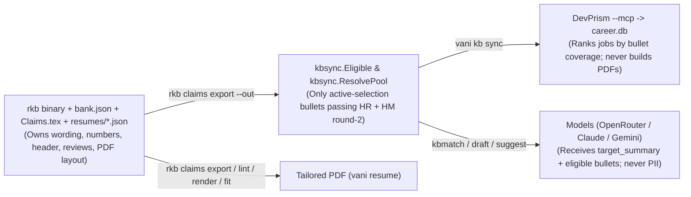

# Agent & New-User Guide: Building & Connecting a Knowledge Base

How Vani grounds answer drafts, tailored PDF resumes, DevPrism gap scores, and embedding similarity in your verified career claims—and how to create or wire a compatible knowledge base from scratch. Checked against `internal/kbsync`, `internal/rkbresume`, `internal/config`, and `cmd/vani`.

---

## 1. Ownership & Safety Model

Vani intentionally separates your **personal resume/claims bank** from **job analysis**:



- **Nothing leaves unapproved:** `vani kb sync`, `vani draft`, `vani suggest`, `vani kbmatch`, `vani resume`, and semantic embeddings **never** read the whole bank directly. They require non-empty `kb.selections` and filter every bullet through `kbsync.Eligible` (`internal/kbsync/eligible.go`).
- **No PII in prompts:** `internal/kbsync/bank.go` never reads header/contact fields from `bank.json`; `target_summary` and `motivation_notes` are guarded against identifying words; `rkbresume` scrubs header strings from `rkb` stderr/errors (`internal/rkbresume/scrub.go`).

---

## 2. Config Keys (`config.json` -> `kb`)

Every `kb.*` path must be **absolute** (`config check` rejects relative paths):

```json
"kb": {
  "bank": "/abs/path/to/career/bank.json",
  "rkb": "/abs/path/to/bin/rkb",
  "code_root": "/abs/path/to/career-repo",
  "selections": [
    "/abs/path/to/career/resumes/base.json",
    "/abs/path/to/career/resumes/systems.json"
  ],
  "base_selection": "/abs/path/to/career/resumes/base.json",
  "vm_report": "/abs/path/to/career/verify.json"
}
```

| Field | Required for | Notes |
|---|---|---|
| `kb.bank` | All KB features & semantic matching | JSON object parsed by `kbsync.Load` (`<= 8 MiB`). |
| `kb.rkb` | `kb sync`, `resume`, semantic profile, `kbmatch`, `draft`, `suggest` | Executable binary called via `rkbexec` (minimal env + `RKB_CODE_ROOT` if `kb.code_root` set). |
| `kb.selections` | Everything except baseline listing/triage | `1..32` selection JSON files declaring which entries/bullets are currently in use. |
| `kb.base_selection` | `vani resume` & Resume Studio | Must be one of `kb.selections`; keeps your own header, layout, skills (`lines`), and formatting untouched. |
| `kb.vm_report` | Optional (`vani resume`) | Path to rkb's number/claim verifier report. |

---

## 3. Exact Contract for `rkb` & Data Files

If you are building an `rkb`-compatible knowledge base (or authoring scripts for a new user), Vani depends on three file formats and one CLI subcommand (`rkb claims export` — plus `lint`/`render`/`fit` only if using `vani resume`).

### A. `bank.json` (`internal/kbsync/bank.go`)

Bounded to **8 MiB** (`MaxBankBytes`), strict JSON (no duplicate keys), IDs `1..128` chars matching `[A-Za-z0-9._:-]+` (no `/` because DevPrism uses `<entry>/<bullet>`):

```json
{
  "entries": {
    "acme_senior_swe": {
      "title": "Senior Software Engineer",
      "org": "Acme Corp",
      "dates": "AUG 2023 – Present",
      "location": "Remote, US",
      "stack": "Go, Rust, PostgreSQL",
      "origin": [],
      "bullets": ["acme_latency"]
    },
    "edu_ms": {
      "title": "Master of Science in Computer Science",
      "org": "State University",
      "dates": "2019 – 2021",
      "location": "",
      "stack": "",
      "origin": [],
      "bullets": []
    }
  },
  "bullets": {
    "acme_latency": {
      "text": "Cut p99 query latency by {{clmLat}} using **zero-copy** buffers",
      "author": "human",
      "unquantified_ok": "",
      "caution_ok": {},
      "review": {
        "hr": [
          {"round": 1, "verdict": "pass", "text_hash": "a1b2c3d4e5f6", "by": "reader_a"},
          {"round": 2, "verdict": "pass", "text_hash": "<12-hex-sha1>", "by": "reader_b"}
        ],
        "hm": [
          {"round": 1, "verdict": "pass", "text_hash": "a1b2c3d4e5f6", "by": "reader_c"},
          {"round": 2, "verdict": "pass", "text_hash": "<12-hex-sha1>", "by": "reader_d"}
        ]
      }
    }
  }
}
```

Key rules checked by `kbsync`:
- **Block kind (`kbsync.KindOf`):** Title starting with `bachelor|master|doctor|ph.?d` -> `"education"`; non-empty `org` + `dates` -> `"work"`; otherwise `"project"`.
- **Dates (`kbsync.ParseDates`):** Use `"MMM YYYY – MMM YYYY"`, `"MMM YYYY – Present"`, or `"YYYY"`.
- **Variants (`origin`):** Entries with non-empty `origin` are treated as rephrased variants of another entry and skipped during `kb sync` so DevPrism does not duplicate experience blocks.
- **Unattached bullets:** Any bullet not listed under an entry in `entries` is ignored.

### B. Selection files (`kb.selections`, `internal/kbsync/eligible.go`)

Bounded to **1 MiB** (`MaxSelectionBytes`), strict JSON:

```json
{
  "sections": [
    {
      "title": "Summary",
      "kind": "bullets",
      "bullets": []
    },
    {
      "title": "Experience",
      "kind": "entries",
      "entries": [
        {"entry": "acme_senior_swe", "bullets": ["acme_latency"]}
      ]
    },
    {
      "title": "Education",
      "kind": "entries",
      "entries": [
        {"entry": "edu_ms", "bullets": []}
      ]
    }
  ]
}
```

Omitted `"kind"` defaults to `"entries"` if `entries` is non-empty, `"lines"` if `lines` is non-null (kept as-is for skills/publications, not synced to DevPrism), else `"bullets"`. Omitting `"bullets"` on an entry (`null` / absent) selects all bullets listed on that entry in `bank.json`; `"bullets": []` selects none (normal for `education`).

### C. `rkb claims export --out <file>` (`internal/kbsync/resolve.go`)

Every time `kb sync`, `semantic status/warm`, or `vani resume` runs, Vani invokes:

```
<kb.rkb> claims export --out /tmp/.../claims.json
```

(with `RKB_CODE_ROOT=<kb.code_root>` when set; default 60 s timeout; output bounded to **4 MiB**):

```json
{
  "claims": {
    "clmLat": {
      "value": "42%",
      "caution": ""
    }
  }
}
```

- Claim IDs must match `clm[A-Za-z]+` (used in bullet text as `{{clmName}}`).
- Every exported claim value must be non-empty (`strings.TrimSpace(value) != ""` — empty claims fail resolution so figures are never erased silently).
- Setting `"caution"` to a non-empty string withholds any bullet referencing that claim unless the bullet's `"caution_ok": {"clmX": "reason"}` explicitly clears it.

> [!NOTE]
> If you also use `vani resume` (PDF tailoring), `<kb.rkb>` must additionally implement `claims export --used-in ...`, `lint`, `render`, and `fit --pages N --strict` (requiring Chrome + `pdftotext`). If you only want DevPrism ranking, `kbmatch`, semantic ordering, and draft grounding, `claims export --out <file>` is the entire `rkb` contract.

---

## 4. The Four `kbsync.Eligible` Rules

A bullet in an active selection is eligible (`kbsync.Eligible`) only when **all four** hold:

1. **Selected under its entry:** Present in at least one `kb.selections` file under an entry whose `bank.json` entry also lists it (or in a `"bullets"` summary section).
2. **Tokens resolve:** Every `{{clmX}}` token resolves via `rkb claims export`.
3. **No uncleared cautions:** Any token flagged `caution` in claims has a non-empty justification in `bullet.caution_ok[token]`.
4. **Independent two-round review (`hr` and `hm`):** For **both** `"hr"` and `"hm"` readers:
   - Compute `RKBPlain(text)` (substitute claims, replace `[label](url)` with `label`, strip `**bold**` and `*italic*`) and take the **first 12 lowercase hex characters of its SHA-1** (`kbsync.WordingHash`).
   - The latest `"round": 2` entry matching that `text_hash` must have `"verdict": "pass"`.
   - There must also be an earlier `"round": 1` `"pass"`, or another `"round": 2` `"pass"` by a different `by`.
   - The round-2 `by` must be non-empty, not `"drafter"`, and not equal to `bullet.author`; and the HR reviewer must not equal the HM reviewer.

Inspect which bullets pass or why each is withheld without touching DevPrism:

```bash
/abs/path/to/Vani/build/vani kb sync --dry-run
```

---

## 5. Step-by-Step Bring-Up for a New Knowledge Base

1. **Author `bank.json`, claims exporter, and selection file(s)** following §3–§4, or import an existing `rkb` workspace.
2. **Configure privacy guards before setting up models:**
   - Set `target_summary` (`<= 1,024` collapsed bytes, concrete engineering focus, zero PII).
   - Create `<state dir>/tracks/identifying-words.txt` listing your name, past employers, schools, and any terms that must stay out of prompts.
   - Optionally set `motivation_notes` via `vani config motivation --set` (auto-checked against `@`, `linkedin`, `github`, and visa keywords).
3. **Verify configuration & eligibility pool (no writes):**

   ```bash
   /abs/path/to/Vani/build/vani config check
   /abs/path/to/Vani/build/vani kb sync --dry-run
   ```

4. **Connect DevPrism for gap ranking (optional):**
   - Set `devprism.binary` to `/Applications/DevPrism.app/Contents/MacOS/claude-prism-desktop` (optional `devprism.tools_hash` after verifying [PHASE0-devprism.md](PHASE0-devprism.md)).
   - Back up DevPrism's `career.db`, then sync (`--replace` takes an automatic SQLite backup in `<state dir>/kbsync/backups/` before removing stale blocks):

   ```bash
   /abs/path/to/Vani/build/vani kb sync
   /abs/path/to/Vani/build/vani rescore --dry-run
   ```

5. **Configure Manvi LLM (`llm.provider`: `"anthropic"` or `"gemini"`)** only if you want KB-grounded essay/factual answers (`vani draft`, `vani suggest`, `vani resume`) ([SETUP.md#9-optional-claude-notes-schedule-badges](SETUP.md#9-optional-claude-notes-schedule-badges)).
6. **Verify semantic profile & `kbmatch` (optional):**

   ```bash
   /abs/path/to/Vani/build/vani semantic status
   /abs/path/to/Vani/build/vani kbmatch status
   ```

---

## 6. Verification Tests

Run the KB & resume unit tests (no live API spend; set `VANI_NO_KEYCHAIN=1`):

```bash
VANI_NO_KEYCHAIN=1 go -C /abs/path/to/Vani test ./internal/kbsync ./internal/rkbresume
```

(Note: `KBSYNC_REAL_BANK=1 KBSYNC_BANK=... KBSYNC_RKB=... go test ./internal/kbsync -run TestRealBank` validates a live `bank.json` and `rkb` binary read-only when set.)
