# LCA sponsorship-history badge

Vani can show a badge beside a posting such as
`142 certified H-1B LCAs FY2023–FY2025 (exact match)`. It comes from the US
Department of Labor's public LCA disclosure data (Form ETA-9035: H-1B, H-1B1
and E-3), imported locally by [`internal/lca`](../internal/lca).

```mermaid
flowchart TD
    subgraph ImportPipeline["1. LCA Import Pipeline (vani lca import)"]
        XLSX["DOL OFLC Disclosure Data\n(LCA_Disclosure_Data_FY*.xlsx)"]
        CSV["Exported CSV\n(Numbers / Excel / soffice)"]
        PARSE["internal/lca Parser\n(Header-name mapped, limits: 10M rows)"]
        FILTER{"Row Filter\n& Validation"}
        SKIP["Skipped Rows Counter\n(ragged, non-certified, bad date, etc.)"]
        COUNT["Tally by Fiscal Year\n(Oct 1 boundary; H-1B, H1B1, E-3)"]
        DEDUP["SHA-256 File Deduplication\n(Replaces prior run byte-for-byte)"]
        INDEX[("Compact JSON Index\n(schema v1, mode 0600, atomic checksummed)")]

        XLSX --> CSV --> PARSE --> FILTER
        FILTER -->|Invalid / Denied| SKIP
        FILTER -->|Certified LCA| COUNT
        COUNT --> DEDUP --> INDEX
    end

    subgraph RuntimeMatching["2. Runtime Badge Matching"]
        POSTING["Job Posting\n(Employer Name)"]
        NORM["Normalize Name\n(strip legal suffixes, punctuation, case)"]
        MATCH{"Index Lookup"}
        EXACT["Exact Match"]
        PREFIX["Unique Prefix Match\n(>= 2 tokens, exactly 1 employer)"]
        AMBIG["Ambiguous / Multiple Matches"]
        NONE["No Match"]

        BADGE["Certified H-1B Badge\n(Count in last 3 FYs, e.g. '142 certified H-1B LCAs')"]
        NO_BADGE["No Badge\n(Never drops or filters posting)"]

        POSTING --> NORM --> MATCH
        MATCH -->|Exact string| EXACT --> BADGE
        MATCH -->|Unique prefix| PREFIX --> BADGE
        MATCH -->|Multiple hits| AMBIG --> NO_BADGE
        MATCH -->|Not found| NONE --> NO_BADGE
    end
```



## Where to download

OFLC performance data page:
<https://www.dol.gov/agencies/eta/foreign-labor/performance>

Under "Labor Condition Application (LCA) Programs", download
`LCA_Disclosure_Data_FY<year>_Q4.xlsx` for each fiscal year you want (Q4 files
cover the whole fiscal year, Oct 1 - Sep 30). Vani never downloads these
itself. Record layout (field names) for each year is linked on the same page,
for example
<https://www.dol.gov/sites/dolgov/files/ETA/oflc/pdfs/LCA_Record_Layout_FY2025_Q4.pdf>.

Import one file per fiscal year. Quarterly files are cumulative within the
year, so importing Q3 and Q4 of the same year double counts: Vani de-duplicates
only byte-identical files (by sha256), not overlapping ones.

## Convert .xlsx to CSV (no Python)

- Numbers or Excel: open the file, File > Export To > CSV.
- LibreOffice, if installed:
  `soffice --headless --convert-to csv --outdir <dir> LCA_Disclosure_Data_FY2025_Q4.xlsx`

Keep dates as dates; `YYYY-MM-DD`, `M/D/YYYY` and ISO timestamps are all read.

## Import

```
vani lca import <file.csv>
```

Re-importing the same file replaces its earlier contribution and never double
counts. The import reports rows read, rows counted and rows skipped by reason
(`ragged_row`, `status_not_certified`, `visa_not_tracked`, `withdrawn_non_h1b`,
`bad_date`, `empty_employer`). Limits: 10,000,000 rows and 2,000,000 distinct
employers per file; exceeding either is an error. The index is saved as compact
JSON (schema version 1, mode 0600, atomic write, checksummed); a corrupted file
is refused on load.

## Columns used

Mapped by header name (trimmed, case-insensitive), never by position. Verified
against DOL's FY2020 and FY2025 Q4 record layouts:

| Need | Header | Notes |
|---|---|---|
| Employer | `EMPLOYER_NAME` | legal business name |
| Status | `CASE_STATUS` | `Certified` counted; `Certified-Withdrawn` counted separately; Denied/Withdrawn skipped |
| Visa | `VISA_CLASS` | `H-1B` counted; `H1B1 Chile/Singapore` and `E-3 Australian` kept in separate tallies |
| Date | `DECISION_DATE`, else `RECEIVED_DATE` | fiscal year derived from it (Oct 1 starts the next FY) |

Historical aliases (`LCA_CASE_EMPLOYER_NAME`, `STATUS`, `CASE_SUBMITTED`,
`LCA_CASE_SUBMIT`, ...) are accepted for older files but were not checked
against those years' layouts.

## What the badge means

A count of certified H-1B Labor Condition Applications filed under a name that
matches the company, in the last three fiscal years loaded. Matching is exact
on a normalised name (case, punctuation and legal suffixes such as Inc/LLC
removed), or a whole-token prefix of exactly one employer when the name has at
least two tokens. Ambiguous names get no badge.

## What it does NOT mean

- Not a count of people, visas or approved petitions. An LCA is a prior step; a
  certified LCA does not mean USCIS approved a petition, and one LCA can cover
  several workers.
- Not evidence that this posting, team or location sponsors. Subsidiaries,
  staffing firms and renamed companies may sit under other names.
- Not a filter. A missing badge or `no LCA match` never drops a posting; the
  job-description triage is the real sponsorship signal.
- The data lags: the newest quarter published is weeks to months old.
