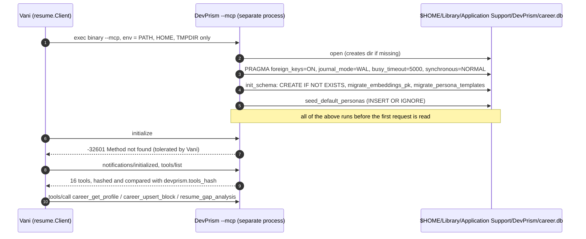

# Phase 0: DevPrism `--mcp` safety and tool shapes

Date: 2026-10-18. Binary: `/Applications/DevPrism.app/Contents/MacOS/claude-prism-desktop`,
`CFBundleShortVersionString` 1.4.0, built 2026-08-22 13:14. Source read: the DevPrism checkout at
`/Users/bharath/Code/devtools/DevPrism` (`apps/desktop/src-tauri`, Cargo version 1.4.0), which is
**newer than the installed build** (see finding 5).

Method: DevPrism's source was located with DevMap (index rebuilt to schema 27, generation #60) and
read for what `--mcp` does before the first request. The installed binary was then run only against a
throwaway `HOME` holding a copy of `career.db`, never against the real data dir. Vani's own client
(`build/phase0-devprism`, gitignored) drove it: a raw JSON-RPC probe, a real `vani kb sync`, a rerun,
and the tools hash. The real `career.db`, `-wal` and `-shm` had the same size, mtime and sha256
prefix (`40757c318dc90d4a`) before and after every run. The copies were deleted afterwards.



## Findings

| Question | Answer |
|---|---|
| Does starting the binary with `--mcp` run migrations on `career.db`? | **Yes, every start.** It opens the real `career.db` and runs the schema init and two migrations before reading stdin. All are idempotent, and on today's `career.db` all are no-ops: a copy was byte-identical after a session. |
| Can the data dir be pointed elsewhere? | **Only through `HOME`.** No flag or DevPrism env var. `dirs` 5.0.1 resolves `config_dir()` from `$HOME`. |
| Do the tools Vani calls exist with the argument shapes Vani sends? | **Yes, all three, on the installed build.** Verified live, including a real 81-block `kb sync`. |
| Can `devprism.binary` be set? | **Yes**, with `devprism.tools_hash` pinned (finding 6). Back up `career.db` first and read finding 7 before the first real sync. |

### 1. `--mcp` opens the real `career.db` and migrates it on every start

From the source (current checkout):

- `main.rs:22-53`: `--mcp`, `mcp-server` or `--mcp-stdio` builds a Tokio runtime and calls
  `run_stdio_transport(Default::default())` (`main.rs:42`).
- `career_db/mod.rs:167-171`: `CareerDbState::default()` is `open_default()`, which calls
  `open_connection()` (`mod.rs:244`).
- `mod.rs:239-242`: the path is `dirs::config_dir()/DevPrism/career.db`; the directory is created if it
  is missing.
- `mod.rs:263-272`: `PRAGMA foreign_keys = ON; journal_mode = WAL; busy_timeout = 5000;
  synchronous = NORMAL`, then `schema::init_schema` and `schema::seed_default_personas`.
- `career_db/schema.rs:64`: `init_schema` runs `CREATE TABLE/INDEX IF NOT EXISTS` for every table, then:
  - `migrate_embeddings_pk` (`schema.rs:93`) rebuilds `embeddings` with `PRIMARY KEY (owner_id, model)`
    when the table still has the old single-column key, then drops `vec_embeddings` and the
    `career_meta.vec_dim` row (`schema.rs:151`). It returns early when the composite key is present.
  - `migrate_persona_templates` (`schema.rs:189`) rewrites `defaultTemplateId` from the two removed
    LaTeX template ids to their Typst ids.
  - It also ensures `career_meta` and `known_projects` exist.
- `schema.rs:202`: `seed_default_personas` inserts `ai`, `life-sciences`, `management` with
  `INSERT OR IGNORE`, so user edits are never overwritten.

A failed open does not exit: the process keeps serving and every career tool answers
`career db unavailable: ...` (`mod.rs:174-186`).

The source states that a separate `--mcp-stdio` process writing `career.db` is intended: WAL and a busy
timeout exist because "`--mcp-stdio` opens a third [writer] from a *separate process*" (`mod.rs:255-262`).

### 2. On today's `career.db` every migration is already applied

Read from a copy with `sqlite3 -readonly` (schema and counts only):

```
PRAGMA journal_mode                     -> wal
embeddings                              -> PRIMARY KEY (owner_id, model)    (migrate_embeddings_pk returns early)
personas with ats-single-column / ats-two-column template ids -> 0          (migrate_persona_templates updates 0 rows)
personas                                -> 3: ai, life-sciences, management (seed inserts nothing)
tables                                  -> blocks, career_meta, embeddings, kb_chunks, kb_sources, known_projects,
                                           personas, synthesis_runs
counts                                  -> blocks 43, embeddings 442
```

Live: after the installed binary ran a full `--mcp` session (tools/list, `career_get_profile`,
`resume_gap_analysis`) against the copy, the copy's sha256 was unchanged (`40757c318dc90d4a` before and
after). WAL and SHM files were created and removed on a clean exit.

So starting `--mcp` today changes nothing in `career.db`. A future DevPrism release can add a migration
that runs on the first `--mcp` start, with no prompt. DevPrism keeps its own backups in
`career-db-backups/` (last written 2026-10-18 11:19); copying `career.db` before pointing Vani at a new
DevPrism build is the cheap guard.

### 3. The data dir is selected by `HOME`, nothing else

There is no DevPrism flag or environment variable for the data dir. `db_path()` uses
`dirs::config_dir()`. Cargo.toml pins `dirs = "5"` (lock: 5.0.1). Its macOS layer
(docs.rs source, `src/mac.rs`):

```rust
pub fn config_dir()       -> Option<PathBuf> { app_support_dir() }
fn app_support_dir()       -> Option<PathBuf> { home_dir().map(|h| h.join("Library/Application Support")) }
```

and `dirs-sys` 0.4.1 `home_dir()` reads `env::var_os("HOME")` first (empty counts as unset), falling
back to `getpwuid_r` only when it is unset. Vani's client passes `HOME` through
(`internal/resume/client.go:178`, `minimalEnv` keeps PATH, HOME and TMPDIR), so `HOME=<dir> vani ...`
redirects DevPrism too. Verified live on the installed build: with `HOME` pointing to the throwaway
dir, the copy went from 43 to 124 blocks (finding 4), while the real `career.db`, `-wal` and `-shm`
kept their size, mtime and sha256. The installed binary embeds no `dirs` version string, so the
version is inferred from the current lock file; the behaviour is what was tested.

### 4. The three tools exist with the shapes Vani sends (installed build, live)

`tools/list` on the installed binary returns 16 tools, including all three. Their input schemas:

| Tool | Schema (installed build) | What Vani sends |
|---|---|---|
| `resume_gap_analysis` | `jd_text` string (required), `persona_id` string, `page_budget` integer 1..4 | `{jd_text, page_budget: 2}`, `persona_id` omitted when empty, so DevPrism uses `"ai"` (`tools_resume.rs:577`) (`internal/resume/tools.go:11-16`, `client.go:37`) |
| `career_get_profile` | `persona_id` string, optional | `{}` (`internal/kbsync/plan.go:45`) |
| `career_upsert_block` | `block` object (required), `input_responses`, `request_state` | `{block: <ExperienceBlock>}` (`internal/kbsync/apply.go:87-88`) |

Answers seen live, by key only (no profile content was printed):

```
career_get_profile   -> keys _meta, blocks, personas, totalBlocks; blocks[0] keys bullets, dateRange, domains,
                        embeddingText, facts, id, kind, org, personas, seniorityLevel, skills, title, updatedAt, url
resume_gap_analysis  -> keys blocksConsideredSelected, blocksInKnowledgebase, coveragePercentage, extractionEmpty,
                        extractionMethod, mustHave{coveragePercentage, coveredCount, items, missingCount, summary,
                        weakCount}, niceToHave, personaId ("ai"), warnings
                        synthetic JD "Must have: Go, Rust, Kubernetes, PostgreSQL" -> coveragePercentage 40,
                        items rust covered, go covered, postgresql/kubernetes/terraform missing
resume_score_and_select -> selectedBlocks (9 at page_budget 2)
```

DevPrism refuses `jd_text` over `MAX_TEXT_BYTES` (1 MiB, `tools_career.rs:48`) with an error rather
than truncating. Vani sends `Posting.Description` (`internal/pipeline/runner.go:189,193`), and every
source caps that at 64 KiB (`srcutil.MaxDescription`: ashby, greenhouse, lever, workday, amazon, google, apple, eightfold, and page
including its JSON-LD path), so the refusal cannot be reached.

The payloads are returned bare as the JSON-RPC `result`, which `unwrapToolResult` passes through.
`initialize` answers `-32601 Method not found: 'initialize'` on this build; Vani's handshake already
treats that code as non-fatal (`client.go:307`).

End to end with Vani's real code, against the copy:

```
$ HOME=<scratch>/home VANI_CONFIG=<scratch>/config.json VANI_STATE_DIR=<scratch>/state build/phase0-devprism/vani kb sync --dry-run
kbsync plan (dry run, nothing sent): 81 add, 0 update, 0 unchanged, 0 blocked, 0 orphaned
$ HOME=<scratch>/home ... vani kb sync
kb sync: 81 added, 0 updated, 0 unchanged, 0 blocked, 0 need confirmation, 43 orphaned      exit 0
$ HOME=<scratch>/home ... vani kb sync          (rerun)
kb sync: 0 added, 0 updated, 81 unchanged, 0 blocked, 0 need confirmation, 43 orphaned
copy afterwards: blocks 124, embeddings 442, personas 3
```

Every `career_upsert_block` answer matched `{success: true, blockId: <sent id>}`
(`tools_career.rs:973-976`). `resume_gap_analysis` and `resume_score_and_select` then ran over all 124
blocks without error.

### 5. The installed build is older than the checkout

String probes of the installed binary (`rg -a -c -F`):

| String | Installed | Meaning |
|---|---|---|
| `[mcp_stdio]`, `Request line of at least` | present | stdio transport with the bounded line reader |
| `Failed to migrate embeddings PK`, `Failed to migrate persona template ids` | 1 each, and no other `Failed to migrate` | the same two migrations as the source |
| `PRAGMA journal_mode = WAL`, `Failed to init career schema`, `Failed to seed persona` | present | same open sequence |
| `Failed to ensure known_projects` | **0** | the build predates the `known_projects` step; the table already exists in `career.db`, so some newer build has opened this db |
| `--mcp-http` / `mcp_http` | 0 / 5 | the flag literal is absent but the `[mcp_http]` log prefix is present: the HTTP transport is likely in the build, its flag compiled into the comparison like `--mcp` |

`--mcp` itself does not appear as a string (short literals are compiled into the comparison), so the flag
is established by the live run, not by the probe.

Build commit, from `git log` run at DevPrism's root (inferred, since a dirty tree at build time cannot be
ruled out): the last commit before the 2026-08-22 13:14 build is `24ecbc8` (2026-08-21 13:52,
"drive tool gating and context planning through the manvi sidecar"). Commits since then that touch
`career_db/`, `main.rs`, `mcp/tools_career.rs` or `mcp/tools_resume.rs`:

```
777f94b 2026-08-22T15:27  fix(career_db): stop reused chunks going stale and duplicates collapsing
52869d3 2026-08-23T17:04  feat(career,mcp): complete career ingest reuse, ATS simulation, and local CI hardening
51b213f 2026-08-24T20:01  fix(career,mcp): atomic ingest/deletes, stale-chunk and model-qualified reuse
90b910c 2026-09-10T22:10  feat(career): update ATS simulation, synthesis, and desktop proxy implementations
```

The local reflog starts on 2026-09-02, so it cannot date the build.

### 6. Tools hash for the installed build

Computed by Vani's own `resume.Start` + `ToolsHash()` (`build/phase0-devprism/hashtool`):

```
1349173b7e4784bf59a8f478d6a4d63fe4f3479e332dba946ad5f09767ecab39
```

Set it as `devprism.tools_hash` together with `devprism.binary`. A DevPrism update that changes any
tool name or input schema then fails `Start` with `ErrToolsChanged` instead of running against an
interface Vani was not checked against. Recompute it after every DevPrism update.

### 7. The first real `kb sync` adds rkb's blocks beside DevPrism's existing ones

DevPrism's 43 existing blocks have ids that no rkb entry uses, so a real sync adds all 81 rkb blocks and
reports the 43 as orphaned; it never deletes. Overlap by `(org, title)` and by title, counted on the copy:

```
new blocks 81 (work 8, project 70, education 3); existing 43 (experience 7, project 32, education 2, publication 2)
new work blocks whose title matches an existing block: 8 of 8 (5 also match the org)
new project blocks whose title matches an existing block: 0
```

Narrowed on a second copy (2026-10-19, real db attached read-only and `immutable`, unchanged after):

```
title + org match (real duplicates): 5 rkb work blocks -> 4 existing experience blocks
                                     (one existing block matches two rkb blocks)
existing content in those 4 blocks:  8 bullets, 4 facts that rkb does not carry
title match, different org:          5 pairs, not duplicates (same job title at another employer)
```

The id pairs, with bullet and fact counts and no text, are in
`build/phase0-devprism/duplicate-work-blocks.tsv` (gitignored). So after the first sync, part of the
work history is in DevPrism twice: once as the old `experience` blocks and once as rkb `work` blocks. `resume_score_and_select` de-duplicates per org, but
`resume_gap_analysis` searches every block for evidence, so coverage can count either copy. Synced
blocks also have no embeddings (442 before and after); the scoring tools state they do not use them.
Deciding whether to delete the old `experience` blocks in DevPrism (they hold DevPrism-only edits, if
any) is the owner's call, before or after the first sync.

## Verdict

`devprism.binary` can be set to `/Applications/DevPrism.app/Contents/MacOS/claude-prism-desktop` with
`devprism.tools_hash` `1349173b...ecab39`. Starting it runs DevPrism's schema init and migrations on the
real `career.db` each time; today they change nothing, and the source designs for this concurrent
writer. Ranking (`resume_gap_analysis`) and a real `kb sync` work with Vani's shapes. Before the first
real sync: copy `career.db`, and decide about the duplicated work blocks (finding 7).

## Reproduce

```
# throwaway data dir inside the repo (build/ is gitignored); never point HOME at the real one
mkdir -p "build/phase0-devprism/home/Library/Application Support/DevPrism"
cp "$HOME/Library/Application Support/DevPrism/career.db" "build/phase0-devprism/home/Library/Application Support/DevPrism/"
HOME=$PWD/build/phase0-devprism/home /Applications/DevPrism.app/Contents/MacOS/claude-prism-desktop --mcp \
    < build/phase0-devprism/probe1.jsonl > build/phase0-devprism/probe1.out
HOME=$PWD/build/phase0-devprism/home build/phase0-devprism/hashtool.bin build/phase0-devprism/config.json
# afterwards: delete the copy and the .out files; they hold the career profile
```
