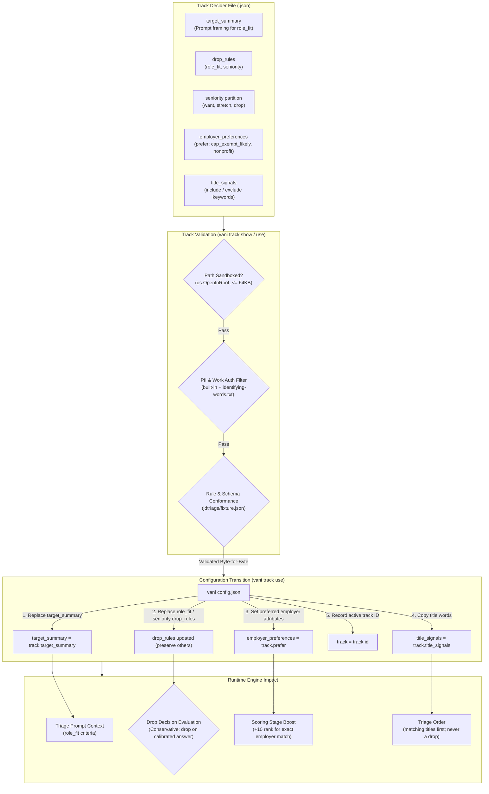

# Track deciders

A track decider tunes Vani's triage for one kind of job: the target summary that `role_fit` is
judged against, the role-fit and seniority drop rules, and the kinds of employer the track favours.
One JSON file per track, `<id>.json`, in the tracks directory.

```bash
vani track list                 # * marks the active track
vani track show ml-research     # print it and run every check
vani track use --dry-run ml-research
vani track use ml-research      # copy it into the config, then validate and save
```



## Where track files live

`tracks_dir` in the config (an absolute path), or `<state dir>/tracks` when unset. Track files are
personal (drawn from the knowledge base), so they are never committed; the owner's drafts are in
the repo's ignored `drafts/deciders/`, which `tracks_dir` can point at directly.

## What `track use` changes

- `target_summary` is replaced by the track's. The one it replaces is printed (including on
  `--dry-run`), with whether a track or a hand set it, so a hand-written summary is never lost.
- `drop_rules`: a rule on a slot the track has a rule for (role_fit, seniority) is replaced. So is
  a rule identical to one of the previously active track's (`track` in the config), which removes
  what that track added on slots the new track does not cover; a rule edited since is kept. Every
  other rule is kept unchanged and in order: sponsorship (never removed this way), work mode and
  anything else track-independent. If the previous track's file cannot be read, the command says
  so and keeps its rules.
- `employer_preferences` is set to the track's `employer_preferences.prefer` (cleared when empty).
- `title_signals` (include, exclude and read) is copied as is, and cleared when the track has none.
  See [Title signals](#title-signals).
- `track` records the id, so `track list` can mark it.
- `motivation_notes` is left alone: it is about the seeker, not the track.
- `exclude` is left alone too: the owner's hard filter (titles, companies, locations,
  descriptions) holds whatever track is active. Unlike `title_signals.exclude`, which only orders
  triage, it drops; see the README's Exclusions entry.

The new config is validated before it is saved. A track that fails any check is not applied and
the config is left byte-for-byte unchanged.

## Checks (`track show` and `track use`)

Ported from the drafting validator (`build/check-deciders.js`):

- `decider_version` is 1; the id matches the file name and is `[a-z0-9][a-z0-9-]{0,63}`, checked
  before it touches a path. Files are opened inside the tracks directory (`os.OpenInRoot`), so
  `../x` and symlinks leading out are refused. Files over 64 KiB, unknown fields and trailing data
  are refused.
- `target_summary` is non-empty, at most 1024 bytes after whitespace collapse, and contains no
  identifying term (whole words, case-insensitive):
  - a built-in list: `@`, linkedin, github, visa, h-1b, opt, citizen and other contact and
    work-authorization terms, plus cap-exempt and nonprofit (those are employer preferences, and
    they imply work authorization);
  - the owner's list, `identifying-words.txt` in the tracks directory: one term per line, `#`
    comments. It holds names, employers, schools and project names, so it is personal and lives
    only beside the track files. **Without it, the command prints that personal names were not
    checked**; it never reports that as a pass.
- Drop rules name a triage slot and legal values from `internal/decide/jdtriage/fixture.json`;
  no sponsorship rule (it stays in the main config); one rule per slot; `min_openrouter_prob` in (0, 1] (the old name `min_jev_prob` still loads).
- `seniority` want/stretch/drop partition the seniority levels, and `drop` equals the seniority
  drop rule's values.
- `employer_preferences` says `use: badge_and_rank` and `drops: false`; `prefer` holds only
  `cap_exempt_likely` and `nonprofit`, without duplicates.
- Evidence ids exist in the knowledge-base bank when `kb.bank` is set; otherwise the command says
  the evidence check was skipped.
- `title_signals.include` and `exclude` have at most 64 entries each; the config allows each entry
  at most 100 bytes, non-empty.
- `title_signals.read` has at most 64 entries. Each names a triage slot other than `sponsorship`
  and one of its values, and has a non-empty `match`; `match` and `unless` phrases have the same
  bounds as include and exclude.

## Employer preferences

They rank, never drop, and never enter a model prompt. See [EMPLOYER.md](EMPLOYER.md).

## Title signals

Each run triages at most 300 postings. With `title_signals` set, the run orders them before applying
that cap: titles matching an exclude signal go last, and the rest go by how many distinct include
signals they match, most first; equal ones keep ledger order. Matching ignores case and runs of
whitespace, and is whole words only: a letter or digit on either side is no match, so `Agent` does
not match `Agents` and `Recruit` does not match `Recruiter`.

Include and exclude only order. They drop nothing and change no status, so a false positive just
moves a posting forward: "People Specialist, Performance Management" matches `Performance`, and
"Security Risk & Compliance, Agent Security" matches `Agent`. An exclude signal (`Management`,
`Security`) moves such titles to the back. A config with no signals keeps ledger order.

### Title readings (`title_signals.read`)

A read entry reads one triage slot from the title alone, before any decision model is asked:

```json
"read": [
  {"slot": "seniority", "value": "staff_plus",
   "match": ["Staff", "Principal", "Distinguished"],
   "unless": ["Member of Technical Staff", "Technical Staff", "Member of Design Staff", "Senior/Staff"]},
  {"slot": "seniority", "value": "manager",
   "match": ["Manager", "Director", "Head of", "VP", "Vice President", "Chief"]},
  {"slot": "role_fit", "value": "mismatch_domain",
   "match": ["Sales", "Account Executive", "Recruiter", "Marketing", "Counsel", "..."],
   "unless": ["Engineer", "Engineering", "Developer", "Scientist", "Science", "Researcher", "Research",
              "Intern", "Internship"]}
]
```

An entry reads its value when a `match` phrase occurs in the title and no `unless` phrase does,
using the same matching as include and exclude. `unless` is an abstention, never another value: the
title is left to the model. When several entries read the same slot, the first one that matches
wins it.

A reading drops a posting only through `drop_rules`. If a rule for that slot lists the value read,
the posting is dropped without asking the OpenRouter model, the LLM or the shadow. No probability
threshold applies, because the reading is deterministic. The ledger records it under the backend
`title` (`triage.backend`, `triage.<slot>`, `triage.<slot>.backend`), and the reason names the
phrase that matched, for example `slot "seniority" = "staff_plus": title matched "Staff"`. Any
other title, whether nothing matched, an `unless` phrase matched or no rule drops the value, is
triaged by the models exactly as without readings. Its title readings are discarded.

To keep a class, take its value out of the drop rule. For example, to keep Engineering Manager
roles, remove `manager` from the seniority rule's values. The model then reads those postings, and
its own seniority reading can no longer drop them for `manager` either. A title drop counts toward
the per-run cap (`advance_per_run`).

`vani prefilter [--list]` is a dry run: it counts the live postings the readings would drop. For
the postings it would drop that a model has already read, it shows how the model rated `role_fit`.
Any strong_fit or partial_fit there is a false drop. It never writes the ledger.

A title drop is reversible. After narrowing a list, removing a value from a drop rule, or removing
the `read` entries, run `vani retriage --title-drops` (add `--dry-run` to see the count first). It
returns to live every posting dropped on a title that the current rules no longer drop, and
forgets its title reading. The next run triages those postings with the models. A posting the
current rules still drop stays dropped, and a posting a model dropped is never touched.
