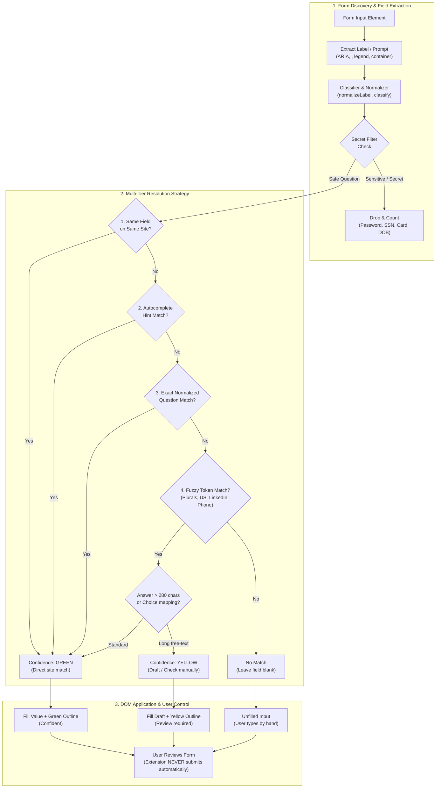

<p align="center">
  
</p>

# Vani Apply (browser extension)

Remembers your job-application answers and fills the next form. Apply once by hand. Each later
form on any common ATS fills the questions it recognises and marks what to check. **It never
submits.** You review and press Submit yourself (Vani plan §9).

## Install (Chrome or another Chromium browser)

```bash
bun run /Users/bharath/Code/apps/Vani/extension/build.ts
```

Then open `chrome://extensions`, turn on Developer mode, choose **Load unpacked**, and pick
`/Users/bharath/Code/apps/Vani/extension/dist-chrome`. The extension id is fixed by the public key
in `static/chrome-key.json` (`clhaobdmkmapebgnmpcfmakbfakmgfip`), which is the id the Mac app's
native-messaging manifest allows. `dist-safari/` is the same code with a Safari-style manifest
(background `scripts`, no `key`) for the Safari web extension in the Mac app.

## Use

1. Apply as usual. When you press Submit, or Next/Continue on a multi-step form, the answers on the
   page are saved. **Save answers** in the floating panel or the popup saves them at any time.
2. On the next application, press **Fill** (panel or popup, or Alt+Shift+F). Each filled field is
   outlined:
   - **green**: confident (the same field on the same site, the page's `autocomplete` hint, or the
     same question);
   - **yellow**: a reworded question matched fuzzily, or a long free-text answer kept as a draft.
     Check these.
   Fields you have already typed into are left alone, unless you tick "overwrite typed values".
   Search-as-you-type fields are left alone unless you tick "type into search fields".
   Questions it hasn't seen are left blank. Answer them, and they're saved for next time.
3. In the popup you can view, edit and delete answers, turn the extension off for a site, and
   export or import the bank as JSON.

### Live help for new questions

Click the panel's status line to list the questions on the page that have no saved answer. For
each one:

- **Use: …** buttons offer your saved answers to *similar* questions, which are too different to
  fill automatically. One click fills that answer, outlined yellow. No model is involved, and
  nothing leaves the browser.
- **Draft** (free-text fields, Chrome, with the Vani Apply Mac app installed) asks the Mac app to
  draft an answer from the job description on the page. The request carries only the question
  label and the posting (company, title, description), never your saved answers or what you
  typed. The draft appears in the panel to edit. **Insert for review** puts it in the field,
  outlined yellow. It never overwrites text you typed unless you click again to confirm, and only
  one draft runs at a time. A kept draft is saved for review, so it is never filled as a confident
  answer later, however short it is. In Safari, use Draft in the Vani Apply app instead.
  Failures say why: the budget is spent, the Mac app isn't reachable, no key is configured, or the
  draft timed out.

It runs automatically on Greenhouse, Lever, Ashby, Workday, SmartRecruiters, Workable, iCIMS,
BambooHR and Jobvite pages. On any other site, open the popup: it runs on that page for that click
only (`activeTab`).

## How a second form gets faster



Each answer is keyed by the normalized question. Wording variants accumulate on the answer, and
stable ATS field names (e.g. `first_name`) are remembered per site. Matching tries these in order:
1. the same field on the same site;
2. the `autocomplete` meaning (given-name, email, tel…);
3. the same question;
4. a fuzzy token match that folds required markers, plurals, "LinkedIn URL"/"LinkedIn profile",
   "the US"/"United States" and "mobile"/"phone".

Choices map across option wordings ("No" → "No, I will not"). A choice with no matching option is
left alone. Free-text answers over 280 characters are filled only as drafts, because they're usually
job-specific.

## Privacy and security (impact statement)


- **Storage:** when the Vani Apply Mac app is installed and connected (native messaging host
  `dev.vbcr.vani_apply`), it holds the answers in one local file shared by Chrome and Safari. The
  popup says "Stored by the Vani Apply Mac app". Otherwise answers stay in `chrome.storage.local`
  in this browser profile ("Stored in this browser only"). The first time the app answers, any
  answers still in the browser are merged into the app's bank (the newer answer per question
  wins) and then removed from the browser; if that fails or the browser copy is unreadable it is
  left in place. If the app answers with an error, the extension reports it rather than
  silently writing to the browser, which would split the bank. The bank is capped at 900 KB
  (Chrome limits a native reply to 1 MB); over the cap, saving is refused until you delete
  answers. Nothing is sent over the network: the extension has no host permission for any server
  and makes no network requests. The only new channel is the local native-messaging pipe to the
  Mac app, whose activity log receives event names, the page hostname and counts, never answers
  or labels. Disk protection is the OS's (FileVault). Other extensions cannot read this storage.
- **Never stored or filled:** password fields; card, CVV and expiry fields; SSN, tax-id, passport and
  driver's-licence fields; bank, routing and IBAN fields; date of birth; security questions; one-time
  codes; captchas. Recognition uses input type, `autocomplete` and label words. An import cannot
  bring them in either: they are dropped and counted.
- **Opt-in:** voluntary self-identification (gender, race/ethnicity, veteran, disability,
  orientation) is saved and filled only if you turn it on in the popup. It's shown masked in the
  list.
- **Never touched:** file uploads (attach your resume yourself), and the Submit button.
- **Permissions:** `storage`, `activeTab`, `scripting` (to run on a non-ATS page when you ask) and
  `nativeMessaging` (to talk to the Vani Apply Mac app only), plus content-script access to the ATS
  hosts above. Only the background script and popup call the native host, never page content
  scripts.

## Limits

- Widgets: native controls, ARIA combobox / listbox / radio / checkbox / switch, button dropdowns
  (`aria-haspopup=listbox`) and contenteditable editors are read, and filled by opening the widget,
  clicking the option that matches the saved answer and checking the widget shows it. A widget that
  does not open or does not show the choice is reported "manual", never "filled".
  - Multi-select (`<select multiple>`, a listbox or combobox that is `aria-multiselectable`, a
    react-select / MUI style chip picker): every selected value is read and saved as one answer.
    Filling clicks each saved value's existing option (each through the same option matching as any
    choice) and checks the chip or selection appears. It only adds: chips already there are kept and
    none is removed, and "overwrite typed values" on a `<select multiple>` makes the selection
    exactly the saved one. A saved value with no option is skipped and the field is outlined yellow.
    A picker with no option list to click (a free-text tag box) stays "manual". A chip box whose
    input has no `combobox` role is read as a plain text field, so its chips are not read (reading
    them would mean inspecting the surroundings of every text input on every scan).
  - Search-as-you-type fields (a list that appears only after typing): typing into them can make
    the site send its own search request, so Fill types into one only when "type into search fields"
    is ticked in the popup. Off, the field is reported "manual" and untouched. On, it types the saved
    answer once, picks the option, and clears the text again if nothing matched (at most one typed
    query and one clear).
  - Dates: `<input type=date|month>` get the saved date as ISO (`YYYY-MM-DD` / `YYYY-MM`, from
    ISO or US-order text) through the native setter plus input and change events, and are read back;
    a month with no day is never guessed onto a date input. `type=week`, read-only inputs that open a
    picker and `aria-haspopup=dialog|grid` pickers stay "manual". ARIA date-grid pickers are not
    driven: libraries label their day cells differently and nothing here could be checked against a
    real one, so a guessed click could fill the wrong day.
  - Only open shadow roots and same-origin iframes are entered. A cross-origin iframe on a host the
    manifest does not match (a company page embedding an unlisted ATS) is entered only when you open
    the popup on that page (it then injects into every frame, which `activeTab` is meant to cover; not
    tried against a live cross-origin frame). The popup's counts are the sum over every frame that
    answers, with a per-frame list; a frame Chrome does not run the scan in is not counted, and
    cannot be told apart from a page with no such frame. Fill and Save from the popup run in every
    frame, but the popup shows the result of the first frame to reply.
- Repeated sections (work history, education): the 2nd, 3rd... occurrence of a question is saved as
  "<question> (vani section n)" and filled from the same entry number; entry 1 keeps its plain key.
  The marker is namespaced so a genuine label ending in "section 2" is not read as entry 2. Keys
  saved by earlier versions ("<question> section n") are still read: they match entry n exactly
  (just below a key saved with the new marker) and as wording variants, and are never rewritten or
  deleted. One case cannot be told apart: an old key that really was a question ending in
  "section n" is also treated as entry n of the shorter question for fuzzy matching only. An entry
  with no saved counterpart is left blank. Dates split into month/day/year and phone numbers
  split into country code + number are one saved answer each; a bare `+15550100` is split only
  when it is unambiguous.
- Capture does not need the Submit click: committed values (change / focus-out / choosing an
  option) are held for the page and saved on submit, Next/Continue/Save, Enter, a route change,
  pagehide and the tab being hidden. Saving the same page twice changes nothing: the page keeps
  what each field last sent, so the same value for the same field is not sent again even if the
  saved answers have not caught up (a refused save is not remembered, so it is retried).
- Coverage: the panel and popup show, for the page, fields found / ready / new / manual / skipped,
  and list the questions with no saved answer. A scan reads at most 500 fields and 40,000 nodes;
  when it stops early the report says how many controls it did not read.
- Not verified against live sites (none were visited): Workday's real markup for button dropdowns
  and date parts, and `pagehide` delivery from a content script, were built from the public
  patterns and a fixture page only.
- Labels come from ARIA, `<label>`, fieldset legends and question containers. A form with no
  readable label for a field falls back to the field's name.
- Not yet connected to Vani: no Greenhouse question-schema prefetch, and no application packet from
  the digest (plan §9).

## Develop

```bash
bun test --cwd /Users/bharath/Code/apps/Vani/extension       # core: normalize, classify, bank, match
bun run /Users/bharath/Code/apps/Vani/extension/build.ts     # dist-chrome/, dist-safari/, dist-test/
bun run /Users/bharath/Code/apps/Vani/extension/test/serve.ts  # then open http://127.0.0.1:4789/test/dom.html
```

`test/dom.html` runs the DOM tests in a real browser. It captures a hand-filled Greenhouse-style
form, then fills a reworded Lever-style form, and checks what must and must not be filled. The page
title reads `PASS n/n`. Type-checking uses `tsc` with `tsconfig.json` (no TypeScript dependency is
installed here; `src/chrome.d.ts` declares the Chrome API surface used). The type-check used here is
`/Users/bharath/Code/apps/SalEdge/node_modules/typescript/bin/tsc -p tsconfig.json --noEmit`.

`bun test` also covers the store (fake native host and fake `chrome.storage`) and replays
`test/vectors/classify.json`, the classifier vectors shared with the Mac app's Swift tests; do not
edit that file by hand.
