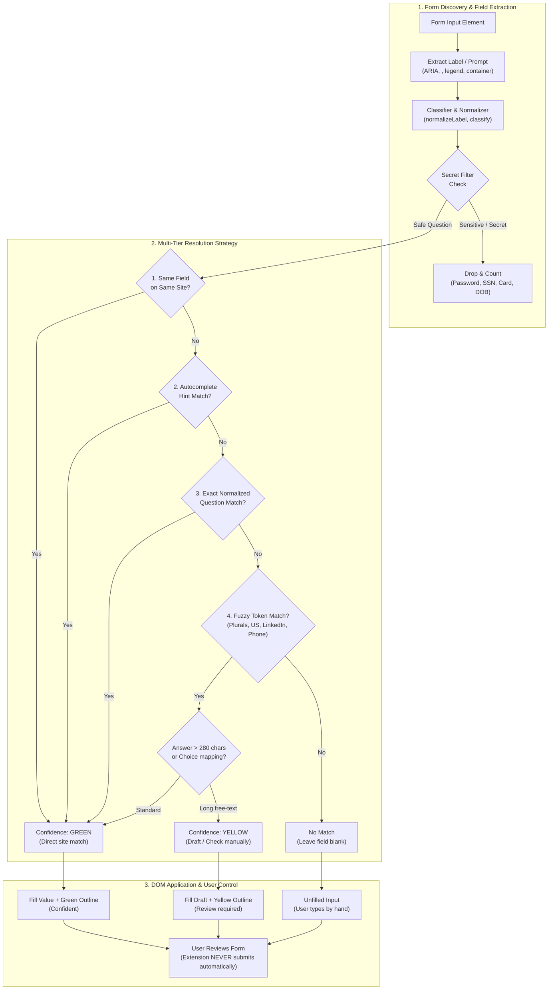

<p align="center">
  
</p>

# Vani Apply (browser extension)

Remembers your job-application answers and fills the next form. Apply once by hand. Each later
form on any common ATS fills the questions it recognises and marks what to check. **It never
submits.** You review and press Submit yourself (Vani plan §9).

## Install (Chrome or another Chromium browser)

```bash
bun run /Users/bharath/Code/apps/Vani/extension/build.ts
```

Then open `chrome://extensions`, turn on Developer mode, choose **Load unpacked**, and pick
`/Users/bharath/Code/apps/Vani/extension/dist-chrome`. The extension id is fixed by the public key
in `static/chrome-key.json` (`clhaobdmkmapebgnmpcfmakbfakmgfip`), which is the id the Mac app's
native-messaging manifest allows. `dist-safari/` is the same code with a Safari-style manifest
(background `scripts`, no `key`) for the Safari web extension in the Mac app.

## Use

1. Apply as usual. When you press Submit, or Next/Continue on a multi-step form, the answers on the
   page are saved. **Save answers** in the floating panel or the popup saves them at any time.
2. On the next application, press **Fill** (panel or popup, or Alt+Shift+F). Each filled field is
   outlined:
   - **green**: confident (the same field on the same site, the page's `autocomplete` hint, or the
     same question);
   - **yellow**: a reworded question matched fuzzily, or a long free-text answer kept as a draft.
     Check these.
   Fields you have already typed into are left alone, unless you tick "overwrite typed values".
   Search-as-you-type fields are left alone unless you tick "type into search fields".
   Questions it hasn't seen are left blank. Answer them, and they're saved for next time.
   **Your basics** in the popup (first and last name, email, phone, city, country, LinkedIn, GitHub,
   website) fills those on the very first form: they are saved as ordinary answers, under the keys
   a form's `autocomplete` or question resolves to, and edited or deleted in the answers table like
   any other. The section opens by itself while no first name or email is saved. Below them are the
   **questions most forms ask** (`src/intents.ts`): authorized to work, visa sponsorship, relocation,
   working in person, interviewed or applied before, earliest start date, deadlines or timeline,
   how you heard, salary expectations, and the AI-use policy. One answer fills every wording of the
   question ("Do you require visa sponsorship?", "Will you now or in the future require
   sponsorship…?"), confidently (green), and a question you answered on a form shows in its box.
   An exact wording you answered by hand still wins over the general answer; among wordings the
   latest answer wins. A label that reads as two of them (authorized to work *without*
   sponsorship: opposite answers) fills from neither. The AI-policy answer always fills yellow,
   to read. With self-ID turned on, gender, Hispanic/Latino, race, veteran and disability get boxes
   too, and a saved "Decline to self-identify" takes each form's own decline option ("I don't wish to
   answer", "I do not want to answer").
   Not offered, on purpose: arbitration and other legal agreements (a waiver is chosen per employer,
   by you), and why-this-company essays (below).
3. In the popup you can view, edit and delete answers, turn the extension off for a site, and
   export or import the bank as JSON.

### The resume for each job

Each job gets its own resume. On a job's application page, open the popup and use **Resume for
this job → Choose PDF** (at most 512 KB). The Vani Apply Mac app keeps a copy in its App Group
folder, keyed by the page's address (the same reduced URL Mark Applied uses), so Chrome and Safari
read the same file. On **Fill**, the file input that reads as a resume (Resume/CV, Résumé, CV, or a
`resume` name) gets that PDF through the browser's drag-and-drop API and is outlined **yellow**,
with the file name in its tooltip: check it is the version for this job. A cover-letter,
"other attachments", transcript or portfolio box never gets it.

There is no default resume. A job with none chosen gets no file, and Fill says why: no resume
chosen for this job, the Mac app isn't reachable (the resume lives only there), the stored copy is
missing or damaged, or the page did not take the file. The PDF goes from the Mac app to the tab
being filled and nowhere else. Its name is never written to the activity log.

### Live help for new questions

Click the panel's status line to list the questions on the page that have no saved answer. For
each one:

- **Use: …** buttons offer your saved answers to *similar* questions, which are too different to
  fill automatically. One click fills that answer, outlined yellow. No model is involved, and
  nothing leaves the browser.
- **Suggest** (panel button, with the Vani Apply Mac app and its agent running) handles the whole
  page in one click. It sends the new free-text questions (labels and field type only, never a
  value or a saved answer) and the posting to `vani suggest`:
  - The decision model (the configured OpenRouter model, then Claude) sorts each question as an
    essay, a fact about you, work authorization, an agreement, self-identification or other.
  - Claude, through Manvi, drafts the essays, at most three per page. Each draft is inserted
    yellow, for review, into a field that is still empty.
  - Every other question is listed with the reason it is left to you.
  - Visa/sponsorship, consent and self-identification labels are pinned by a fixed rule, so no
    model is ever asked about them.
  - Choice questions (selects, radios) are never sent. They come from your saved answers only.
  - It runs as a job in the Vani Apply agent: the extension starts it, then polls every 2 s for up
    to about 6 minutes. This works the same in Safari and Chrome.
- **Draft** (free-text fields, with the Vani Apply Mac app installed) asks the Mac app to
  draft an answer from the job description on the page. The request carries only the question
  label and the posting (company, title, description), never your saved answers or what you
  typed. The draft appears in the panel to edit. **Insert for review** puts it in the field,
  outlined yellow. It never overwrites text you typed unless you click again to confirm, and only
  one draft runs at a time. A kept draft is saved for review, so it is never filled as a confident
  answer later, however short it is. In Safari, the draft runs as a job in the Vani Apply agent,
  because Safari's sandboxed extension cannot start `vani` itself.
  Failures say why: the budget is spent, the Mac app isn't reachable, no key is configured, or the
  draft timed out.

### Marking a job Applied

When you press **Submit** (or **Send application**) on a page that is one of the postings Vani
tracks, the extension offers to mark it Applied in the Vani Apply Jobs tab: a small bar at the top
right asks "Did your application go through? Mark … as Applied in Vani?" with **Mark Applied** and
**Not now**. **It never marks without that click.**

- Only a final Submit counts. Next, Continue, Save, Review, "Review and submit" and Apply do not.
- The page is matched on scheme, host and path against each posting's link and apply link
  (`vani jobs find`). The query and fragment are dropped in the browser before anything is sent,
  so tokens in them never reach the Mac app, except the few parameters that name a job (`gh_jid`,
  `jid`, `job_id`, `jobid`, `req_id`, with a plain identifier as the value): Greenhouse boards on
  a company's own careers page tell postings apart by `gh_jid`. A Greenhouse embedded form
  (`boards.greenhouse.io/embed/job_app?for=…&token=…`) is the posting it embeds, and
  `job-boards.greenhouse.io` is the same site as `boards.greenhouse.io`. When no link matches
  exactly, an application sub-page (`…/apply`, `…/application`, Workday's `…/apply/applyManually`)
  is matched to the posting it belongs to. A page that two postings share is not guessed at and
  gets no offer; neither does a job already marked Applied.
- Many boards load a confirmation page after Submit. The question follows you there: the background
  worker keeps it for the tab for 10 minutes in `chrome.storage.session` (so a stopped worker still
  has it; where that API is missing it is held in memory only), and the toolbar button shows "✓?"
  on that tab. If the confirmation page is on a host the extension does not run on, the bar
  does not appear; open the popup instead.
- **The popup does the same on any site.** Opening it on a page Vani tracks (the popup may read the
  active tab's address) shows "Tracked job on this page: … Mark Applied / Not now", whether or not a
  content script runs there. That is also the way in on a company careers page the extension does not
  watch for Submit. Opening the popup sends the page's address, reduced as above, to the Mac app
  (local, not logged).
- Chrome through the native host, and Safari through the Vani Apply agent (the same `jobFind` and
  `jobMark` ops over XPC, since Safari's sandboxed extension cannot start `vani`). Unreachable app,
  untracked page: the extension stays silent.
- A form inside a frame (a Greenhouse embed on a company page) asks the top frame to show the
  question, and shows it inside the frame only if the top frame has no content script. The frame's
  own address is tried first, then the tab's, where the browser gives it.
- Submit is detected from the click on a button labelled Submit / Send application, which also
  covers Enter in a field and keyboard activation (the browser clicks the button). A form submitted
  by script with no such button gives no offer.

It runs automatically on Greenhouse, Lever, Ashby, Workday, SmartRecruiters, Workable, iCIMS,
BambooHR and Jobvite pages. On any other site, open the popup: it runs on that page for that click
only (`activeTab`).

## How a second form gets faster



Each answer is keyed by the normalized question. Wording variants accumulate on the answer, and
stable ATS field names (e.g. `first_name`) are remembered per site. Matching tries these in order:
1. the same field on the same site;
2. the `autocomplete` meaning (given-name, email, tel…);
3. the same question;
4. a fuzzy token match that folds required markers, plurals, "LinkedIn URL"/"LinkedIn profile",
   "the US"/"United States" and "mobile"/"phone".

Choices map across option wordings ("No" → "No, I will not"). A choice with no matching option is
left alone. Free-text answers over 280 characters are filled only as drafts, because they're usually
job-specific.

## Privacy and security (impact statement)


- **Storage:** when the Vani Apply Mac app is installed and connected (native messaging host
  `dev.vbcr.vani_apply`), it holds the answers in one local file shared by Chrome and Safari. The
  popup says "Stored by the Vani Apply Mac app". Otherwise answers stay in `chrome.storage.local`
  in this browser profile ("Stored in this browser only"). The first time the app answers, any
  answers still in the browser are merged into the app's bank (the newer answer per question
  wins) and then removed from the browser; if that fails or the browser copy is unreadable it is
  left in place. If the app answers with an error, the extension reports it rather than
  silently writing to the browser, which would split the bank. The bank is capped at 900 KB
  (Chrome limits a native reply to 1 MB); over the cap, saving is refused until you delete
  answers. Nothing is sent over the network: the extension has no host permission for any server
  and makes no network requests. The only new channel is the local native-messaging pipe to the
  Mac app, whose activity log receives event names, the page hostname and counts, never answers
  or labels. Disk protection is the OS's (FileVault). Other extensions cannot read this storage.
- **Never stored or filled:** password fields; card, CVV and expiry fields; SSN, tax-id, passport and
  driver's-licence fields; bank, routing and IBAN fields; date of birth; security questions; one-time
  codes; captchas. Recognition uses input type, `autocomplete` and label words. An import cannot
  bring them in either: they are dropped and counted.
- **Opt-in:** voluntary self-identification (gender, race/ethnicity, veteran, disability,
  orientation) is saved and filled only if you turn it on in the popup. It's shown masked in the
  list.
- **Never touched:** file uploads (attach your resume yourself), and the Submit button.
- **Permissions:** `storage`, `activeTab`, `scripting` (to run on a non-ATS page when you ask) and
  `nativeMessaging` (to talk to the Vani Apply Mac app only), plus content-script access to the ATS
  hosts above. Only the background script and popup call the native host, never page content
  scripts.

## Limits

- Widgets: native controls, ARIA combobox / listbox / radio / checkbox / switch, button dropdowns
  (`aria-haspopup=listbox`) and contenteditable editors are read, and filled by opening the widget,
  clicking the option that matches the saved answer and checking the widget shows it. A widget that
  does not open or does not show the choice is reported "manual", never "filled".
  - Multi-select (`<select multiple>`, a listbox or combobox that is `aria-multiselectable`, a
    react-select / MUI style chip picker): every selected value is read and saved as one answer.
    Filling clicks each saved value's existing option (each through the same option matching as any
    choice) and checks the chip or selection appears. It only adds: chips already there are kept and
    none is removed, and "overwrite typed values" on a `<select multiple>` makes the selection
    exactly the saved one. A saved value with no option is skipped and the field is outlined yellow.
    A picker with no option list to click (a free-text tag box) stays "manual". A chip box whose
    input has no `combobox` role is read as a plain text field, so its chips are not read (reading
    them would mean inspecting the surroundings of every text input on every scan).
  - Search-as-you-type fields (a list that appears only after typing): typing into them can make
    the site send its own search request, so Fill types into one only when "type into search fields"
    is ticked in the popup. Off, the field is reported "manual" and untouched. On, it types the saved
    answer once, picks the option, and clears the text again if nothing matched (at most one typed
    query and one clear).
  - Dates: `<input type=date|month>` get the saved date as ISO (`YYYY-MM-DD` / `YYYY-MM`, from
    ISO or US-order text) through the native setter plus input and change events, and are read back;
    a month with no day is never guessed onto a date input. `type=week`, read-only inputs that open a
    picker and `aria-haspopup=dialog|grid` pickers stay "manual". ARIA date-grid pickers are not
    driven: libraries label their day cells differently and nothing here could be checked against a
    real one, so a guessed click could fill the wrong day.
  - Only open shadow roots and same-origin iframes are entered. A cross-origin iframe on a host the
    manifest does not match (a company page embedding an unlisted ATS) is entered only when you open
    the popup on that page (it then injects into every frame, which `activeTab` is meant to cover; not
    tried against a live cross-origin frame). Scan, Fill and Save from the popup (and the Fill
    shortcut) ask each frame that runs Vani on its own and add the answers up, so a form inside a
    frame is counted even when the top frame has no fields; the scan shows a per-frame list. Each
    frame's content script tells the background worker it is there when it starts (kept per tab in
    `chrome.storage.session`, memory only where that is missing), because the popup cannot list a
    cross-origin frame it may not script: Chrome lists only the page activeTab grants, not a
    Greenhouse iframe the manifest runs in (checked in Chrome 155, `test/live.ts`). A frame that
    errors or gives no answer within 20 s is reported as not answering and its fields are not
    counted; a listed frame that has since gone away is skipped.
- Repeated sections (work history, education): the 2nd, 3rd... occurrence of a question is saved as
  "<question> (vani section n)" and filled from the same entry number; entry 1 keeps its plain key.
  The marker is namespaced so a genuine label ending in "section 2" is not read as entry 2. Keys
  saved by earlier versions ("<question> section n") are still read: they match entry n exactly
  (just below a key saved with the new marker) and as wording variants, and are never rewritten or
  deleted. One case cannot be told apart: an old key that really was a question ending in
  "section n" is also treated as entry n of the shorter question for fuzzy matching only. An entry
  with no saved counterpart is left blank. Dates split into month/day/year and phone numbers
  split into country code + number are one saved answer each; a bare `+15550100` is split only
  when it is unambiguous.
- Capture does not need the Submit click: committed values (change / focus-out / choosing an
  option) are held for the page and saved on submit, Next/Continue/Save, Enter, a route change,
  pagehide and the tab being hidden. Saving the same page twice changes nothing: the page keeps
  what each field last sent, so the same value for the same field is not sent again even if the
  saved answers have not caught up (a refused save is not remembered, so it is retried). Only a
  page that has shown at least 3 questions is saved on its own; on a smaller page (a search page
  the popup ran Vani on) only **Save answers** saves, so a search query pressed with Enter is never
  kept as an answer.
- Why-this-company questions ("Why Anthropic?", "Why do you want to work here?", "What excites you
  about this role?") are never filled from saved answers, even word for word: such an answer is
  written for one posting, and every Greenhouse company shares one host, so a saved one cannot tell
  which company it was for. Fill lists them as new questions, for **Draft** or **Suggest** to write
  from the posting on the page; the panel's "Use: …" buttons still offer an earlier answer on a click.
- Not questions, so never read, saved or filled: search boxes (`type=search`, `role=searchbox`,
  anything inside `role=search` or `<search>`), and a text box hidden from assistive technology and
  out of the tab order (`aria-hidden=true`, negative `tabindex`). React-Select keeps one beside each
  required dropdown on job-boards.greenhouse.io until a value is chosen; counting it doubled every
  dropdown. A hidden select, checkbox or radio is still read: custom widgets keep their value there.
- A choice is matched with a trailing dialling code set aside: "United States" picks
  job-boards.greenhouse.io's "United States +1", and an answer saved as "United States +1" fills a
  plain "United States". That Country box shows only "+1" once a country is chosen, so a bare
  dialling code never replaces a saved answer that names more; it is kept only where it is the
  whole answer (a "Country code" question).
- Coverage: the panel and popup show, for the page, fields found / ready / new / manual / skipped,
  and list the questions with no saved answer. A scan reads at most 500 fields and 40,000 nodes;
  when it stops early the report says how many controls it did not read.
- Not verified against live sites (none were visited): Workday's real markup for button dropdowns
  and date parts, and `pagehide` delivery from a content script, were built from the public
  patterns and a fixture page only.
- Labels come from ARIA, `<label>`, fieldset legends and question containers. A form with no
  readable label for a field falls back to the field's name.
- Connected to Vani only for drafts, Suggest and marking a job Applied (above): no Greenhouse
  question-schema prefetch, and no application packet from the digest (plan §9).

## Develop

```bash
bun test --cwd /Users/bharath/Code/apps/Vani/extension       # core: normalize, classify, bank, match
bun run /Users/bharath/Code/apps/Vani/extension/build.ts     # dist-chrome/, dist-safari/, dist-test/
bun run /Users/bharath/Code/apps/Vani/extension/test/serve.ts  # then open http://127.0.0.1:4789/test/dom.html
```

```bash
bun run /Users/bharath/Code/apps/Vani/extension/test/live.ts  # real Chrome, headless, throwaway profile
```

`test/live.ts` loads the built extension into a headless Chrome (over the DevTools pipe; no
dependency) with a throwaway profile, and checks what the fake `chrome` in `bun test` cannot:
Save, Fill and Scan count a form in a cross-origin Greenhouse iframe on a company page; with a
content script in both frames both are asked; a removed frame is skipped; the frame list survives
the worker being stopped; the import input takes the same file again; and `test/dom.html` passes.
Its copy of the extension has no `key` and no `nativeMessaging`, so it never reaches the Mac app
or your saved answers, and a host permission for `http://127.0.0.1` stands in for the activeTab
grant the popup gets (automation cannot grant activeTab). It needs Google Chrome (or `--chrome
PATH`) and `openssl`.

`test/dom.html` runs the DOM tests in a real browser. It captures a hand-filled Greenhouse-style
form, then fills a reworded Lever-style form, and checks what must and must not be filled. The page
title reads `PASS n/n`. Type-checking uses `tsc` with `tsconfig.json` (no TypeScript dependency is
installed here; `src/chrome.d.ts` declares the Chrome API surface used). The type-check used here is
`/Users/bharath/Code/apps/SalEdge/node_modules/typescript/bin/tsc -p tsconfig.json --noEmit`.

`bun test` also covers the store (fake native host and fake `chrome.storage`) and replays
`test/vectors/classify.json`, the classifier vectors shared with the Mac app's Swift tests; do not
edit that file by hand.
