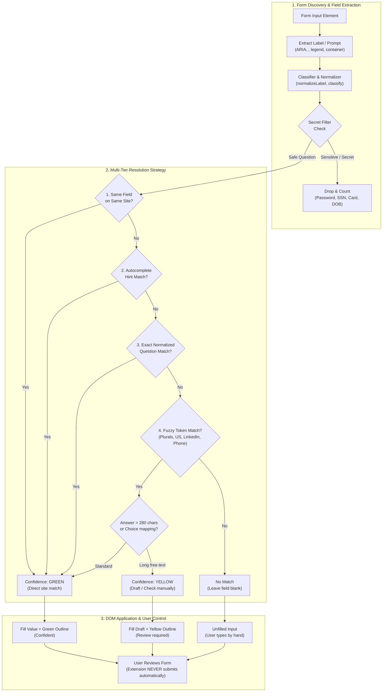
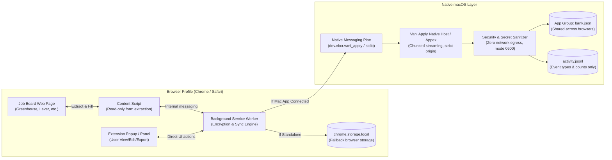

<p align="center">
  
</p>

# Vani Apply (browser extension)

Remembers your job-application answers and fills the next form. Apply once by hand. Each later
form on any common ATS fills the questions it recognises and marks what to check. **It never
submits.** You review and press Submit yourself (Vani plan §9).

## Install (Chrome or another Chromium browser)

```bash
bun run /Users/bharath/Code/apps/Vani/extension/build.ts
```

Then open `chrome://extensions`, turn on Developer mode, choose **Load unpacked**, and pick
`/Users/bharath/Code/apps/Vani/extension/dist-chrome`. The extension id is fixed by the public key
in `static/chrome-key.json` (`clhaobdmkmapebgnmpcfmakbfakmgfip`), which is the id the Mac app's
native-messaging manifest allows. `dist-safari/` is the same code with a Safari-style manifest
(background `scripts`, no `key`) for the Safari web extension in the Mac app.

## Use

1. Apply as usual. When you press Submit, or Next/Continue on a multi-step form, the answers on the
   page are saved. **Save answers** in the floating panel or the popup saves them at any time.
2. On the next application, press **Fill** (panel or popup, or Alt+Shift+F). Each filled field is
   outlined:
   - **green**: confident (the same field on the same site, the page's `autocomplete` hint, or the
     same question);
   - **yellow**: a reworded question matched fuzzily, or a long free-text answer kept as a draft.
     Check these.
   A saved answer longer than the field's character limit (`maxlength`) is never written, cut or
   otherwise: the field stays empty, outlined **yellow**, and its tooltip says how long the answer
   is and what the field allows (see Limits).
   Every write is read back after the page settles. A controlled field (React, Angular) that throws
   the value away is written once more, the way typing does, and if it still does not keep it the
   field is reported "manual" ("the page did not keep the value"), never "filled".
   **Undo fill** in the panel puts back what the last Fill changed, but only in fields that still
   hold what Fill wrote: anything you edited since stays as you left it.
   Answers that go out of date are not trusted for ever: a start date or timeline saved more than
   21 days ago, a salary expectation more than 90 days ago and a work location more than 180 days
   ago fill yellow, with the age in the tooltip; a start date, deadline or "today's date" that has
   already gone by is not filled at all.
   Fields you have already typed into are left alone, unless you tick "overwrite typed values".
   Search-as-you-type fields are left alone unless you tick "type into search fields".
   Questions it hasn't seen are left blank. Answer them, and they're saved for next time.
   **Your basics** in the popup (first and last name, email, phone, city, country, LinkedIn, GitHub,
   website) fills those on the very first form: they are saved as ordinary answers, under the keys
   a form's `autocomplete` or question resolves to, and edited or deleted in the answers table like
   any other. The section opens by itself while no first name or email is saved. Below them are the
   **questions most forms ask** (`src/intents.ts`): authorized to work, visa sponsorship, relocation,
   working in person, interviewed or applied before, earliest start date, deadlines or timeline,
   how you heard, salary expectations, where you'll work from (the "address from which you plan on
   working" question), the AI-use policy and the arbitration agreement. One answer fills every wording of the
   question ("Do you require visa sponsorship?", "Will you now or in the future require
   sponsorship…?"), confidently (green), and a question you answered on a form shows in its box.
   An exact wording you answered by hand still wins over the general answer; among wordings the
   latest answer wins. A label that reads as two of them (authorized to work *without*
   sponsorship: opposite answers) fills from neither. The AI-policy and arbitration answers always
   fill yellow, to read, and arbitration stays empty until you choose "I agree" (a legal waiver is
   your call): then "I agree" takes the one acknowledgement each form offers ("I will read the
   arbitration agreement below.", "I understand and agree…"), never a refusal. With self-ID turned on, gender, Hispanic/Latino, race, veteran and disability get boxes
   too, and a saved "Decline to self-identify" takes each form's own decline option ("I don't wish to
   answer", "I do not want to answer").
   Not offered, on purpose: other legal agreements and consents, and why-this-company essays (below).
3. In the popup you can:
   - Track form readiness at a glance with the **visual coverage meter** (confident, review, new).
   - Switch between **Page & Fill**, **Your Basics**, **Saved Answers**, and **Settings & Data** tabs.
   - Add new custom answers directly with the **+ Add answer** modal.
   - Edit saved answers in an **interactive dialog** (with multiline text and review flag toggle) instead of browser prompts.
   - Filter answers by category chip (**All**, **Contact**, **Work**, **Needs Review**, **Self-ID**) and sort by recency, alphabet, or fill count.
   - Copy any saved answer to clipboard with one click.
   - Clear green/yellow field highlights once reviewed via **Clear marks**.
   - Manage site exclusions, voluntary self-ID capture, and export/import the bank as JSON.
4. On the page:
   - The floating panel is **draggable** to any comfortable position on screen.
   - Click the minimize button (`—`) to collapse it into a compact badge (`⚡ Vani • 4/6`) that never blocks form buttons, and click to restore.
   - Hover over any outlined field to see an **in-page tooltip** explaining why it matched and its confidence.
   - Generated and suggested drafts include a **Copy** button to copy drafts to clipboard directly.

### The resume for each job

Each job gets its own resume. On a job's application page, open the popup and use **Resume for
this job → Choose PDF** (at most 512 KB). The Vani Apply Mac app keeps a copy in its App Group
folder, keyed by the page's address (the reduced URL Mark Applied uses; on Workday one key per
posting, so its `/job/`, `/en-US/…/job/`, `/details/` and `/apply/…` routes share one resume), so
Chrome and Safari read the same file. A resume chosen before that, under a Workday page's old
address, is still found on that same route and moves to the new key when you choose again; one chosen
on a different route than the page you are on is not found until you choose it again. On **Fill**, the file input that reads as a resume (Resume/CV, Résumé, CV, or a
`resume` name) gets that PDF through the browser's drag-and-drop API and is outlined **yellow**,
with the file name in its tooltip: check it is the version for this job. A cover-letter,
"other attachments", transcript or portfolio box never gets it.

There is no default resume. A job with none chosen gets no file, and Fill says why: no resume
chosen for this job, the Mac app isn't reachable (the resume lives only there), the stored copy is
missing or damaged, or the page did not take the file. The PDF goes from the Mac app to the tab
being filled and nowhere else. Its name is never written to the activity log.

When Fill leaves the resume box empty because none is chosen, a bar (bottom left) offers
**Build and attach**, **Choose PDF…** or **Not now**. Nothing happens without a click.
- **Build and attach** first asks Vani whether it tracks this posting. A tracked posting is built
  as the next saved version of that job's resume (`vani jobs resume build`, then `use`: the same
  builder the Mac app's Resume Studio uses), and the bar names the version. Any other page is built
  from the page's own text by the stateless `vani resume` and is not saved as a version; the bar
  says so, and says when Vani could not be asked. Either way the agent runs `vani`, which builds the resume with
  rkb, your resume tool, in your own template: the base selection (`kb.base_selection`) with the
  bullets that suit this posting, two pages, every bullet one that passed `kbsync.Eligible` and
  whose figures rkb has double-verified. DevPrism builds nothing. When the model can be asked
  (a configured provider, today's budget left) it chooses the bullets; otherwise, or when its
  answer is refused, the base selection is built as you wrote it. The header is the base
  selection's own, from rkb's bank: "Your basics" is neither needed nor sent. An untracked page
  must publish its job description (JSON-LD, as Greenhouse, Lever and Ashby do); a tracked
  one uses the text Vani already holds. Vani's config must
  name `kb.bank`, `kb.rkb`, `kb.selections` and `kb.base_selection` (docs/RUNTIME.md, "Building
  a resume"), and Chrome and poppler must be installed; without them the bar shows Vani's
  reason. Open the PDF before you submit.
- **Choose PDF…** opens a file picker for a PDF you already have.

Either way the PDF is saved for this job, as if chosen in the popup, and attached now, outlined
yellow. The next Fill on this job attaches it without asking.

### Live help for new questions

Click the panel's status line to list the questions on the page that have no saved answer. For
each one:

- **Use: …** buttons offer your saved answers to *similar* questions, which are too different to
  fill automatically. One click fills that answer, outlined yellow. No model is involved, and
  nothing leaves the browser.
- **Suggest** (panel button, with the Vani Apply Mac app and its agent running) handles the whole
  page in one click. It sends the new free-text questions (labels and field type only, never a
  value or a saved answer) and the posting to `vani suggest`:
  - A decision model sorts each question as an essay, a fact about you, work authorization, an
    agreement, self-identification or other: first Apple's on-device model (`vani-fm`, the
    question label and field type only, free; skipped on a Mac without Apple Intelligence or when
    it declines), then the configured OpenRouter model, then Claude.
  - Claude, through Manvi, drafts the essays: three that succeed per page, with at most two more
    attempts for failures. A draft is sized to the field's character limit (`max_chars`); a field
    under 260 characters is a short answer and is left to you. A draft that names a figure,
    credential or acronym nothing backs gets one rewrite naming it, then is refused if it still
    does. Each draft is inserted yellow, for review, into a field that is still empty.
  - Suggest is not started when the page has no job description (under 40 characters).
  - Each run appends counts only (category, status, code, backend, timings; never a question, a
    draft or the posting) to `state/suggest/outcomes.jsonl`, so the success rate can be read.
  - Every other question is listed with the reason it is left to you.
  - Visa/sponsorship, consent and self-identification labels are pinned by a fixed rule, so no
    model is ever asked about them. The one exception is a plain essay prompt that only the broad
    consent rule flags ("Describe a time a teammate didn't agree with you"): it is read and drafted
    like any essay, by Suggest and by Draft alike (`draft.NeverDrafted`).
  - Short factual questions ("Years of experience with Kubernetes", "Current title") and
    single-choice questions (a select or radio group, 2 to 50 options, that your saved answers do not
    cover) are answered from your knowledge base in one Claude turn per page, at most 15: the turn
    sees the posting, your eligible knowledge-base bullets and the questions with their options,
    never your saved answers, contact details or work authorization. Each answer must cite a bullet
    and pass the same grounding check as a draft; a chosen option must be one the field offers. A
    factual answer is inserted and a choice is selected **yellow**, and both are saved for review,
    never as confident answers. A question your knowledge base does not answer says so. Multi-selects,
    checkboxes and search-as-you-type pickers are never sent; nor are work authorization,
    self-identification and agreements.
  - With a Vani older than the extension (it refuses the newer request), Suggest sends the older
    request once and says to reinstall Vani.
  - It runs as a job in the Vani Apply agent: the extension starts it, then polls every 2 s for up
    to about 6 minutes. This works the same in Safari and Chrome. A poll the host could not answer
    is tried again (backing off to 16 s) within that bound, and a job the agent no longer knows says
    so, rather than "the agent isn't running".
- **Draft** (free-text fields of 260 characters or more, with the Vani Apply Mac app installed) asks the Mac app to
  draft an answer from the job description on the page. The request carries only the question
  label and the posting (company, title, description), never your saved answers or what you
  typed. The draft appears in the panel to edit. **Insert for review** puts it in the field,
  outlined yellow. It never overwrites text you typed unless you click again to confirm, and only
  one draft runs at a time. A kept draft is saved for review, so it is never filled as a confident
  answer later, however short it is. In Safari, the draft runs as a job in the Vani Apply agent,
  because Safari's sandboxed extension cannot start `vani` itself.
  Failures say why: the budget is spent, the Mac app isn't reachable, no key is configured, or the
  draft timed out.

### The relevance badge: Vani's row or an estimate

The score pill on a job page is one of two different numbers, and its label says which.

- **Relevance (Vani's row).** When the page's posting is in Vani's ledger, the extension asks the
  Mac app for Vani's own jobs row (`jobRow`, `src/jobrow.ts`; one answer is kept for a minute per
  URL). The pill then shows the row's age-free relevance and fit, with the priority in the label
  (for example "Strong fit (priority 62)"). This is the number the Jobs tab and the digest rank by.
- **Estimate.** A posting Vani has not read (not in the ledger, no Mac app, or a `vani` too old to
  answer) is scored in the page from its text against your bank's target profile
  (`src/relevance.ts`, a heuristic that falls back to a generic profile). It is labelled "Estimate"
  and is not the ranking: it can differ from the row Vani gives the same posting once it has read
  it. A row Vani has but cannot be read says why next to the estimate instead of passing the estimate
  off as Vani's.

### Searching LinkedIn, Glassdoor and Naukri

The Job Scraper tab has a job-site search with a job title, a location and one button per site
(`src/jobsites.ts`). It starts from the first target title you saved and your preferred location.
A click opens that site's own search in a new tab. Vani reads nothing from it; you search there
yourself. Each site's terms forbid automated reading:

- LinkedIn's User Agreement §8.2 names browser plugins and add-ons that scrape.
- Naukri's terms forbid "automated means to crawl and/or scrape".
- Glassdoor's terms forbid robots, spiders and data-mining tools.

On Glassdoor and Naukri pages the extension shows the site's badge, and Scrape and Crawl refuse
with that reason. The content script does not read the posting's text there, so nothing is rated
or sent to Vani. Filling a form still works. LinkedIn's existing Scrape reader is kept by the
owner's choice (2026-11-17), so on LinkedIn the user carries the §8.2 risk.

The search URLs follow how each site writes its own address bar, as third parties describe it. The
sites publish no documentation for them:

- LinkedIn: `keywords`, `location`.
- Glassdoor: `sc.keyword`. No location is sent, because its text location is reported to be
  ignored. Set the location on the site.
- Naukri: the keyword and city in the path, with `k`.

### Crawling a whole listing into Vani

In the scrape drawer, **Crawl all pages → Vani** reads every page of the listing you are on, not
just the one on screen, and sends the jobs to Vani the way **Save to Vani** does (`ingestJobs`,
every job, in batches of at most 200; `src/crawlrun.ts`, `src/crawler.ts`). Progress shows under the button,
**Stop** ends the crawl and sends nothing, and the last line says what was read, what was left out
and what Vani answered.

- **Workday boards** are read through the board's own listing API, same-origin from the page, so
  no host permission is added. Both hosts are read: `{tenant}.wd{N}.myworkdayjobs.com/{site}` and
  the shared `wd{N}.myworkdaysite.com/recruiting/{tenant}/{site}`, whose tenant is the path's
  (the same board `vani jobs ingest` derives from the page). That API serves at most 2000 rows of one query and then serves page
  1 again, so a bigger board is split by one of its own facets. Vani analyses the description it
  is sent and fetches none, so the crawl reads the descriptions of the 200 most relevant jobs
  (ranked against your bank's target profile). Each description is trimmed to the 4000-byte ingest
  bound, starting where the role is described. The jobs it did not fetch are counted, not sent.
- **Other listings** are walked through their own "Next" or "Load more" control. A `rel=next` or
  next link is fetched and parsed only when it stays on the same listing: the same origin and path,
  and the same query apart from paging parameters. Anything else is reported and not followed. The
  tab never navigates.
- **Nothing is cut in silence.** One page is read up to 2000 jobs (`MAX_PAGE_JOB_LINKS`), whether it
  lists them as links (Anthropic's careers page: 669 on one page) or as JSON-LD; jobs past that are
  counted and named in the drawer, the popup and the crawl's last line, and such a walk is never
  reported complete. A page whose structured data marks up a few featured roles still has its job
  cards read. A paged Greenhouse board says how many jobs the board lists (`jobPosts.total`, e.g. 669
  where a page shows 50), and a walk that ends short of that count is reported incomplete. A Workday
  answer with more rows than one answer is read for is named, not cut. A TalentBrew search (Citi)
  says how many results it has (`section#search-results`'s `data-total-job-results`, e.g. 3116 where a
  page shows 15).
- **Navigation is not a job.** A pager control (Next, Previous, Show more jobs) is never a job, and a
  board reader's link back to the listing itself that names no posting is left out (ServiceNow's skip
  link). When at least 3 of a page's job links, and more than half, name a posting (a number, a UUID,
  or a job parameter such as `gh_jid`), the link reader leaves out the ones that do not, and the
  drawer and popup say how many: on Citi's search, Saved Jobs, the early-career programme pages and
  the talent-network forms. Without such a majority every link is kept, so a board whose postings carry
  no number, or a narrow search with fewer postings than site links, is read as before.
  - Checked on saved copies of four real boards in Chrome (2026-11-12): Anthropic's careers page
    669 of 669, OpenAI on Ashby 828 of 828, Shield AI on Lever 660 of 660, and Anthropic's Greenhouse
    board 50 shown with 669 reported; plus `bun test`. Navigation checked on six saved boards
    (2026-11-12): those four, Citi's search (15 of 15 postings, 10 links left out, 3116 reported) and
    ServiceNow on SmartRecruiters (20 of 20, its two controls left out); no posting was left out.
    Not checked: the drawer and popup wording in the loaded extension, and boards that build their
    list in the browser (Gem, Workable, Rippling's careers page, AMD on Jibe), which a saved page
    cannot show.
- **Bounds:** 600 requests, 3 in flight, a 250 ms pause before each, 15 s per request, a 4 MiB
  body, 15 minutes per Workday crawl, 50 pages or 2000 jobs per page walk. Eight descriptions
  failing in a row end the description phase. The crawl reports itself complete only when the
  board's own count (two of its facets agreeing) was reached and nothing was left out.
- **Batches** close at 200 jobs or 800 KiB, whichever comes first. The size is counted the way the
  Mac host measures its 1 MiB bound, with every `/` escaped. A live 200-job NVIDIA batch was 749 KB.
  **Save to Vani** (drawer and popup) sends through the same batches (`sendScrape`), so a 669-job
  page goes as four messages, not as 200 with the rest left behind; it shows which jobs are in flight,
  and the popup has to stay open until the last batch (closing it ends the batches after the one in
  flight). A send is reported ok only when no batch failed. Checked with `bun test` against a fake
  host (2026-11-12). Not checked: multi-batch Save into the real Mac host, and the popup and drawer
  wiring in the loaded extension. The host side names each spooled batch by time and random bytes, and
  `vani` drains 50 a time, so back-to-back batches are not expected to collide (read, not run).
- **A Workday URL cut to fit is named.** More than 20 filters, more than 200 values in one filter, or
  a search over 200 characters is cut, which changes the listing the crawl reads, so the crawl names
  the cut and is not complete.
- **Saving the search:** a Workday board with more than 5,000 jobs is not saved as a daily search,
  because the daemon's Workday adapter (`workday.MaxPostings` for a board with no `max_postings`)
  refuses a board that size on every run. The status line says so. Narrow the board with a search
  or filter, then crawl again to save it.
- **Checked, and not checked.**
  - Checked: the crawl code against NVIDIA's live board (2753 of 2753 jobs listed, descriptions
    read), the same-origin listing and detail requests from inside the real careers page, and
    `bun test`.
  - Loaded in a real Chrome: the drawer button, progress, Stop, an NVIDIA crawl and a Greenhouse
    pager all reached the native host. An app whose bundled `vani` predates `jobs ingest` refuses
    the batch; a current `vani` queued it.
  - **Not checked:** saving a daily search from the extension.

### Marking a job Applied

When you press **Submit** (or **Send application**) on a page that is one of the postings Vani
tracks, the extension offers to mark it Applied in the Vani Apply Jobs tab: a small bar at the top
right asks "Did your application go through? Mark … as Applied in Vani?" with **Mark Applied** and
**Not now**. **It never marks without that click.**

- Only a final Submit counts. Next, Continue, Save, Review, "Review and submit" and Apply do not.
- The page is matched on scheme, host and path against each posting's link and apply link
  (`vani jobs find`). The query and fragment are dropped in the browser before anything is sent,
  so tokens in them never reach the Mac app, except the few parameters that name a job (`gh_jid`,
  `jid`, `job_id`, `jobid`, `req_id`, with a plain identifier as the value): Greenhouse boards on
  a company's own careers page tell postings apart by `gh_jid`. A Greenhouse embedded form
  (`boards.greenhouse.io/embed/job_app?for=…&token=…`) is the posting it embeds, and
  `job-boards.greenhouse.io` is the same site as `boards.greenhouse.io`. When no link matches
  exactly, an application sub-page (`…/apply`, `…/application`, Workday's `…/apply/applyManually`)
  is matched to the posting it belongs to. A page that two postings share is not guessed at and
  gets no offer; neither does a job already marked Applied.
- Many boards load a confirmation page after Submit. The question follows you there: the background
  worker keeps it for the tab for 10 minutes in `chrome.storage.session` (so a stopped worker still
  has it; where that API is missing it is held in memory only), and the toolbar button shows "✓?"
  on that tab. If the confirmation page is on a host the extension does not run on, the bar
  does not appear; open the popup instead.
- **The popup does the same on any site.** Opening it on a page Vani tracks (the popup may read the
  active tab's address) shows "Tracked job on this page: … Mark Applied / Not now", whether or not a
  content script runs there. That is also the way in on a company careers page the extension does not
  watch for Submit. Opening the popup sends the page's address, reduced as above, to the Mac app
  (local, not logged).
- Chrome through the native host, and Safari through the Vani Apply agent (the same `jobFind` and
  `jobMark` ops over XPC, since Safari's sandboxed extension cannot start `vani`). Unreachable app,
  untracked page: the extension stays silent.
- A form inside a frame (a Greenhouse embed on a company page) asks the top frame to show the
  question, and shows it inside the frame only if the top frame has no content script. The frame's
  own address is tried first, then the tab's, where the browser gives it.
- Submit is detected from the click on a button labelled Submit / Send application, which also
  covers Enter in a field and keyboard activation (the browser clicks the button). A form submitted
  by script with no such button gives no offer.

It runs automatically on Greenhouse, Lever, Ashby, Workday, SmartRecruiters, Workable, iCIMS,
BambooHR and Jobvite pages. On any other site, open the popup: it runs on that page for that click
only (`activeTab`).

## How a second form gets faster



Each answer is keyed by the normalized question. Wording variants accumulate on the answer, and
stable ATS field names (e.g. `first_name`) are remembered per site. Matching tries these in order:
1. the same field on the same site;
2. the `autocomplete` meaning (given-name, email, tel…);
3. the same question;
4. a fuzzy token match that folds required markers, plurals, "LinkedIn URL"/"LinkedIn profile",
   "the US"/"United States" and "mobile"/"phone".

Several saved answers can claim one field: its id on this site, its exact wording, its declared
meaning, the intent it reads as, or (for name, email, phone, city, state, country, postal code,
LinkedIn, GitHub and website) the contact basic it asks for, however it was saved. Among those
direct claims **the latest answer wins**, then the more used: how often an old answer was
confirmed never outweighs a correction. A fuzzy resemblance only fills when no direct claim does.
A field id that pages generate (`:r3:`, `react-select-3-input`, `mui-12`, `input-4`, `answer`,
`textInput`…) is never remembered as the field's identity, and one id belongs to one question: a
newer answer captured under it takes it from the old one.

A site can reword a question and keep its id, or give its id to a different question; when the
field's id and its exact wording name two different saved answers, Fill asks Apple's on-device
model (the two question labels only, never an answer; at most 10 per Fill, 8 s in all) whether
they are the same question. "Same": the id's newer answer fills, green. "Different": the
exact wording's answer fills, green. No answer (no Apple Intelligence, an older Mac app, a
timeout): the exact wording's answer fills yellow, saying why. An alternative whose own answer has
gone stale is never offered, and a legal or sensitive question (work authorization, sponsorship,
agreements, attestations, self-identification) is never asked about: it stays yellow, for you to
read. A choice is only ever written as the option with exactly its text, or the one option it
matches once punctuation is set aside; where that would be several ("C", "C++", "C#"), nothing is
chosen.

A question left empty says why in the panel when there is a reason: your saved start date has
passed, or your saved answer is not one of this form's options. A handle is not a URL: "GitHub
handle" and "GitHub username" are their own questions, while "LinkedIn", "LinkedIn URL" and
"LinkedIn profile" stay one.

When Vani filled a field and you submit it untouched, that is Vani's own fill coming back, not
your answer: it does not count as another use, add a wording or id, or turn a yellow fill green.
Edit it, however slightly, and it is saved as yours.

A question that names another country ("authorized to work in the UK") or asks the opposite way
round ("can you work without sponsorship?") reads as no intent, so it is neither filled from nor
saved over your general answer.

Choices map across option wordings ("No" → "No, I will not"). A choice with no matching option is
left alone, and an older answer to the same question is never used instead. Free-text answers over 280 characters are filled only as drafts, because they're usually
job-specific.

## Privacy and security (impact statement)



- **Storage:** when the Vani Apply Mac app is installed and connected (native messaging host
  `dev.vbcr.vani_apply`), it holds the answers in one local file shared by Chrome and Safari. The
  popup says "Stored by the Vani Apply Mac app". Otherwise answers stay in `chrome.storage.local`
  in this browser profile ("Stored in this browser only"). The first time the app answers, any
  answers still in the browser are merged into the app's bank (the newer answer per question
  wins) and then removed from the browser; if that fails or the browser copy is unreadable it is
  left in place. If the app answers with an error, the extension reports it rather than
  silently writing to the browser, which would split the bank. Large banks are streamed
  in 500 KB chunks so Chrome's 1 MB native-messaging reply limit is never exceeded.
  Nothing is sent over the network: the extension has no host permission for any server
  and makes no network requests. The only new channel is the local native-messaging pipe to the
  Mac app, whose activity log receives event names, the page hostname and counts, never answers
  or labels. Disk protection is the OS's (FileVault). Other extensions cannot read this storage.
- **Native port (Chrome):** bank ops share one `connectNative` port (`src/nativeport.ts`) instead of
  launching the host per message. The host is one serial loop, so replies arrive in request order
  and are matched by position (no request ids; the protocol is unchanged). Up to 4 calls are in
  flight and 64 pending in all; a call that times out (5 s) or a lost connection closes the port and
  rejects everything pending, since a late reply would be matched to the wrong call, and the next
  call reconnects. Only read-only ops (`ping`, `get`, `getChunk`, `resumeGet`, `resumeInfo`) are
  retried once, and only after a disconnect. Ops that can take seconds
  (`draft`, `jobFind`, `jobMark`, `jobsIngest`) and any unknown op still use one process per message,
  as do all calls while the port is backing off after failed connections (1 s doubling to 30 s).
  Safari, and a Chrome without `connectNative`, keep the per-message path.
- **Never stored or filled:** password fields; card, CVV and expiry fields; SSN, tax-id, passport and
  driver's-licence fields; bank, routing and IBAN fields; date of birth; security questions; one-time
  codes; captchas. Recognition uses input type, `autocomplete` and label words. An import cannot
  bring them in either: they are dropped and counted.
- **Opt-in:** voluntary self-identification (gender, race/ethnicity, veteran, disability,
  orientation) is saved and filled only if you turn it on in the popup. It's shown masked in the
  list.
- **Never touched:** file uploads (attach your resume yourself), and the Submit button.
- **Permissions:** `storage`, `activeTab`, `scripting` (to run on a non-ATS page when you ask) and
  `nativeMessaging` (to talk to the Vani Apply Mac app only), plus content-script access to the ATS
  hosts above. Only the background script and popup call the native host, never page content
  scripts.

## Limits

- **Widgets & multi-select:** Native inputs, ARIA combobox/listbox/radio/checkbox/switch, button dropdowns (`aria-haspopup=listbox`), and `contenteditable` editors are read and filled by opening the widget, clicking the matching option, and verifying the widget shows it (unconfirmed fills report `"manual"`). Multi-select (`<select multiple>`, `aria-multiselectable`, react-select/MUI chip pickers) adds saved chips without clearing existing selections except under "overwrite typed values" on `<select multiple>`; unrecognised chip inputs stay `"manual"`.
- **Search-as-you-type & dates:** Autocomplete fields are typed only when "type into search fields" is enabled in the popup (one query, cleared if nothing matches; otherwise `"manual"`). `<input type=date|month>` set ISO strings via the native setter + input/change events (never guessing a missing day); `type=week`, read-only pickers, and `aria-haspopup=dialog|grid` stay `"manual"`.
- **Shadow roots & frames:** Scans enter open shadow roots and same-origin iframes (cross-origin unlisted embeds only when the popup grants `activeTab`). Each frame's content script registers in `chrome.storage.session`; frame scans time out after 20 s. Per-page scans cap at 500 fields / 40,000 nodes.
- **Character limits (`maxlength`):** Before writing `.value`, Fill checks live UTF-16 length (newline = 1 in `<textarea>`, 0 in single-line inputs) and refuses over-limit answers (`too_long`, yellow outline) rather than silently truncating; pre-submit audit flags any over-limit values already on the form. Server-side limits and cleared search queries are not covered.
- **Repeated sections & compound fields:** Entry 2+ of repeating sections saves/fills as `<question> (vani section n)` while still reading legacy `<question> section n` keys. Split dates (month/day/year) and split phones (country code + number) map to one saved answer each.
- **Auto-capture & exclusions:** Answers commit on submit/Next/Enter/route-change/`pagehide`/`visibilitychange` once a page shows `>= 3` questions (smaller pages require **Save answers**; identical values are deduplicated). Search controls (`type=search`, `role=search`, `<search>`) and hidden non-tabbable React-Select helpers (`aria-hidden=true` + negative `tabindex`) are skipped. Why-this-company prompts never autofill from saved answers (Draft/Suggest only, though panel history buttons can still paste an earlier answer manually). Country dropdowns ignore trailing dial codes (`United States +1`) unless the question asks specifically for a dialing/country code, and verify flag icons when only `+1` remains visible.
- **Performance & labels:** Question matching uses bounded 8,192-entry caches. Labels derive from ARIA, `<label>`, legends, and containers (falling back to field `name`). Workday button dropdowns, Workday date parts, and `pagehide` content-script delivery rely on fixture coverage (`test/dom.html`), not live site scraping. Not coupled to digest application packets.

## Develop

```bash
bun test --cwd /Users/bharath/Code/apps/Vani/extension         # unit, store, and shared vector suites
bun run /Users/bharath/Code/apps/Vani/extension/build.ts       # builds dist-chrome/, dist-safari/, dist-test/
bun run /Users/bharath/Code/apps/Vani/extension/test/serve.ts  # local fixture harness at http://127.0.0.1:4789/test/dom.html
bun run /Users/bharath/Code/apps/Vani/extension/test/live.ts   # headless Chrome integration suite (isolated profile)
```

`test/live.ts` drives headless Chrome over the DevTools pipe (no `key` or `nativeMessaging`, using `http://127.0.0.1` permission in place of `activeTab`) to verify cross-origin iframe aggregation, frame survival across worker restarts, `test/dom.html`, and real open-shadow-root timing (`< 150 ms` after options render).

`bun test` covers `test/bankindex.test.ts` (2,000-answer parity), `test/fillwait.test.ts` (MutationObserver waits/teardown across up to 64 shadow roots), `test/bankcache.test.ts` (memo invalidation), `test/rounds.test.ts` (3-round / 6 s cascading dropdown waits), `test/concept.test.ts`, and shared fixtures `test/vectors/classify.json` and `test/vectors/concept.json` (shared with Mac Swift tests—do not edit by hand).

### Type-check gate

`bun test` does not type-check. From `extension/`, run:

```bash
sh scripts/typecheck.sh        # or: bun run typecheck
```

`scripts/typecheck.sh` verifies `bun install --frozen-lockfile`, checks the pinned `tsc --version` from `package.json`, and runs `./node_modules/.bin/tsc -p tsconfig.json --noEmit` against `src/`.

### Native Messaging & Reliability Hardening

- **Single-port native caching:** Caches one native port per runtime and picks up `chrome.runtime.connectNative` after initial import.
- **Probe timeout isolation:** Splices expired frame probe timeouts cleanly so stale probes do not break active channels.
- **Bank cache generation invalidation:** `fresh()` bumps generation counters and discards stale in-flight fetches.
- **Manifest V3 CSP compliance:** Answer import file pickers attach via script listeners (no inline `onclick`).
