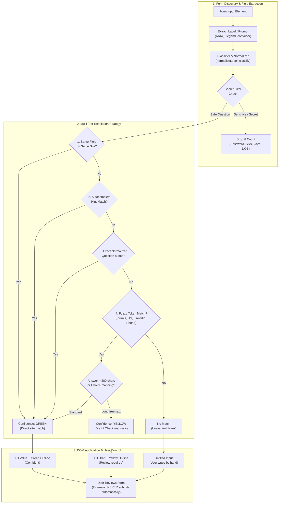
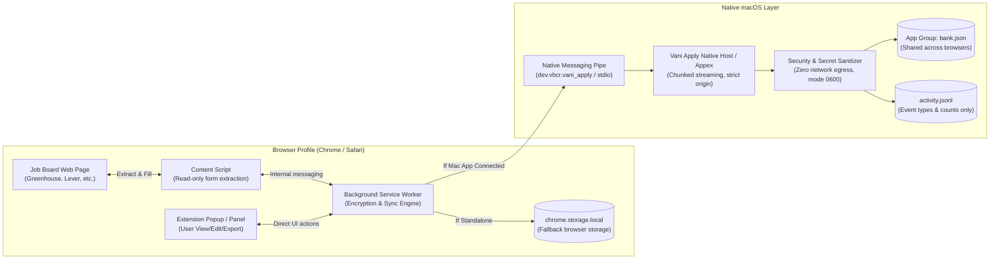

<p align="center">
  
</p>

# Vani Apply (browser extension)

Remembers your job-application answers and fills the next form. Apply once by hand. Each later
form on any common ATS fills the questions it recognises and marks what to check. **It never
submits.** You review and press Submit yourself (Vani plan §9).

## Install (Chrome or another Chromium browser)

```bash
bun run /Users/bharath/Code/apps/Vani/extension/build.ts
```

Then open `chrome://extensions`, turn on Developer mode, choose **Load unpacked**, and pick
`/Users/bharath/Code/apps/Vani/extension/dist-chrome`. The extension id is fixed by the public key
in `static/chrome-key.json` (`clhaobdmkmapebgnmpcfmakbfakmgfip`), which is the id the Mac app's
native-messaging manifest allows. `dist-safari/` is the same code with a Safari-style manifest
(background `scripts`, no `key`) for the Safari web extension in the Mac app.

## Use

1. Apply as usual. When you press Submit, or Next/Continue on a multi-step form, the answers on the
   page are saved. **Save answers** in the floating panel or the popup saves them at any time.
2. On the next application, press **Fill** (panel or popup, or Alt+Shift+F). Each filled field is
   outlined:
   - **green**: confident (the same field on the same site, the page's `autocomplete` hint, or the
     same question);
   - **yellow**: a reworded question matched fuzzily, or a long free-text answer kept as a draft.
     Check these.
   A saved answer longer than the field's character limit (`maxlength`) is never written, cut or
   otherwise: the field stays empty, outlined **yellow**, and its tooltip says how long the answer
   is and what the field allows (see Limits).
   Fields you have already typed into are left alone, unless you tick "overwrite typed values".
   Search-as-you-type fields are left alone unless you tick "type into search fields".
   Questions it hasn't seen are left blank. Answer them, and they're saved for next time.
   **Your basics** in the popup (first and last name, email, phone, city, country, LinkedIn, GitHub,
   website) fills those on the very first form: they are saved as ordinary answers, under the keys
   a form's `autocomplete` or question resolves to, and edited or deleted in the answers table like
   any other. The section opens by itself while no first name or email is saved. Below them are the
   **questions most forms ask** (`src/intents.ts`): authorized to work, visa sponsorship, relocation,
   working in person, interviewed or applied before, earliest start date, deadlines or timeline,
   how you heard, salary expectations, where you'll work from (the "address from which you plan on
   working" question), the AI-use policy and the arbitration agreement. One answer fills every wording of the
   question ("Do you require visa sponsorship?", "Will you now or in the future require
   sponsorship…?"), confidently (green), and a question you answered on a form shows in its box.
   An exact wording you answered by hand still wins over the general answer; among wordings the
   latest answer wins. A label that reads as two of them (authorized to work *without*
   sponsorship: opposite answers) fills from neither. The AI-policy and arbitration answers always
   fill yellow, to read, and arbitration stays empty until you choose "I agree" (a legal waiver is
   your call): then "I agree" takes the one acknowledgement each form offers ("I will read the
   arbitration agreement below.", "I understand and agree…"), never a refusal. With self-ID turned on, gender, Hispanic/Latino, race, veteran and disability get boxes
   too, and a saved "Decline to self-identify" takes each form's own decline option ("I don't wish to
   answer", "I do not want to answer").
   Not offered, on purpose: other legal agreements and consents, and why-this-company essays (below).
3. In the popup you can:
   - Track form readiness at a glance with the **visual coverage meter** (confident, review, new).
   - Switch between **Page & Fill**, **Your Basics**, **Saved Answers**, and **Settings & Data** tabs.
   - Add new custom answers directly with the **+ Add answer** modal.
   - Edit saved answers in an **interactive dialog** (with multiline text and review flag toggle) instead of browser prompts.
   - Filter answers by category chip (**All**, **Contact**, **Work**, **Needs Review**, **Self-ID**) and sort by recency, alphabet, or fill count.
   - Copy any saved answer to clipboard with one click.
   - Clear green/yellow field highlights once reviewed via **Clear marks**.
   - Manage site exclusions, voluntary self-ID capture, and export/import the bank as JSON.
4. On the page:
   - The floating panel is **draggable** to any comfortable position on screen.
   - Click the minimize button (`—`) to collapse it into a compact badge (`⚡ Vani • 4/6`) that never blocks form buttons, and click to restore.
   - Hover over any outlined field to see an **in-page tooltip** explaining why it matched and its confidence.
   - Generated and suggested drafts include a **Copy** button to copy drafts to clipboard directly.

### The resume for each job

Each job gets its own resume. On a job's application page, open the popup and use **Resume for
this job → Choose PDF** (at most 512 KB). The Vani Apply Mac app keeps a copy in its App Group
folder, keyed by the page's address (the reduced URL Mark Applied uses; on Workday one key per
posting, so its `/job/`, `/en-US/…/job/`, `/details/` and `/apply/…` routes share one resume), so
Chrome and Safari read the same file. A resume chosen before that, under a Workday page's old
address, is still found on that same route and moves to the new key when you choose again; one chosen
on a different route than the page you are on is not found until you choose it again. On **Fill**, the file input that reads as a resume (Resume/CV, Résumé, CV, or a
`resume` name) gets that PDF through the browser's drag-and-drop API and is outlined **yellow**,
with the file name in its tooltip: check it is the version for this job. A cover-letter,
"other attachments", transcript or portfolio box never gets it.

There is no default resume. A job with none chosen gets no file, and Fill says why: no resume
chosen for this job, the Mac app isn't reachable (the resume lives only there), the stored copy is
missing or damaged, or the page did not take the file. The PDF goes from the Mac app to the tab
being filled and nowhere else. Its name is never written to the activity log.

When Fill leaves the resume box empty because none is chosen, a bar (bottom left) offers
**Build and attach**, **Choose PDF…** or **Not now**. Nothing happens without a click.
- **Build and attach** first asks Vani whether it tracks this posting. A tracked posting is built
  as the next saved version of that job's resume (`vani jobs resume build`, then `use`: the same
  builder the Mac app's Resume Studio uses), and the bar names the version. Any other page is built
  from the page's own text by the stateless `vani resume` and is not saved as a version; the bar
  says so, and says when Vani could not be asked. Either way the agent runs `vani`, which builds the resume with
  rkb, your resume tool, in your own template: the base selection (`kb.base_selection`) with the
  bullets that suit this posting, two pages, every bullet one that passed `kbsync.Eligible` and
  whose figures rkb has double-verified. DevPrism builds nothing. When the model can be asked
  (a configured provider, today's budget left) it chooses the bullets; otherwise, or when its
  answer is refused, the base selection is built as you wrote it. The header is the base
  selection's own, from rkb's bank: "Your basics" is neither needed nor sent. An untracked page
  must publish its job description (JSON-LD, as Greenhouse, Lever and Ashby do); a tracked
  one uses the text Vani already holds. Vani's config must
  name `kb.bank`, `kb.rkb`, `kb.selections` and `kb.base_selection` (docs/RUNTIME.md, "Building
  a resume"), and Chrome and poppler must be installed; without them the bar shows Vani's
  reason. Open the PDF before you submit.
- **Choose PDF…** opens a file picker for a PDF you already have.

Either way the PDF is saved for this job, as if chosen in the popup, and attached now, outlined
yellow. The next Fill on this job attaches it without asking.

### Live help for new questions

Click the panel's status line to list the questions on the page that have no saved answer. For
each one:

- **Use: …** buttons offer your saved answers to *similar* questions, which are too different to
  fill automatically. One click fills that answer, outlined yellow. No model is involved, and
  nothing leaves the browser.
- **Suggest** (panel button, with the Vani Apply Mac app and its agent running) handles the whole
  page in one click. It sends the new free-text questions (labels and field type only, never a
  value or a saved answer) and the posting to `vani suggest`:
  - The decision model (the configured OpenRouter model, then Claude) sorts each question as an
    essay, a fact about you, work authorization, an agreement, self-identification or other.
  - Claude, through Manvi, drafts the essays, at most three per page. Each draft is inserted
    yellow, for review, into a field that is still empty.
  - Every other question is listed with the reason it is left to you.
  - Visa/sponsorship, consent and self-identification labels are pinned by a fixed rule, so no
    model is ever asked about them.
  - Choice questions (selects, radios) are never sent. They come from your saved answers only.
  - It runs as a job in the Vani Apply agent: the extension starts it, then polls every 2 s for up
    to about 6 minutes. This works the same in Safari and Chrome.
- **Draft** (free-text fields, with the Vani Apply Mac app installed) asks the Mac app to
  draft an answer from the job description on the page. The request carries only the question
  label and the posting (company, title, description), never your saved answers or what you
  typed. The draft appears in the panel to edit. **Insert for review** puts it in the field,
  outlined yellow. It never overwrites text you typed unless you click again to confirm, and only
  one draft runs at a time. A kept draft is saved for review, so it is never filled as a confident
  answer later, however short it is. In Safari, the draft runs as a job in the Vani Apply agent,
  because Safari's sandboxed extension cannot start `vani` itself.
  Failures say why: the budget is spent, the Mac app isn't reachable, no key is configured, or the
  draft timed out.

### The relevance badge: Vani's row or an estimate

The score pill on a job page is one of two different numbers, and its label says which.

- **Relevance (Vani's row).** When the page's posting is in Vani's ledger, the extension asks the
  Mac app for Vani's own jobs row (`jobRow`, `src/jobrow.ts`; one answer is kept for a minute per
  URL). The pill then shows the row's age-free relevance and fit, with the priority in the label
  (for example "Strong fit (priority 62)"). This is the number the Jobs tab and the digest rank by.
- **Estimate.** A posting Vani has not read (not in the ledger, no Mac app, or a `vani` too old to
  answer) is scored in the page from its text against your bank's target profile
  (`src/relevance.ts`, a heuristic that falls back to a generic profile). It is labelled "Estimate"
  and is not the ranking: it can differ from the row Vani gives the same posting once it has read
  it. A row Vani has but cannot be read says why next to the estimate instead of passing the estimate
  off as Vani's.

### Crawling a whole listing into Vani

In the scrape drawer, **Crawl all pages → Vani** reads every page of the listing you are on, not
just the one on screen, and sends the jobs to Vani the way **Save to Vani** does (`ingestJobs`,
batches of at most 200; `src/crawlrun.ts`, `src/crawler.ts`). Progress shows under the button,
**Stop** ends the crawl and sends nothing, and the last line says what was read, what was left out
and what Vani answered.

- **Workday boards** are read through the board's own listing API, same-origin from the page, so
  no host permission is added. Both hosts are read: `{tenant}.wd{N}.myworkdayjobs.com/{site}` and
  the shared `wd{N}.myworkdaysite.com/recruiting/{tenant}/{site}`, whose tenant is the path's
  (the same board `vani jobs ingest` derives from the page). That API serves at most 2000 rows of one query and then serves page
  1 again, so a bigger board is split by one of its own facets. Vani analyses the description it
  is sent and fetches none, so the crawl reads the descriptions of the 200 most relevant jobs
  (ranked against your bank's target profile). Each description is trimmed to the 4000-byte ingest
  bound, starting where the role is described. The jobs it did not fetch are counted, not sent.
- **Other listings** are walked through their own "Next" or "Load more" control. A `rel=next` or
  next link is fetched and parsed only when it stays on the same listing: the same origin and path,
  and the same query apart from paging parameters. Anything else is reported and not followed. The
  tab never navigates.
- **Bounds:** 600 requests, 3 in flight, a 250 ms pause before each, 15 s per request, a 4 MiB
  body, 15 minutes per Workday crawl, 50 pages or 2000 jobs per page walk. Eight descriptions
  failing in a row end the description phase. The crawl reports itself complete only when the
  board's own count (two of its facets agreeing) was reached and nothing was left out.
- **Batches** close at 200 jobs or 800 KiB, whichever comes first. The size is counted the way the
  Mac host measures its 1 MiB bound, with every `/` escaped. A live 200-job NVIDIA batch was 749 KB.
- **Saving the search:** a Workday board with more than 5,000 jobs is not saved as a daily search,
  because the daemon's Workday adapter (`workday.MaxPostings` for a board with no `max_postings`)
  refuses a board that size on every run. The status line says so. Narrow the board with a search
  or filter, then crawl again to save it.
- **Checked, and not checked.**
  - Checked: the crawl code against NVIDIA's live board (2753 of 2753 jobs listed, descriptions
    read), the same-origin listing and detail requests from inside the real careers page, and
    `bun test`.
  - Loaded in a real Chrome: the drawer button, progress, Stop, an NVIDIA crawl and a Greenhouse
    pager all reached the native host. An app whose bundled `vani` predates `jobs ingest` refuses
    the batch; a current `vani` queued it.
  - **Not checked:** saving a daily search from the extension.

### Marking a job Applied

When you press **Submit** (or **Send application**) on a page that is one of the postings Vani
tracks, the extension offers to mark it Applied in the Vani Apply Jobs tab: a small bar at the top
right asks "Did your application go through? Mark … as Applied in Vani?" with **Mark Applied** and
**Not now**. **It never marks without that click.**

- Only a final Submit counts. Next, Continue, Save, Review, "Review and submit" and Apply do not.
- The page is matched on scheme, host and path against each posting's link and apply link
  (`vani jobs find`). The query and fragment are dropped in the browser before anything is sent,
  so tokens in them never reach the Mac app, except the few parameters that name a job (`gh_jid`,
  `jid`, `job_id`, `jobid`, `req_id`, with a plain identifier as the value): Greenhouse boards on
  a company's own careers page tell postings apart by `gh_jid`. A Greenhouse embedded form
  (`boards.greenhouse.io/embed/job_app?for=…&token=…`) is the posting it embeds, and
  `job-boards.greenhouse.io` is the same site as `boards.greenhouse.io`. When no link matches
  exactly, an application sub-page (`…/apply`, `…/application`, Workday's `…/apply/applyManually`)
  is matched to the posting it belongs to. A page that two postings share is not guessed at and
  gets no offer; neither does a job already marked Applied.
- Many boards load a confirmation page after Submit. The question follows you there: the background
  worker keeps it for the tab for 10 minutes in `chrome.storage.session` (so a stopped worker still
  has it; where that API is missing it is held in memory only), and the toolbar button shows "✓?"
  on that tab. If the confirmation page is on a host the extension does not run on, the bar
  does not appear; open the popup instead.
- **The popup does the same on any site.** Opening it on a page Vani tracks (the popup may read the
  active tab's address) shows "Tracked job on this page: … Mark Applied / Not now", whether or not a
  content script runs there. That is also the way in on a company careers page the extension does not
  watch for Submit. Opening the popup sends the page's address, reduced as above, to the Mac app
  (local, not logged).
- Chrome through the native host, and Safari through the Vani Apply agent (the same `jobFind` and
  `jobMark` ops over XPC, since Safari's sandboxed extension cannot start `vani`). Unreachable app,
  untracked page: the extension stays silent.
- A form inside a frame (a Greenhouse embed on a company page) asks the top frame to show the
  question, and shows it inside the frame only if the top frame has no content script. The frame's
  own address is tried first, then the tab's, where the browser gives it.
- Submit is detected from the click on a button labelled Submit / Send application, which also
  covers Enter in a field and keyboard activation (the browser clicks the button). A form submitted
  by script with no such button gives no offer.

It runs automatically on Greenhouse, Lever, Ashby, Workday, SmartRecruiters, Workable, iCIMS,
BambooHR and Jobvite pages. On any other site, open the popup: it runs on that page for that click
only (`activeTab`).

## How a second form gets faster



Each answer is keyed by the normalized question. Wording variants accumulate on the answer, and
stable ATS field names (e.g. `first_name`) are remembered per site. Matching tries these in order:
1. the same field on the same site;
2. the `autocomplete` meaning (given-name, email, tel…);
3. the same question;
4. a fuzzy token match that folds required markers, plurals, "LinkedIn URL"/"LinkedIn profile",
   "the US"/"United States" and "mobile"/"phone".

Choices map across option wordings ("No" → "No, I will not"). A choice with no matching option is
left alone. Free-text answers over 280 characters are filled only as drafts, because they're usually
job-specific.

## Privacy and security (impact statement)



- **Storage:** when the Vani Apply Mac app is installed and connected (native messaging host
  `dev.vbcr.vani_apply`), it holds the answers in one local file shared by Chrome and Safari. The
  popup says "Stored by the Vani Apply Mac app". Otherwise answers stay in `chrome.storage.local`
  in this browser profile ("Stored in this browser only"). The first time the app answers, any
  answers still in the browser are merged into the app's bank (the newer answer per question
  wins) and then removed from the browser; if that fails or the browser copy is unreadable it is
  left in place. If the app answers with an error, the extension reports it rather than
  silently writing to the browser, which would split the bank. Large banks are streamed
  in 500 KB chunks so Chrome's 1 MB native-messaging reply limit is never exceeded.
  Nothing is sent over the network: the extension has no host permission for any server
  and makes no network requests. The only new channel is the local native-messaging pipe to the
  Mac app, whose activity log receives event names, the page hostname and counts, never answers
  or labels. Disk protection is the OS's (FileVault). Other extensions cannot read this storage.
- **Native port (Chrome):** bank ops share one `connectNative` port (`src/nativeport.ts`) instead of
  launching the host per message. The host is one serial loop, so replies arrive in request order
  and are matched by position (no request ids; the protocol is unchanged). Up to 4 calls are in
  flight and 64 pending in all; a call that times out (5 s) or a lost connection closes the port and
  rejects everything pending, since a late reply would be matched to the wrong call, and the next
  call reconnects. Only read-only ops (`ping`, `get`, `getChunk`, `resumeGet`, `resumeInfo`) are
  retried once, and only after a disconnect. Ops that can take seconds
  (`draft`, `jobFind`, `jobMark`, `jobsIngest`) and any unknown op still use one process per message,
  as do all calls while the port is backing off after failed connections (1 s doubling to 30 s).
  Safari, and a Chrome without `connectNative`, keep the per-message path.
- **Never stored or filled:** password fields; card, CVV and expiry fields; SSN, tax-id, passport and
  driver's-licence fields; bank, routing and IBAN fields; date of birth; security questions; one-time
  codes; captchas. Recognition uses input type, `autocomplete` and label words. An import cannot
  bring them in either: they are dropped and counted.
- **Opt-in:** voluntary self-identification (gender, race/ethnicity, veteran, disability,
  orientation) is saved and filled only if you turn it on in the popup. It's shown masked in the
  list.
- **Never touched:** file uploads (attach your resume yourself), and the Submit button.
- **Permissions:** `storage`, `activeTab`, `scripting` (to run on a non-ATS page when you ask) and
  `nativeMessaging` (to talk to the Vani Apply Mac app only), plus content-script access to the ATS
  hosts above. Only the background script and popup call the native host, never page content
  scripts.

## Limits

- Widgets: native controls, ARIA combobox / listbox / radio / checkbox / switch, button dropdowns
  (`aria-haspopup=listbox`) and contenteditable editors are read, and filled by opening the widget,
  clicking the option that matches the saved answer and checking the widget shows it. A widget that
  does not open or does not show the choice is reported "manual", never "filled".
  - Multi-select (`<select multiple>`, a listbox or combobox that is `aria-multiselectable`, a
    react-select / MUI style chip picker): every selected value is read and saved as one answer.
    Filling clicks each saved value's existing option (each through the same option matching as any
    choice) and checks the chip or selection appears. It only adds: chips already there are kept and
    none is removed, and "overwrite typed values" on a `<select multiple>` makes the selection
    exactly the saved one. A saved value with no option is skipped and the field is outlined yellow.
    A picker with no option list to click (a free-text tag box) stays "manual". A chip box whose
    input has no `combobox` role is read as a plain text field, so its chips are not read (reading
    them would mean inspecting the surroundings of every text input on every scan).
  - Search-as-you-type fields (a list that appears only after typing): typing into them can make
    the site send its own search request, so Fill types into one only when "type into search fields"
    is ticked in the popup. Off, the field is reported "manual" and untouched. On, it types the saved
    answer once, picks the option, and clears the text again if nothing matched (at most one typed
    query and one clear).
  - Dates: `<input type=date|month>` get the saved date as ISO (`YYYY-MM-DD` / `YYYY-MM`, from
    ISO or US-order text) through the native setter plus input and change events, and are read back;
    a month with no day is never guessed onto a date input. `type=week`, read-only inputs that open a
    picker and `aria-haspopup=dialog|grid` pickers stay "manual". ARIA date-grid pickers are not
    driven: libraries label their day cells differently and nothing here could be checked against a
    real one, so a guessed click could fill the wrong day.
  - Only open shadow roots and same-origin iframes are entered. A cross-origin iframe on a host the
    manifest does not match (a company page embedding an unlisted ATS) is entered only when you open
    the popup on that page (it then injects into every frame, which `activeTab` is meant to cover; not
    tried against a live cross-origin frame). Scan, Fill and Save from the popup (and the Fill
    shortcut) ask each frame that runs Vani on its own and add the answers up, so a form inside a
    frame is counted even when the top frame has no fields; the scan shows a per-frame list. Each
    frame's content script tells the background worker it is there when it starts (kept per tab in
    `chrome.storage.session`, memory only where that is missing), because the popup cannot list a
    cross-origin frame it may not script: Chrome lists only the page activeTab grants, not a
    Greenhouse iframe the manifest runs in (checked in Chrome 155, `test/live.ts`). A frame that
    errors or gives no answer within 20 s is reported as not answering and its fields are not
    counted; a listed frame that has since gone away is skipped.
- Character limits: a browser holds `maxlength` against typing only, so a script's `.value =` can
  write past it, and some ATSs (Greenhouse noted) then drop or cut the answer on submit without a
  word. Fill therefore compares the answer with the field's limit when it fills (an `<input>` of a
  type `maxlength` applies to, or a `<textarea>`; read live, so a limit the page changes after
  render counts) and, when the answer is longer, writes nothing: the outcome is `too_long`, the field
  is outlined yellow, and its tooltip and the Fill message say "The answer is N characters and this
  field allows M. Vani left it empty rather than cut it: shorten it by hand here, or edit the saved
  answer." The saved answer is never changed. Length is counted in UTF-16 code units as the browser
  counts it (an emoji is 2, a letter plus a combining mark is 2), with a textarea's line break as 1 and
  a single-line input's dropped. The same rule covers an inserted draft and the pieces of a split
  date or phone (those are left for review or unfilled, not cut). A contenteditable has no limit.
  Text you already typed is still left alone. The pre-submit audit also lists every field whose
  current value is over its limit ("holds N characters but allows M"), whoever wrote it, and changes
  nothing. Not covered: the query Fill types into a search-as-you-type box when you tick "type into
  search fields" (it is cleared again), and a limit the site enforces only on its server.
- Repeated sections (work history, education): the 2nd, 3rd... occurrence of a question is saved as
  "<question> (vani section n)" and filled from the same entry number; entry 1 keeps its plain key.
  The marker is namespaced so a genuine label ending in "section 2" is not read as entry 2. Keys
  saved by earlier versions ("<question> section n") are still read: they match entry n exactly
  (just below a key saved with the new marker) and as wording variants, and are never rewritten or
  deleted. One case cannot be told apart: an old key that really was a question ending in
  "section n" is also treated as entry n of the shorter question for fuzzy matching only. An entry
  with no saved counterpart is left blank. Dates split into month/day/year and phone numbers
  split into country code + number are one saved answer each; a bare `+15550100` is split only
  when it is unambiguous.
- Capture does not need the Submit click: committed values (change / focus-out / choosing an
  option) are held for the page and saved on submit, Next/Continue/Save, Enter, a route change,
  pagehide and the tab being hidden. Saving the same page twice changes nothing: the page keeps
  what each field last sent, so the same value for the same field is not sent again even if the
  saved answers have not caught up (a refused save is not remembered, so it is retried). Only a
  page that has shown at least 3 questions is saved on its own; on a smaller page (a search page
  the popup ran Vani on) only **Save answers** saves, so a search query pressed with Enter is never
  kept as an answer.
- Why-this-company questions ("Why Anthropic?", "Why do you want to work here?", "What excites you
  about this role?") are never filled from saved answers, even word for word: such an answer is
  written for one posting, and every Greenhouse company shares one host, so a saved one cannot tell
  which company it was for. Fill lists them as new questions, for **Draft** or **Suggest** to write
  from the posting on the page; the panel's "Use: …" buttons still offer an earlier answer on a click.
- Not questions, so never read, saved or filled: search boxes (`type=search`, `role=searchbox`,
  anything inside `role=search` or `<search>`), and a text box hidden from assistive technology and
  out of the tab order (`aria-hidden=true`, negative `tabindex`). React-Select keeps one beside each
  required dropdown on job-boards.greenhouse.io until a value is chosen; counting it doubled every
  dropdown. A hidden select, checkbox or radio is still read: custom widgets keep their value there.
- A choice is matched with a trailing dialling code set aside: "United States" picks
  job-boards.greenhouse.io's "United States +1", and an answer saved as "United States +1" fills a
  plain "United States". That Country box shows only "+1" once a country is chosen, so a bare
  dialling code never replaces a saved answer that names more, and is saved at all only for a
  question about a code or a phone (a "Country code" question); a "Country" that reads "+1" saves
  nothing. When Fill chooses a country there and the box then shows only "+1", which several
  countries share, it checks the flag beside it: the chosen option's flag is a confident fill, a
  different flag is not a fill, and a box with no flag is filled yellow, to check.
- Matching a full form against a full bank (2,000 answers, 25 fields) took about 260 ms per
  rescan before the question reading and saved-wording tokens were cached, and about 9 ms after
  (min of 7, `bun`, Apple silicon; the timing script is not committed). Both caches are bounded
  (8,192 entries) and cleared when full.
- Coverage: the panel and popup show, for the page, fields found / ready / new / manual / skipped,
  and list the questions with no saved answer. A scan reads at most 500 fields and 40,000 nodes;
  when it stops early the report says how many controls it did not read.
- Not verified against live sites (none were visited): Workday's real markup for button dropdowns
  and date parts, and `pagehide` delivery from a content script, were built from the public
  patterns and a fixture page only.
- Labels come from ARIA, `<label>`, fieldset legends and question containers. A form with no
  readable label for a field falls back to the field's name.
- Connected to Vani only for drafts, Suggest and marking a job Applied (above): no Greenhouse
  question-schema prefetch, and no application packet from the digest (plan §9).

## Develop

```bash
bun test --cwd /Users/bharath/Code/apps/Vani/extension       # core: normalize, classify, bank, match
bun run /Users/bharath/Code/apps/Vani/extension/build.ts     # dist-chrome/, dist-safari/, dist-test/
bun run /Users/bharath/Code/apps/Vani/extension/test/serve.ts  # then open http://127.0.0.1:4789/test/dom.html
```

```bash
bun run /Users/bharath/Code/apps/Vani/extension/test/live.ts  # real Chrome, headless, throwaway profile
```

`test/live.ts` loads the built extension into a headless Chrome (over the DevTools pipe; no
dependency) with a throwaway profile, and checks what the fake `chrome` in `bun test` cannot:
Save, Fill and Scan count a form in a cross-origin Greenhouse iframe on a company page; with a
content script in both frames both are asked; a removed frame is skipped; the frame list survives
the worker being stopped; the import input takes the same file again; and `test/dom.html` passes.
Its copy of the extension has no `key` and no `nativeMessaging`, so it never reaches the Mac app
or your saved answers, and a host permission for `http://127.0.0.1` stands in for the activeTab
grant the popup gets (automation cannot grant activeTab). It needs Google Chrome (or `--chrome
PATH`) and `openssl`.

`test/dom.html` runs the DOM tests in a real browser. It captures a hand-filled Greenhouse-style
form, then fills a reworded Lever-style form, and checks what must and must not be filled. The page
title reads `PASS n/n`.

### Type-check gate

`bun test` does not type-check. The gate is one command, run from `extension/`:

```bash
sh scripts/typecheck.sh        # or: bun run typecheck
```

It runs `bun install --frozen-lockfile` (the compiler is `typescript`, an exact-pinned devDependency
in `package.json`, locked in `bun.lock`; `node_modules/` is git-ignored and never shipped, since
`build.ts` bundles `src/` and copies `static/` only), then the installed
`./node_modules/.bin/tsc -p tsconfig.json --noEmit` against `src/` (`src/chrome.d.ts` declares the
Chrome API surface used). Before it runs, `tsc --version` must name exactly the version pinned in
`package.json`. A missing, empty or foreign compiler exits non-zero and says to run the install step; the
script never prints `typecheck: ok` unless the pinned `tsc` ran and exited zero, and it has no
environment overrides (its tests run a copy in a scratch directory with a stub `bun`). It never uses `bunx` or `npx`,
which download a missing package. Bumping the compiler is a reviewed change to `package.json` and
`bun.lock`.

`bun test` also covers the store (fake native host and fake `chrome.storage`) and replays
`test/vectors/classify.json`, the classifier vectors shared with the Mac app's Swift tests; do not
edit that file by hand.

Also under `bun test`:

- `test/bankindex.test.ts`: the indexed `matchField` equals the old full scan of the bank (seeded
  random banks, a 2000-answer bank), and one bank is indexed once.
- `test/fillwait.test.ts`: fill waits on the page, not a clock (a fake DOM and MutationObserver):
  `waitFor` resolves on the first mutation batch, gives up at its ceiling, releases every observer
  and timer on every exit (also when the condition throws), and observes each root it is given (up
  to 64), so a change inside an open shadow root is seen.
- `test/bankcache.test.ts`: the bank memo (`createBankMemo`): reads inside the freshness window share
  one request, `invalidate` and writes in flight, failures, and a clock that goes backwards.
- `test/rounds.test.ts`: fill rounds (a state list that appears after the country is filled in
  round 2; the 3-round and 6 s limits; a field the user cleared is not refilled), `carryMatches`,
  and `waitForQuiet` / `observeRoots` over the document and open shadow roots, with every observer
  disconnected after quiet, after the cap and after a failure.
- `test/concept.test.ts`: one concept, one bank row (`conceptKey`, `findOwner`, `mergeCapture`,
  `pendingDiff`), the label cap, intent sync and lookup cost, replaying `test/vectors/concept.json`, which is shared with
  the Mac app's Swift `ConceptKeyTests`; do not edit that file by hand.

`test/dom.html` includes real open-shadow-root cases (`shadow+frames`, and a dependent field that
appears inside a shadow root mid-fill). Its fill-waits check, run by `test/live.ts`, measures how
soon the fill acts after the widget renders its options (under 150 ms), not the total time:
headless Chrome throttles page timers by hundreds of ms, and by a different amount per timer.
