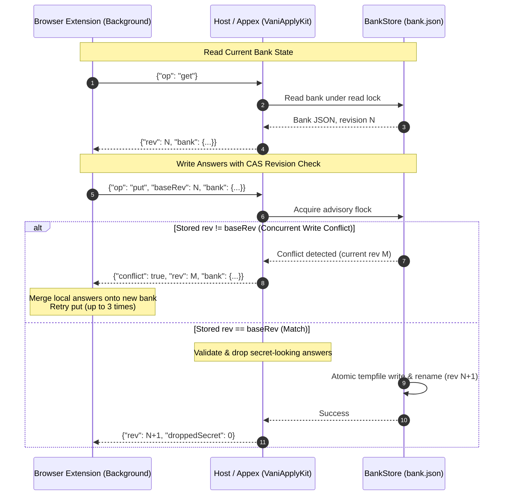

<p align="center">
  
</p>

# Vani Apply for macOS

A Mac app that holds the Vani Apply answer bank for both Chrome and Safari, and gives you control over
it: view, add, edit and delete answers, turn self-identification on or off, turn the extension off per
site, import and export, and see what each browser saved and filled.

Its **Jobs** tab browses the roles Vani retrieved (New, Saved, Applied, Hidden, All), with the picked
"Fits / Gap / Check" note, triage readings and the job description, and lets you Save (⌘S), mark
Applied (⇧⌘A), Hide (⌘⌫) and keep a private note per role. It is a client of `vani jobs … --json`
(cmd/vani/jobscmd.go) run from `Contents/Helpers/vani` with the Vani config and state folder set in
Settings › Vani. Vani reads its ledger without taking the run's lock, so Jobs works while a run is
going. A role's detail shows **Why it ranks here**: the components of the priority `vani jobs` reports
(`score_factors`; an absent signal reads "not known", never 0) and the posting lines that matched your
résumé roles best (`semantic.evidence`). Both are display only, decoded leniently, and absent from an older
`vani`. Settings › Vani sets the freshness half-life (`--half-life`, sent only when it is not Vani's 10 days).
Its **Pipeline** tab shows `vani status --json` and has **Run Now…** (⇧⌘R), which starts
`vani run-once` with options for that run only: every board or the ones you pick from the watchlist,
whether to triage, score and explain (and a cap in place of `advance_per_run`), and whether to write a
digest. The last choices are remembered. The run gets the keys drafting gets, writes its output to
`<state>/runs/manual.log` (Show Log), and the tab re-reads the status every 3 s while it goes.
**Stop** sends the run this app started SIGTERM, which vani records as cancelled; a run the daemon
or a shell started is shown but never signalled. A run vani refuses before it starts (another run
holds the ledger) shows vani's reason from the log. The run is a separate process, so quitting the
app does not stop it; the next launch shows it from the run record, without Stop.
While the daemon runs (status's `daemon.running`), the daemon holds the ledger and run-once would be
refused, so Run Now calls `vani run-request --json` with the same options instead: the daemon makes
the run with its own keys (none are read here) and its own log. The tab shows "Waiting for the daemon
to pick up your run" while `run_request` is pending, then follows the run record like any other run;
Stop is not offered, since the run is the daemon's. A request the daemon drops without a run (stale
after an hour, or unreadable), or one still waiting when the daemon stops, is reported in the error
banner. Both facets decode leniently and are absent from an older `vani`, which keeps the run-once path.
The app keeps its request's time only in memory: after a relaunch a pending request still blocks
Run Now ("A run request is already waiting") and its run shows from the record once the daemon
makes it, but a request the daemon then drops is not reported.
Your marks and notes live in `<state>/marks/marks.jsonl`, never in the ledger, and nothing
in the pipeline reads them, so a note never reaches a model. Hiding a role only removes it from
New; the daily digest does not read marks yet.

```mermaid
flowchart TD
    subgraph BrowserLayer["Browsers & Extensions"]
        CR["Chrome Extension (MV3)\nclhaobdmkmapebgnmpcfmakbfakmgfip"]
        SF["Safari Web Extension\n(dist-safari)"]
    end

    subgraph NativeHosts["Native Entry Points"]
        HOST["vani-apply-host\n(dev.vbcr.vani_apply\nin Contents/Helpers)"]
        APPEX["Safari App Extension\n(VaniApplyExtension.appex\nin Contents/PlugIns)"]
    end

    subgraph AppBundle["Vani Apply.app"]
        UI["SwiftUI UI (VaniApply)\nJobs, Pipeline, Answers, Browsers, Activity, Settings"]
        KIT["VaniApplyKit Framework"]
        VAL["BankValidator & Sanitizer\n(Drops secret-looking answers)"]
        STORE["BankStore (CAS Store)\nAdvisory Lock (flock) + Atomic Temp-Rename"]
    end

    subgraph AppGroup["Shared App Group Container (HAUHVD8M37.dev.vbcr.vani)"]
        BANK[("apply/bank.json\n(Mode 0600)")]
        ACT[("apply/activity.jsonl\n(Event, host, counts; no answer text)")]
    end

    CR -->|Chrome Native Messaging (stdio)| HOST
    SF -->|sendNativeMessage (NSExtensionMain)| APPEX
    HOST --> KIT
    APPEX --> KIT
    UI --> KIT
    KIT --> VAL --> STORE
    STORE -->|flock + write + rename| BANK
    STORE -->|append event| ACT
```

```
Chrome extension ──native messaging──▶ vani-apply-host ─┐
Safari extension ──sendNativeMessage─▶ Safari appex ────┼─▶ bank.json in the App Group container
Vani Apply.app (SwiftUI) ───────────────────────────────┘     (+ activity.jsonl, no answer text)
```

- **[`VaniApplyKit`](Sources/VaniApplyKit)** (library): bank model, validation (a port of the extension's `parseBank`, including
  dropping secret-looking answers), and [`BankStore`](Sources/VaniApplyKit/BankStore.swift), a revisioned compare-and-swap store under an
  advisory lock with atomic writes. It also holds the native protocol, Chrome framing, the Chrome
  connector and the app's editing rules.
- **[`vani-apply-host`](Sources/vani-apply-host)**: the Chrome native messaging host (`dev.vbcr.vani_apply`), in
  `Contents/Helpers`.
- **[`VaniApplyExtension`](Sources/VaniApplyExtension)**: the Safari web extension's native app extension (sandboxed appex, entry
  point `NSExtensionMain`), in `Contents/PlugIns`. Its resources are `extension/dist-safari`.
- **[`VaniApply`](Sources/VaniApply)**: the control app.

There is no Xcode project. SwiftPM builds the binaries and [`scripts/bundle.sh`](scripts/bundle.sh) assembles and signs the
bundle.

## Protocol



The extension's background script sends JSON requests. The Chrome host and the Safari appex answer
them identically:

| Request | Reply |
| --- | --- |
| `{"op":"ping"}` | `{"ok":true,"protocol":1,"rev":N}` |
| `{"op":"get"}` | `{"rev":N,"bank":{…}}` |
| `{"op":"put","baseRev":N,"bank":{…}}` | `{"rev":N+1,"droppedSecret":K}`, or `{"conflict":true,"rev":M,"bank":{…}}` |
| `{"op":"log","entry":{"event":…,"host"?:…,"counts"?:{…}}}` | `{"ok":true}` |
| anything refused | `{"error":"…"}` |

Merging stays in the extension, so there is one implementation. On a conflict it re-applies its change
to the returned bank, up to 3 times.
- **Streaming:** replies over 750 KB are streamed in chunks (`getChunk`) to stay under
  Chrome's 1 MB native-messaging reply limit, removing any 900 KB bank cap.
- **Classifier parity:** `normalizeLabel` and `classify` exist in TypeScript and Swift. Both are held
  to `extension/test/vectors/classify.json`, which is generated from the TS code by
  `build/macos-gen/gen-vectors.ts`.

## Build

```bash
swift test --package-path /Users/bharath/Code/apps/Vani/macos
/Users/bharath/Code/apps/Vani/macos/scripts/bundle.sh
```

`bundle.sh` writes `macos/build/Vani Apply.app` and installs nothing.
- **Signing:** it signs inside-out with the Apple Development identity (team `HAUHVD8M37`, hardened
  runtime). Override the identity with `VANI_SIGN_IDENTITY`.
- **App Group:** `HAUHVD8M37.dev.vbcr.vani` is Team-ID-prefixed, so macOS 15+ grants the container
  without a provisioning profile.
- **The Chrome extension's id** is fixed by the public key in `extension/static/chrome-key.json`:
  `clhaobdmkmapebgnmpcfmakbfakmgfip`. No private key is kept, because an unpacked extension needs only
  the public one.
- **Fixture bundles are real bundles.** With `VANI_CLI_BINARY` pointing at a fixture script, `bundle.sh`
  still builds a bundle with the real bundle id and the real agent plist; only `Contents/Helpers/vani` is
  the fixture. The login agent (`dev.vbcr.vani.apply.agent`) is one per user, and the last copy to
  register it owns it, so launching such a bundle makes Safari and Chrome drafts and job marks run the
  fixture.
- **Rigs launch with `-VaniApplyNoAgent YES`.** A screenshot or fixture rig opens its copy with
  `open -n "<rig>/Vani Apply.app" --args -VaniApplyNoAgent YES`. That copy never registers the agent
  (Register again is refused too), and Settings says the agent was left alone on purpose. Only YES, TRUE
  or 1 opts out; a missing, empty or unknown value, or a near miss such as `-VaniApplyNoAgent=YES`,
  registers as usual and prints why on stderr. It is a launch argument only, never a `defaults` key: a
  rig shares the owner's bundle id, so a stored default would stop the owner's app from registering.
  Parsed by [`AgentLaunch`](Sources/VaniApplyKit/AgentLaunch.swift).

## Use

1. **Install.** Move `Vani Apply.app` to `/Applications` (or `~/Applications`) and open it once.
   macOS registers the Safari extension when the app is first opened.
2. **Safari.**
   - Open Safari ▸ Settings ▸ Extensions and turn on Vani Apply. Allow it on job sites.
   - A development-signed build may also need Safari ▸ Settings ▸ Developer ▸ "Allow unsigned
     extensions". Safari turns this off again each time it quits.
3. **Chrome.**
   - In `chrome://extensions`, turn on Developer mode, choose **Load unpacked**, and pick the folder
     that the app's Browsers ▸ Show Extension Folder opens.
   - Check that the id Chrome shows is `clhaobdmkmapebgnmpcfmakbfakmgfip`, then click **Connect**.
   - Until then the extension keeps answers inside Chrome. On first contact it moves them into the
     Mac app's bank.
4. **Moving the app.** If you move the app, its Chrome row reads "Needs reconnecting". Click Reconnect.
5. **Claude drafting.**
   - Answers ▸ Draft with Claude drafts a long free-text answer, such as "why this company", from
     the question, the pasted posting, and the knowledge-base bullets that best match them.
   - It runs the bundled `vani draft`, using the model and daily cap in Vani's config
     (`llm.model`, `decide.daily_usd.llm`). That cap is shared with the daily listings run.
   - Set the config and state paths in Settings ▸ Claude drafting. Empty means Vani's default
     folder.
   - Settings ▸ What you care about edits `motivation_notes` in that config through
     `vani config motivation`, so Vani checks it and rewrites the config file whole (as
     `vani track use` does: keys in Vani's order, deprecated names replaced). "Why <company>?" drafts use the note;
     it reaches the model, so it must not name you or say where you live or your work status.
   - A saved draft is always marked for review, so forms fill it yellow.
   - The Chrome extension can ask for a draft through the native host (op `draft`). Safari's
     sandboxed appex cannot start `vani`, so it answers `unsupported` to that op. Instead, both
     browsers run drafts and page-wide suggestions as jobs in the agent (below).
6. **The Vani Apply agent.**
   - A login item that the app registers with `SMAppService` each time it opens. Approve it in
     System Settings ▸ General ▸ Login Items; Settings ▸ Browser suggestions shows its state.
   - launchd starts it on demand when a browser connects to its Mach service,
     `HAUHVD8M37.dev.vbcr.vani.agent`. The name is prefixed by the App Group id, which is what lets
     the sandboxed appex look it up. The agent exits after 5 idle minutes.
   - It runs one job at a time: `vani draft` or `vani suggest`, with the same Keychain key, config
     and minimal environment as drafting.
   - Browsers call `jobStart`, then poll `jobResult`. A result nobody fetches is dropped after
     10 minutes.
   - It accepts XPC connections only from code signed by team `HAUHVD8M37`, so another process
     running as you cannot spend your model budget through it.
7. **Run notifications.**
   - While the app runs, with or without its window open, it announces each finished daily run once
     as a Vani Apply notification. Clicking one opens the app on the Jobs tab, and reopens the
     window if it was closed.
   - Closing the window does not quit the app: it keeps the notifier lock and keeps announcing.
     The Dock icon or a notification click brings the window back. Quit (Command-Q) hands notices
     back to the daemon.
   - It reads the run from `vani status --json` (`last_run`), the same read the Pipeline tab makes
     every 60 seconds. It never reads Vani's state folder itself.
   - The app asks for notification permission at first launch, and only while you have not
     answered. Change the answer later in System Settings ▸ Notifications ▸ Vani Apply.
   - The wording is the daemon's fixed vocabulary (`cmd/vani/runnotice.go`). A run that ended
     `ok` and digested roles posts **Vani digest**: "N roles to review", plus how many postings
     could not be read or scored. A `failed` run's notice follows `failureNotice`'s order:
     `last_run.cause` `ledger_fatal` posts **Vani stopped**, and `digest_held_back` posts **Vani
     digest held back**. Otherwise the stop reason decides (`unread_streak`/`none_read`,
     `fail_streak`/`none_advanced`) and then the stage `pipeline`, both as **Vani run failed**.
     After those, `config_stale` posts **Vani config not reloaded**, and anything else gets "The
     digest could not be finished." The daemon sets `cause` from the error's identity
     (`runCause` in `cmd/vani/runrecord.go`), and both sides read that one code. A run records
     `config_stale` when the per-run config re-read (`reloadBoards`) fails and the run goes on
     with the previous watchlist. The run's error
     text can carry fetched URLs or page content, so it never appears in a notification. Nothing
     personal does either.
   - The digest's size is `last_run.digest_roles`: the roles the run's digest listed. The daemon
     records it whenever it wrote a digest, including a failed run that wrote one (a stale
     config, or a ledger append that failed after the file was written). A digest of 0 roles
     posts nothing.
   - **Older vani.** A vani that records neither field gets the old mapping: the stage's text
     for the three causes, and the run's net change in the ledger's `digested` count
     (`counts_after` minus `counts_before`) as the digest's size. That net figure undercounts
     when the same run's reconcile moved earlier digested postings to `dead` or `live`. An
     unknown `cause` from a newer vani reads as the stage's text.
   - **Posts nothing:** a run that is still going, cancelled, interrupted, in a state this app does
     not know, or one that finished more than 36 hours ago (a backstop; the lock cutoff below
     already leaves earlier runs to the daemon). It also
     posts nothing when no run is recorded, when the record could not be read (corrupt, wrong
     version), or when `vani status` fails. The announcer keeps the reason (`RunAnnouncer.lastSkip`).
   - **Once per run.** A run is keyed on its start time. The last key announced is stored in the
     app's defaults (`lastAnnouncedRun`) *before* the notice is posted, so a relaunch or a re-read
     never repeats it. A crash at that moment loses one notice rather than posting it twice.
   - A day's notices share a thread (`vani-run-YYYY-MM-DD`, the run's local finish day), so they
     group together in Notification Center.
   - **One notice per run.** The daemon can post two for one run: a stale-config run that wrote
     its digest gets **Vani digest** from `publishDigest`, then **Vani config not reloaded**. The
     app posts one notice per run, the failure, so that run's digest notice is not posted. The
     digest file is still written.
   - **The daemon is the fallback.** While the app runs, it holds an exclusive `flock` on
     `<state_dir>/app/notifier.lock`, where `state_dir` is the folder `vani status` reports. The
     daemon's notifier (`notify.UnlessHeld`, wired in `cmd/vani/wire.go`) tests that lock before
     each notice. While the lock is held it posts nothing, and otherwise it posts through osascript
     as before. Those fallback notices are attributed to Script Editor, and clicking one opens Script
     Editor. The lock belongs to the app's open file, so it goes when the app quits or crashes: a
     stale lock file cannot silence the daemon. A lock the daemon cannot check (an unreadable
     file, a lock error) counts as not held, so the daemon posts. A duplicate is better than
     silence. The app's Settings (config and state paths) must point at the state folder that the
     launchd daemon uses. Otherwise the lock is in a folder the daemon never checks, and both post.
   - The app announces a run only if the run finished after the app took the lock (its first
     status read). A run that finished earlier was the daemon's to announce, so the app stays quiet
     about it. If the app cannot take the lock (another copy holds it, or there is no state folder),
     it posts nothing and the daemon announces.
   - **Edge cases.** A run that ends in the same moment the app takes the lock can be announced
     twice, or not at all. A run that ends while the app holds the lock, followed by the app quitting
     before its next read (up to 60 seconds), is announced by neither. The next launch treats that
     run as the daemon's.
   - A bare `swift run` (no app bundle) has no notification center, so it takes no lock and
     announces nothing.

## Claude drafting: what is sent and where the key comes from

- **What Claude sees:** the question and the posting (both marked as untrusted, length-capped), your
  target-roles summary, and up to about 6,000 characters of the most relevant knowledge-base bullets
  with their role title, organisation and dates.
- **What it never sees:** your name, contact details, location or work authorization. Vani never
  reads the bank header, and entry locations are dropped. A test checks the prompt for a synthetic
  name and email.
- **The key.** Vani takes provider keys from the environment only (Manvi's policy). When the Vani
  config's `llm.provider` is `anthropic`, the app and the Chrome host start
  `anthropic-account exec [--account NAME] -- <bundled vani> draft` instead of `vani` itself.
  `anthropic-account` (Manvi's `cmd/anthropic-account`, installed in `~/.local/bin` or
  `/opt/homebrew/bin`) is the one place on this Mac that picks the Console organisation. It reads
  that account's key from the login Keychain (`anthropic-api-key-<name>`), adds it and the account's
  workspace id (if `~/.anthropic-accounts` lists one) to the environment, and replaces itself with
  `vani`.
  - Neither the app nor the host reads, holds or passes an Anthropic key.
  - The child gets a minimal environment, not the app's; the launcher adds only its own variables.
  - With any other provider, or a config the app cannot read, `vani` starts directly and reports
    its own errors. With the anthropic provider and no launcher installed, the draft fails with
    code `account` rather than running keyless.
- **The account.** Settings ▸ Vani has an Anthropic account picker fed by
  `anthropic-account list --json`; it is saved in `draft-settings.json` and passed as `--account`.
  Default leaves the pick to the launcher (the first line of `~/.anthropic-accounts`). A file from
  before accounts carried an `anthropicWorkspace`; it is ignored, because the workspace now belongs
  to the account's registry line.
- **Spending.** Each draft charges Manvi's budget ledger before the request is sent. When today's
  cap is spent, the reply is `budget_exhausted`, never an empty draft.

## Security impact

- **What gets weaker.** Without the Mac app, answers live in `chrome.storage.local`, readable only by
  that browser profile. With it, they live in a file that any process running as you can read:
  `~/Library/Group Containers/HAUHVD8M37.dev.vbcr.vani/apply/bank.json`.
- **Mitigations.**
  - The store directory is mode 0700 and the bank and log are 0600.
  - The store, the host and the Safari extension make no network requests. The only network
    traffic is a draft you ask for, which `vani draft` sends to Anthropic.
  - Secret-looking answers are refused on every write path: capture, put, import and manual add. They
    cover passwords, government ids, card and bank numbers, and date of birth.
  - The activity log records event names, hostnames and counts only, never question or answer text.
- **The Anthropic account name** goes from `draft-settings.json` (0600) to `anthropic-account` as
  `--account`. It names an account and grants nothing by itself. Before a name reaches the
  launcher's argv it is checked against the launcher's rule (letters, digits, `.`, `_`, `-`), plus
  no leading `-` and at most 64 bytes. The launcher strips every inherited `ANTHROPIC_*` credential variable, and the child's
  minimal environment does not carry `ANTHROPIC_BASE_URL`, so the app cannot be pointed at another
  host. Shell runs of `vani` do honour it, as Manvi does, so whoever controls that shell's
  environment decides where the key is sent.
- **Who can reach the bank.**
  - In Chrome, only the extension id named in the host manifest (`allowed_origins`). That file is
    written only when you click Connect, and Disconnect removes exactly that file.
  - In Safari, only this app's own extension can message its appex.
  - The host refuses to run without a `chrome-extension://` origin argument. It also caps requests
    at 2 MB and replies at 1 MB.
- **Not covered.** Malware running as your user can read the bank, as it can read your browser
  profiles. FileVault protects it at rest.

## Verified and not

- **Verified here:**
  - `swift test`: 410 tests, 0 failures (2026-10-19; first counted at 129). They cover the TS vectors, validation, the store
    (including 16 concurrent compare-and-swap writers losing nothing), the protocol, framing, the
    connector, and the jobs client and filters. They also drive the built host binary over real
    pipes, and the jobs client against the Go `vani` in `build/vani` (skipped when it is not built).
  - The bundle signs and passes `codesign --verify --deep --strict`.
  - The appex is sandboxed and every piece carries the App Group entitlement.
  - The appex's `LC_MAIN` entry is the `_NSExtensionMain` stub, and its principal class is
    `SafariWebExtensionHandler`.
  - Run notifications (`RunNoticeTests`, 2026-10-19). The tests cover how each run state, stage,
    stop reason and cause code maps to a notice, in `failureNotice`'s order. They cover
    `digest_roles` over the counts' difference, the fallback when a vani records neither, and
    that error text stays out, even text that names a cause. They also cover missing,
    corrupt and unreadable records, and that a run is announced once, including across a
    relaunch. They also cover the notifier lock (exclusion, release, moving with the state folder,
    refusing a symlink) and the cutoff at lock time. `internal/notify`'s `held_test.go` covers
    the daemon's side: it skips while the lock is held, posts when there is no lock, a stale file
    or an unopenable path, and never creates the file.
  - Run notifications in the signed bundle (2026-10-19). The bundle came from `scripts/bundle.sh`.
    The copy tested had its own bundle id (`dev.vbcr.vani.apply.notifytest`) and no agent plist
    or appex, so it could not disturb the installed app's login item. It used a throwaway store
    (`VANI_APPLY_STORE_DIR`) and a throwaway Vani state folder. Evidence is from the unified log
    (`usernoted`) and `lsof`:
    - The permission prompt is shown at first launch and not on the next one.
    - A run that finished after launch is posted once and presented as a banner. The next 60-second
      poll does not post it again.
    - With the window closed, the app keeps running, keeps the lock and posts the next run. A Dock
      reopen brings the window back in the same process.
    - While the app runs, `lsof` shows it holding `<state>/app/notifier.lock`. `vani run-once`
      reached its "digest held back" notice and posted nothing. After the app quit, the same run
      posted through osascript, logged as a Script Editor notification about 0.2 s later.
  - That Swift's `flock(LOCK_EX)` and Go's shared probe exclude each other: the bundled app above
    held the lock and the daemon's notifier stayed quiet.
- **Not verified here:**
  - A click on a notification, with the window open or closed. Computer use cannot reach
    Notification Center, and no click on the test copy's notices showed up in the log. The
    reopen goes through `MainWindowReveal` (`MainWindowRevealTests`). Without the fix, closing
    the window quit the app, so there was no running app to click through to.
  - The text of a posted notice as shown on screen. The log hides it; it comes from
    `RunNotice.decide`, which `RunNoticeTests` cover.
  - Safari loading the appex (`pluginkit` lists it only once macOS has registered the app).
  - Signed binaries opening the group container without a prompt.
  - A live round trip from either browser.
  - The Chrome id derivation, which is a known rule but not stated in Chrome's documentation.
  - Safari's message size limit, which Apple does not document.
