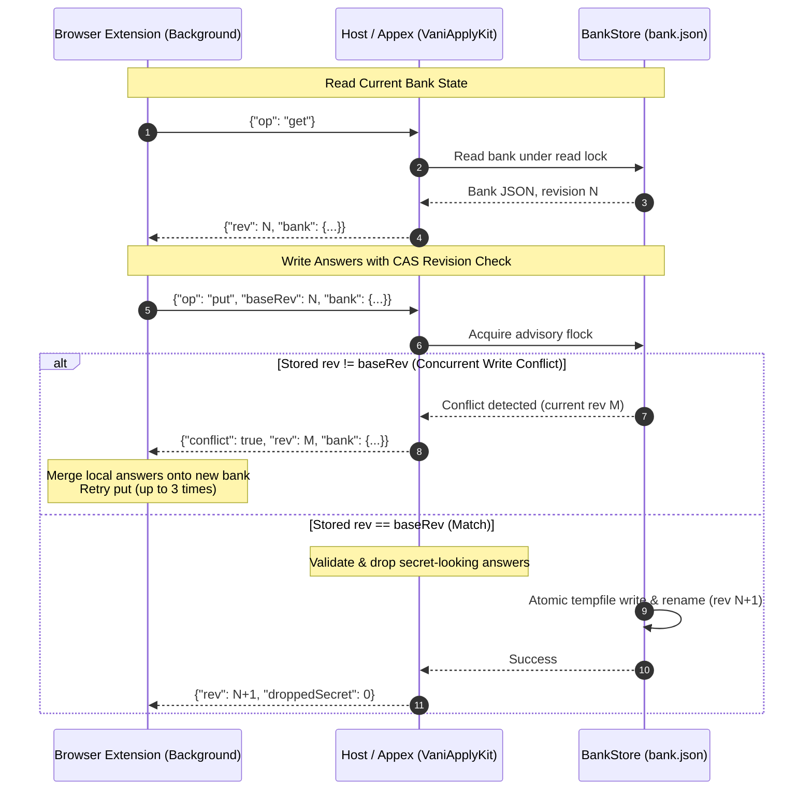

<p align="center">
  
</p>

# Vani Apply for macOS

A Mac app that holds the Vani Apply answer bank for both Chrome and Safari, and gives you control over
it: view, add, edit and delete answers, turn self-identification on or off, turn the extension off per
site, import and export, and see what each browser saved and filled.

Its **Jobs** tab browses the roles Vani retrieved (New, Saved, Applied, Hidden, All), with the picked
"Fits / Gap / Check" note, triage readings and the job description, and lets you Save (⌘S), mark
Applied (⇧⌘A), Hide (⌘⌫) and keep a private note per role. It is a client of `vani jobs … --json`
(cmd/vani/jobscmd.go) run from `Contents/Helpers/vani` with the Vani config and state folder set in
Settings › Vani. Vani reads its ledger without taking the run's lock, so Jobs works while a run is
going. Your marks and notes live in `<state>/marks/marks.jsonl`, never in the ledger, and nothing
in the pipeline reads them, so a note never reaches a model. Hiding a role only removes it from
New; the daily digest does not read marks yet.

```mermaid
flowchart TD
    subgraph BrowserLayer["Browsers & Extensions"]
        CR["Chrome Extension (MV3)\nclhaobdmkmapebgnmpcfmakbfakmgfip"]
        SF["Safari Web Extension\n(dist-safari)"]
    end

    subgraph NativeHosts["Native Entry Points"]
        HOST["vani-apply-host\n(dev.vbcr.vani_apply\nin Contents/Helpers)"]
        APPEX["Safari App Extension\n(VaniApplyExtension.appex\nin Contents/PlugIns)"]
    end

    subgraph AppBundle["Vani Apply.app"]
        UI["SwiftUI UI (VaniApply)\nJobs, Pipeline, Answers, Browsers, Activity, Settings"]
        KIT["VaniApplyKit Framework"]
        VAL["BankValidator & Sanitizer\n(Drops secret-looking answers)"]
        STORE["BankStore (CAS Store)\nAdvisory Lock (flock) + Atomic Temp-Rename"]
    end

    subgraph AppGroup["Shared App Group Container (HAUHVD8M37.dev.vbcr.vani)"]
        BANK[("apply/bank.json\n(Mode 0600, capped <= 900KB)")]
        ACT[("apply/activity.jsonl\n(Event, host, counts; no answer text)")]
    end

    CR -->|Chrome Native Messaging (stdio)| HOST
    SF -->|sendNativeMessage (NSExtensionMain)| APPEX
    HOST --> KIT
    APPEX --> KIT
    UI --> KIT
    KIT --> VAL --> STORE
    STORE -->|flock + write + rename| BANK
    STORE -->|append event| ACT
```

```
Chrome extension ──native messaging──▶ vani-apply-host ─┐
Safari extension ──sendNativeMessage─▶ Safari appex ────┼─▶ bank.json in the App Group container
Vani Apply.app (SwiftUI) ───────────────────────────────┘     (+ activity.jsonl, no answer text)
```

- **[`VaniApplyKit`](Sources/VaniApplyKit)** (library): bank model, validation (a port of the extension's `parseBank`, including
  dropping secret-looking answers), and [`BankStore`](Sources/VaniApplyKit/BankStore.swift), a revisioned compare-and-swap store under an
  advisory lock with atomic writes. It also holds the native protocol, Chrome framing, the Chrome
  connector and the app's editing rules.
- **[`vani-apply-host`](Sources/vani-apply-host)**: the Chrome native messaging host (`dev.vbcr.vani_apply`), in
  `Contents/Helpers`.
- **[`VaniApplyExtension`](Sources/VaniApplyExtension)**: the Safari web extension's native app extension (sandboxed appex, entry
  point `NSExtensionMain`), in `Contents/PlugIns`. Its resources are `extension/dist-safari`.
- **[`VaniApply`](Sources/VaniApply)**: the control app.

There is no Xcode project. SwiftPM builds the binaries and [`scripts/bundle.sh`](scripts/bundle.sh) assembles and signs the
bundle.

## Protocol



The extension's background script sends JSON requests. The Chrome host and the Safari appex answer
them identically:

| Request | Reply |
| --- | --- |
| `{"op":"ping"}` | `{"ok":true,"protocol":1,"rev":N}` |
| `{"op":"get"}` | `{"rev":N,"bank":{…}}` |
| `{"op":"put","baseRev":N,"bank":{…}}` | `{"rev":N+1,"droppedSecret":K}`, or `{"conflict":true,"rev":M,"bank":{…}}` |
| `{"op":"log","entry":{"event":…,"host"?:…,"counts"?:{…}}}` | `{"ok":true}` |
| anything refused | `{"error":"…"}` |

Merging stays in the extension, so there is one implementation. On a conflict it re-applies its change
to the returned bank, up to 3 times.
- **Size cap:** a bank is capped at 900 KB because Chrome refuses any host message over 1 MB. Both
  sides enforce it, and so does the host's reply encoder.
- **Classifier parity:** `normalizeLabel` and `classify` exist in TypeScript and Swift. Both are held
  to `extension/test/vectors/classify.json`, which is generated from the TS code by
  `build/macos-gen/gen-vectors.ts`.

## Build

```bash
swift test --package-path /Users/bharath/Code/apps/Vani/macos
/Users/bharath/Code/apps/Vani/macos/scripts/bundle.sh
```

`bundle.sh` writes `macos/build/Vani Apply.app` and installs nothing.
- **Signing:** it signs inside-out with the Apple Development identity (team `HAUHVD8M37`, hardened
  runtime). Override the identity with `VANI_SIGN_IDENTITY`.
- **App Group:** `HAUHVD8M37.dev.vbcr.vani` is Team-ID-prefixed, so macOS 15+ grants the container
  without a provisioning profile.
- **The Chrome extension's id** is fixed by the public key in `extension/static/chrome-key.json`:
  `clhaobdmkmapebgnmpcfmakbfakmgfip`. No private key is kept, because an unpacked extension needs only
  the public one.

## Use

1. **Install.** Move `Vani Apply.app` to `/Applications` (or `~/Applications`) and open it once.
   macOS registers the Safari extension when the app is first opened.
2. **Safari.**
   - Open Safari ▸ Settings ▸ Extensions and turn on Vani Apply. Allow it on job sites.
   - A development-signed build may also need Safari ▸ Settings ▸ Developer ▸ "Allow unsigned
     extensions". Safari turns this off again each time it quits.
3. **Chrome.**
   - In `chrome://extensions`, turn on Developer mode, choose **Load unpacked**, and pick the folder
     that the app's Browsers ▸ Show Extension Folder opens.
   - Check that the id Chrome shows is `clhaobdmkmapebgnmpcfmakbfakmgfip`, then click **Connect**.
   - Until then the extension keeps answers inside Chrome. On first contact it moves them into the
     Mac app's bank.
4. **Moving the app.** If you move the app, its Chrome row reads "Needs reconnecting". Click Reconnect.
5. **Claude drafting.**
   - Answers ▸ Draft with Claude drafts a long free-text answer, such as "why this company", from
     the question, the pasted posting, and the knowledge-base bullets that best match them.
   - It runs the bundled `vani draft`, using the model and daily cap in Vani's config
     (`llm.model`, `decide.daily_usd.llm`). That cap is shared with the daily listings run.
   - Set the config and state paths in Settings ▸ Claude drafting. Empty means Vani's default
     folder.
   - Settings ▸ What you care about edits `motivation_notes` in that config through
     `vani config motivation`, so Vani checks it and rewrites the config file whole (as
     `vani track use` does: keys in Vani's order, deprecated names replaced). "Why <company>?" drafts use the note;
     it reaches the model, so it must not name you or say where you live or your work status.
   - A saved draft is always marked for review, so forms fill it yellow.
   - The Chrome extension can ask for a draft through the native host (op `draft`). Safari's
     sandboxed appex cannot start `vani`, so it answers `unsupported` to that op. Instead, both
     browsers run drafts and page-wide suggestions as jobs in the agent (below).
6. **The Vani Apply agent.**
   - A login item that the app registers with `SMAppService` each time it opens. Approve it in
     System Settings ▸ General ▸ Login Items; Settings ▸ Browser suggestions shows its state.
   - launchd starts it on demand when a browser connects to its Mach service,
     `HAUHVD8M37.dev.vbcr.vani.agent`. The name is prefixed by the App Group id, which is what lets
     the sandboxed appex look it up. The agent exits after 5 idle minutes.
   - It runs one job at a time: `vani draft` or `vani suggest`, with the same Keychain key, config
     and minimal environment as drafting.
   - Browsers call `jobStart`, then poll `jobResult`. A result nobody fetches is dropped after
     10 minutes.
   - It accepts XPC connections only from code signed by team `HAUHVD8M37`, so another process
     running as you cannot spend your model budget through it.

## Claude drafting: what is sent and where the key comes from

- **What Claude sees:** the question and the posting (both marked as untrusted, length-capped), your
  target-roles summary, and up to about 6,000 characters of the most relevant knowledge-base bullets
  with their role title, organisation and dates.
- **What it never sees:** your name, contact details, location or work authorization. Vani never
  reads the bank header, and entry locations are dropped. A test checks the prompt for a synthetic
  name and email.
- **The key.** Vani takes provider keys from the environment only (Manvi's policy). When the Vani
  config's `llm.provider` is `anthropic`, the app and the Chrome host start
  `anthropic-account exec [--account NAME] -- <bundled vani> draft` instead of `vani` itself.
  `anthropic-account` (Manvi's `cmd/anthropic-account`, installed in `~/.local/bin` or
  `/opt/homebrew/bin`) is the one place on this Mac that picks the Console organisation. It reads
  that account's key from the login Keychain (`anthropic-api-key-<name>`), adds it and the account's
  workspace id (if `~/.anthropic-accounts` lists one) to the environment, and replaces itself with
  `vani`.
  - Neither the app nor the host reads, holds or passes an Anthropic key.
  - The child gets a minimal environment, not the app's; the launcher adds only its own variables.
  - With any other provider, or a config the app cannot read, `vani` starts directly and reports
    its own errors. With the anthropic provider and no launcher installed, the draft fails with
    code `account` rather than running keyless.
- **The account.** Settings ▸ Vani has an Anthropic account picker fed by
  `anthropic-account list --json`; it is saved in `draft-settings.json` and passed as `--account`.
  Default leaves the pick to the launcher (the first line of `~/.anthropic-accounts`). A file from
  before accounts carried an `anthropicWorkspace`; it is ignored, because the workspace now belongs
  to the account's registry line.
- **Spending.** Each draft charges Manvi's budget ledger before the request is sent. When today's
  cap is spent, the reply is `budget_exhausted`, never an empty draft.

## Security impact

- **What gets weaker.** Without the Mac app, answers live in `chrome.storage.local`, readable only by
  that browser profile. With it, they live in a file that any process running as you can read:
  `~/Library/Group Containers/HAUHVD8M37.dev.vbcr.vani/apply/bank.json`.
- **Mitigations.**
  - The store directory is mode 0700 and the bank and log are 0600.
  - The store, the host and the Safari extension make no network requests. The only network
    traffic is a draft you ask for, which `vani draft` sends to Anthropic.
  - Secret-looking answers are refused on every write path: capture, put, import and manual add. They
    cover passwords, government ids, card and bank numbers, and date of birth.
  - The activity log records event names, hostnames and counts only, never question or answer text.
- **The Anthropic account name** goes from `draft-settings.json` (0600) to `anthropic-account` as
  `--account`. It names an account and grants nothing by itself. Before a name reaches the
  launcher's argv it is checked against the launcher's rule (letters, digits, `.`, `_`, `-`), plus
  no leading `-` and at most 64 bytes. The launcher strips every inherited `ANTHROPIC_*` credential variable, and the child's
  minimal environment does not carry `ANTHROPIC_BASE_URL`, so the app cannot be pointed at another
  host. Shell runs of `vani` do honour it, as Manvi does, so whoever controls that shell's
  environment decides where the key is sent.
- **Who can reach the bank.**
  - In Chrome, only the extension id named in the host manifest (`allowed_origins`). That file is
    written only when you click Connect, and Disconnect removes exactly that file.
  - In Safari, only this app's own extension can message its appex.
  - The host refuses to run without a `chrome-extension://` origin argument. It also caps requests
    at 2 MB and replies at 1 MB.
- **Not covered.** Malware running as your user can read the bank, as it can read your browser
  profiles. FileVault protects it at rest.

## Verified and not

- **Verified here:**
  - `swift test`: 129 tests (2026-10-19). They cover the TS vectors, validation, the store
    (including 16 concurrent compare-and-swap writers losing nothing), the protocol, framing, the
    connector, and the jobs client and filters. They also drive the built host binary over real
    pipes, and the jobs client against the Go `vani` in `build/vani` (skipped when it is not built).
  - The bundle signs and passes `codesign --verify --deep --strict`.
  - The appex is sandboxed and every piece carries the App Group entitlement.
  - The appex's `LC_MAIN` entry is the `_NSExtensionMain` stub, and its principal class is
    `SafariWebExtensionHandler`.
- **Not verified here:**
  - Safari loading the appex (`pluginkit` lists it only once macOS has registered the app).
  - Signed binaries opening the group container without a prompt.
  - A live round trip from either browser.
  - The Chrome id derivation, which is a known rule but not stated in Chrome's documentation.
  - Safari's message size limit, which Apple does not document.
